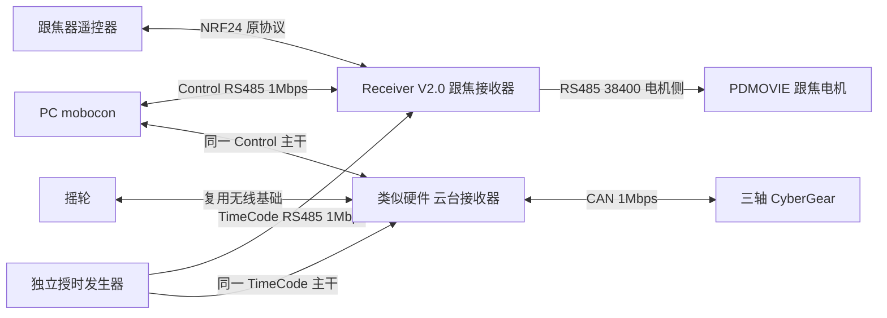

> V2.0已取代本文旧DeviceNode/节目/T0及定位扩展设想。本文仅记录已有跟焦/无线代码，不作为当前云台任务；以 [云台V2.0设计](gimbal-receiver-design.md) 为准。

> 2026年10月8日更新：时码器只接mobocon/UE，本文历史双线TimeCode接收器接入与授时任务均已取消，当前以 [时码边界](timecode-integration.md) 为准。

> 参考资料：记录现有接收器基础与早期扩展设想。跟焦系统已设计完成，本文跟焦新增事项不属于本次任务；云台实施以 [独立云台设计](gimbal-receiver-design.md) 为准。

# SS-07 Receiver V2.0 控制节点复用方案

跟焦节点复用 `virtual_lens_radio_comm` 的 Receiver V2.0 硬件与固件，保留已实现的 PDMOVIE 控制。云台节点使用类似硬件，复用摇轮无线通信基础，新增 CyberGear 驱动。用户已明确云台控制尚未开始开发，不能把虚拟摇轮 USB 数据转发视为现成实体云台驱动。

按用户确认的架构，RK3588 作为视频总控，不转发运动命令。PC mobocon 经 RS485 直接连接 F/G；跟焦器和摇轮保持无线操作链路。PC 协议已从 device_protocol 仓库取得，为 Mobocom 时间轴 V1.2；PC 负责时间轴、编辑时单次定位与低频位置查询，连续手动由跟焦器/摇轮完成，新增有限定位和只读遥测。独立 Control/TimeCode 输入与电机输出必须分别核验接口。

## 1 源码基线与能力边界

| 项目 | 记录 |
| --- | --- |
| 仓库 | `git@codeup.aliyun.com:629f6370487c500c27f60603/interfocal/virtual_lens_radio_comm.git` |
| 分支 | master |
| 检查提交 | `b5f62d05422993af6e3c48b38a9a1315327c91f7` |
| 设备 | Receiver V2.0，ESP32-S3，NRF24L01+，屏幕与触摸 |
| 构建体系 | PlatformIO、Arduino、FreeRTOS；环境名 `heltec_wifi_kit_32_V3` |
| 协议依赖 | `lib/simple_protocol`，提交 `d41391f43e42e3595c417180f62a68d29db2b212` |
| 用户确认 | 云台控制尚未开始；跟焦节点使用该设备，已有电机控制能力 |

已检查 master 与当前可见的 ESP32_NOW、Pdmovie_motor、comm、previe手柄接收器和频道设置分支中的相关应用源码。已有跟焦控制与摇轮设备配置，未发现 CyberGear、TWAI 或 yaw/pitch/roll 实体电机控制实现。此结论针对这些源码范围，不否定其他未提供项目中的能力。

### 1.1 可以直接复用

- `src/radio.cpp` 与 `lib/nrf24_device`：NRF24 接收、动态载荷、ACK Payload、设备地址与 USB CDC 桥。
- `src/broadcast_frame_decoder.cpp`：固定 32 字节广播的帧头、长度、通道、CRC 与字段解析。
- `src/pdmovie_protocol.cpp`：PDMOVIE 单/多通道位置帧与 BCC 编码。
- `src/motor_control_logic.cpp`：状态门控、有限数检查、归一化限幅、反向与行程映射。
- `src/motor_tx_scheduler.cpp` 和 `src/motor_controller.cpp`：独立发送任务、最新目标优先、100Hz 上限和无线丢失后的待发送目标清理。
- 显示、触摸、频道/设备类型配置与 EEPROM 保存。

代码复用不等于 SS-07 已完成硬件验证。实际电机型号、电源、方向、安装行程与反馈能力仍在台架确认。

### 1.2 尚需增加

1. 接入 V1.2 公共 DeviceNode/Clock/Stream、Control/TimeCode、节目缓存/准备/运行，以及单次定位、动作状态和只读位置遥测。
2. 本地无线、PC 单次定位与时间轴的节点级仲裁，PC 位置查询不占运动来源，按运行模式区分无线失联与授时失效。
3. 云台无线字段定义、轴映射、CyberGear CAN 驱动、反馈、限位与失效保护。
4. 跟焦位置指令与实际位置反馈的区别、标定结果确认和故障表示。
5. PC RS485 断开、串口分片/粘包、节点重启、无效无线帧与重复帧的联调验证；USB 桥保留原有回归。

## 2 独立控制路径



RK3588 无需连接该运动控制链路，视频进程重启不会改变接收器控制权。PC 与接收器之间使用用户指定的 RS485；现有 USB CDC 保留虚拟相机桥或诊断用途，不替代 PC 运动入口。

Receiver 的板载 RS485 已用于 PDMOVIE 下行。PC 上行应使用另一个物理接口、独立收发器与 UART，或已经实现并验证的专用接口。当前代码只能证明电机侧的 GPIO44/43 UART1，不证明该硬件已有第二路 RS485。

V1.2 支持寻址与回复调度，PC 通过共享 Control 主干访问两个节点，独立发生器通过 TimeCode 主干授时。F 双线配置需要 Control/TimeCode/电机三条串行链路；G 两路 RS485 加 CAN。参考总线为 1Mbps/8N1、不超过 20m，具体隔离/接地、捕获、线长与电气验收按实物确定。缺口允许评估规范的 Control 承载授时，但不能省略可靠授时与门槛。

## 3 现有跟焦电机接口

| 项目 | 源码定义 |
| --- | --- |
| 芯片/串口 | ESP32-S3 UART1 |
| TX/RX | GPIO44 / GPIO43，板载自动收发 RS485，无 DE/RE 控制脚 |
| 波特率 | 38400、8N1 |
| 默认轴 | focus→R1(0x01)，zoom→G2(0x02)，iris→B3(0x04) |
| 位置输入 | 归一化 0 至 1，有限数检查与限幅 |
| 编码位置 | 默认 0 至 7200，属于协议数值，不能推断为角度或毫米 |
| 状态门控 | 对应 `motorflag_*_status==2` 才生成该轴位置目标 |
| 发送 | 最大 100Hz，10ms 间隔；实际频率由新目标、总线和按钮任务决定 |
| 丢无线 | 取消待发送位置目标，不回零、不自动校准；没有主动停止帧 |

SS-07 首版只启用 focus/R1，保留 zoom/iris 扩展能力，避免把三个字段误当成云台三轴。`motorflag_*_status` 来自手柄控制数据，并非电机反馈，因此不能据此宣布“电机已完成校准”或“已到位”。

### 3.1 PDMOVIE 帧

```text
@1 + 两位十六进制通道掩码
   + 每个有效通道四位位置 ASCII
   + 两位 BCC ASCII + CR LF
```

位置以低字节的两位十六进制字符在前，高字节在后；多通道固定按 R1、G2、B3、Y4、C5、P6 顺序编码。BCC 是其前面所有 ASCII 字节的 XOR。

源码测试样例：

```text
R1=0:     @101000070\r\n
G2=7200:  @102201C03\r\n
```

单轴位置帧 12 字节，三轴帧 20 字节。38400、8N1 下，100Hz 三轴位置帧线传输约占 `20×10×100/38400 = 52.1%`，按钮命令与其他报文另计。100Hz 为发送上限，不保证电机反馈或目标跟随速度达到 100Hz。

当前已读运行路径未发现电机响应解析，不能向岸端提供未经确认的实际位置。首期至少上报目标位置、发送状态、无线状态与节点状态；实际位置、到位、堵转与标定完成需厂家反馈协议或独立传感器支持。

### 3.2 校准与速度按钮

master 最近提交增加 `@B` 按键模拟板帧：状态从非 0 切到 0 可请求校准，非零速度档变化可请求一次换速。它是共享串口上的按钮模拟命令，不是对指定电机返回完成确认的闭环协议。

校准候选为 1 次、按住 3000ms；换速候选为 5 次、每次按住 200ms；间隔与忙时保护见 `motor_button_protocol` 和 `Config::MotorButton`。是否安装按键模拟板、它实际控制哪台马达、是否影响多台设备需要确认。

SS-07 不因打开网页、首次接管、重连或通道状态默认值变化而自动校准。显式维护命令才允许校准/换速，带唯一请求 ID；重复包不重复触发。执行期间报告“请求已发送/等待人工或反馈确认”，不能仅经过定时等待就宣告完成。仲裁撤销时也要清理尚未发出的按钮请求。

## 4 NRF24 与现有 USB 协议

### 4.1 广播字段

现有 32 字节数据帧：

| 偏移 | 长度 | 字段 |
| --- | --- | --- |
| 0 | 2 | `A5 AB` |
| 2 | 1 | 长度 `1D` |
| 3 | 1 | 通道 `01` |
| 4 | 4 | mac，小端 |
| 8 | 4 | ts，小端 |
| 12 | 4 | focus，float32 小端 |
| 16 | 4 | zoom，float32 小端 |
| 20 | 4 | iris，float32 小端 |
| 24 | 4 | hitwall，float32 小端 |
| 28 | 2 | 状态/速度与 UE 标志位，小端 |
| 30 | 2 | 当前协议实现返回 CRC 值的小端表示 |

CRC 覆盖偏移 2 至 29，共 28 字节，使用指定提交的 `SimpleProtocolImpl::crc16`。沿用它的函数输出与字节顺序并建立黄金向量，不能仅因名称为 CRC16 就替换成主方案候选的 CCITT-FALSE。Linux 使用显式字节解析，不直接 memcpy C++ 位域结构。

NRF24 当前配置为 1Mbps、动态载荷、硬件 16bit CRC、自动应答和 ACK Payload；频道与设备类型可设置保存。摇轮模式有独立地址组，但上述 `focus/zoom/iris` 载荷没有定义真实 yaw/pitch/roll 单位与控制语义。云台需读取摇轮发送端的实际载荷或抓包，再定义兼容轴映射。

### 4.2 USB 的真实行为

原生 USB 使用独立 `USBSerial`，主机侧沿用 2,000,000 配置。节点上行转发原始无线字节，可能包括未通过应用广播校验的载荷，因此主控必须自行验证后才用作操作数据。

当前下行行为是：电脑写入的 1 至 32 字节保存为 ACK Payload，并在后续无线应答中发送给手柄。它不调用本地电机驱动。无线自动 ACK、CDC 写成功和电机执行完成是不同层级的结果。

USB 是字节流，主机一次 write 不保证在节点一次 available/read 中形成一个报文；现有按可读字节数接收且超过 32 整批丢弃的做法不能直接用于可靠管理命令。这一限制属于现有 USB 桥边界；新增 PC RS485 命令入口同样须实现跨读取缓存、定长/长度判定、校验、超时与粘包解析，不复用“当前可读字节数即完整报文”的假设。

## 5 Mobocom V1.2、单次定位与位置查询

公共仓库 `git@codeup.aliyun.com:629f6370487c500c27f60603/device_protocol.git` 已读，基线为 main 提交 0e192c33dc2a6255e662dd9edf48ca2b3c78aa3b，SDK 1.2.0-candidate.1、wire 0x12。替代此前缺少协议的待确认状态，完整接入见 [V1.2 方案](mobocom-integration.md)。

Receiver 保留 NRF24、显示、配置与 PDMOVIE 驱动，复用公共 DeviceNode 实现时间轴的下载、校验、准备与运行。UART/RS485 方向控制、SOF 时间捕获、实时 tick、真实位置/限位、安全确认由设备适配。当前电机代码无实际到位反馈，不能用等待固定时间伪造准备完成。

PC 编辑时单次定位并查询位置，按照 [定位与位置查询方案](position-telemetry.md)在公共库增加有限定位、动作状态与只读遥测，不向电机发送 PC 连续手动目标，也不让 RK3588 接管电机。现有 USB 桥保持虚拟相机/诊断用途；NRF24 CRC 与 V1.2 CCITT-FALSE 不同，解析器分开实现。

### 5.1 模式仲裁

现有 motor_handle_broadcast 收到合法无线帧立即更新目标，接入时间轴前必须在此处加入唯一来源门控。节点来源为 SAFE、LOCAL_MANUAL、PC_POSITIONING、PC_TIMELINE，与公共 download/preparation/run 状态并存。

活动节目期间无线回调不能直接覆盖电机。明确本地接管先中止本节点并确认安全，再授权手动；手动改变初态使准备 token 失效，公共 notify_state_change 记录此变化。切回时间轴重新准备。来源变化清理旧目标与尚未发出的按钮请求，故障/急停不能被普通接管解除。

定位由节点本地有限轨迹执行，Control 断开后按期限完成或停止；重连仅查询结果，不自动重发。定位改变初态同样使旧准备失效，来源交接遵循 [云台独立设计](gimbal-receiver-design.md)。

控制失联按模式处理：本地无线失联按真实电机策略处理，PC 查询中断只标记数据过期；时间轴 Control 断开但独立授时正常时继续节目；TimeCode 失效按协议保持/误差边界停止本节点。恢复授时不续播、重启旧节目不可运行。一节点故障不自动停其他节点，整场停止由用户明确发起。

### 5.2 既有驱动与保护边界

原代码 3000ms 是通信恢复阈值，约 10 个无数据周期改变无线连接状态；它们不等于经过机械验证的停止时间，也不能代替 V1.2 授时状态机。radio 在广播 CRC 校验前刷新通信存活，新模块只能由合法、新鲜输入刷新相应运动/授时年龄。

跟焦位置目标取消不等于立即机械停止，电机可能继续到最后目标。按真实类别实现 safe_targets/safe_confirmed、prepare_confirmed 与 terminal_confirmed；没有反馈的能力如实报告未完成。云台速度失效、机械保持与 CyberGear 超时独立验证。

## 6 云台新增范围

云台开发按以下顺序进行：确认类似硬件的实际 MCU、空闲 GPIO、CAN 收发器和 USB 口；获取摇轮发送端载荷；验证原有 RF 接收；实现 CyberGear 单轴身份与状态读取；再实现受限位置/速度、三轴映射和控制仲裁。

参考 [CyberGear 接口方案](cybergear-interface.md)，保持实体云台角度与虚拟软件输入值之间的转换独立配置。已有 Receiver 的跟焦/摇轮设备地址、屏幕与通信架构可复用，PDMOVIE 驱动不能替代 CyberGear CAN 驱动，也不把 focus/zoom/iris 直接解释为三轴角度。

优先保持 Receiver 的 PlatformIO/Arduino 工程体系，在同一节点代码基础增加角色配置、PC RS485 模块和云台驱动；不为接入 SS-07 先进行全量 ESP-IDF 重写。G 的实际固件仓库组织在开发开始时确定，第三方依赖与 MCU 目标锁定并记录。

## 7 联调交付与验收

| 阶段 | 交付与验证 |
| --- | --- |
| 已有节点回归 | 保留 NRF24、屏幕、USB 与 PDMOVIE 功能；运行原有 native 协议/映射/调度测试，再做实物回归 |
| PC 接收器接口 | V1.2 黄金向量/流解析/事务、Control/TimeCode 接口与真实 SOF 捕获正确 |
| 跟焦 PC 接入 | PC 单次定位及时间轴到 R1 实物动作，重复定位请求不重复运动；无线/定位/时间轴互斥；位置查询无运动副作用，不错误启用 G2/B3，不因重连触发标定 |
| 云台单轴 | CyberGear 状态与单位转换、位置/速度模式、软限位、控制会话与失联测试 |
| 云台三轴 | 摇轮轴映射与正方向、安装零位、负载/线缆范围、电源回馈和机械停止行为 |
| 系统整合 | RK 视频/录像满负载与重启不影响独立接收器链路；手动断线与固件更新不恢复旧目标，时间轴双线失联按 V1.2 分别处理 |

本次完成源码阅读与设计更新，未修改该上游仓库的固件、未编译 ESP32 固件、未上传硬件。原有测试的存在与 README 能力描述均不能代替 SS-07 实物联调结果。
