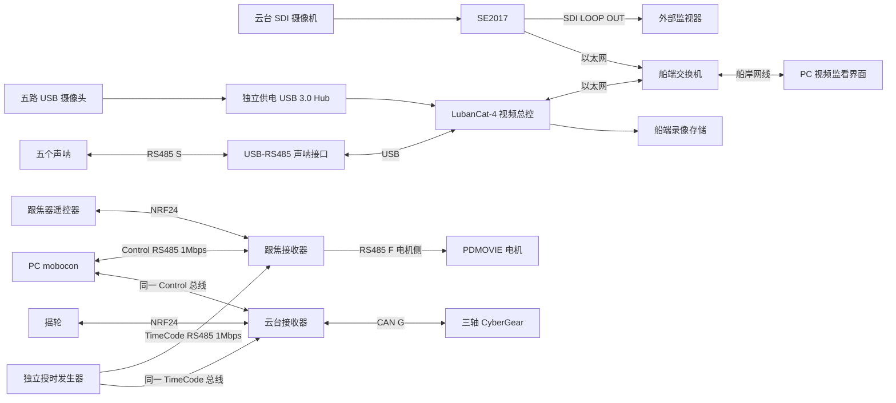

> 历史扩展方案：包含早期四应用范围，已由当前两软件设计取代。不得据此新增跟焦或 mobocon 开发任务。

# SS-07 水上控制系统完整方案

SS-07 采用视频与运动控制分别运行的架构。LubanCat-4 作为视频总控，汇聚六路视频并提供监看与录像；跟焦器和摇轮分别经无线接收器控制电机；PC 上的 mobocon 通过 RS485 直接向接收器提交运动命令。运动控制无需经过 RK3588。

版本为 v0.8，日期为 2026 年 10 月 6 日。已确认第一阶段完整联调六路视频、五路声呐、云台与跟焦；船岸视频网络使用网线；RK3588 镜像从当前 SDK 编译；跟焦复用 Receiver V2.0，云台控制与 PC mobocon 尚未开发；PC 负责时间轴编辑/播放、单次移动到目标位置与低频反馈查询，连续手动运动由跟焦器或摇轮完成，协议基线为 Mobocom V1.2。标为建议的数值是设计起点，设备能力与现场指标仍需实物验收。本文定义方案，尚未编译 SS-07 应用或刷写设备。

## 1 应用划分与职责

| 应用或固件 | 运行位置 | 职责 | 现有基础 |
| --- | --- | --- | --- |
| SS-07 视频应用 | LubanCat-4 | 六路视频采集、媒体分发、录像、设备状态、配置与日志；声呐作为独立采集服务 | 当前 SDK 的 Ubuntu 22.04/Linux 6.1/MPP/RGA 镜像流程 |
| 跟焦接收器固件 | Receiver V2.0 ESP32-S3 | 接收跟焦器 NRF24 数据与 PC RS485 命令，仲裁后驱动 PDMOVIE | virtual_lens_radio_comm 已有无线及电机控制，PC 命令入口需确认/扩展 |
| 云台接收器固件 | 类似 Receiver 的云台硬件 | 接收摇轮数据与 PC RS485 命令，仲裁后驱动三轴 CyberGear | 复用摇轮通信基础，新增实体云台驱动 |
| mobocon 控制端 | PC | 直接访问接收器 RS485，时间轴编辑/播放、单次定位、读取跟焦/云台位置与状态 | 应用尚未开发；复用 device_protocol V1.2 TypeScript SDK，增加单次定位与只读位置查询 |
| 岸端视频界面 | PC 浏览器或现有监看客户端 | 通过以太网读取六路视频、录像与声呐信息 | 可由 RK3588 视频应用提供网页，不必再建独立桌面进程 |

实现上需要四个主要交付：RK3588 应用包、跟焦接收器固件、云台接收器固件，以及 PC mobocon 应用。时间轴另需独立授时发生器；若无可复用设备，增加发生器硬件与固件交付。RK3588 应用包内部可包含多个服务，不把每项后台服务都作为独立产品。跟焦与云台固件宜共用无线、配置与通信基础模块，电机驱动和控制语义按角色分开。

### 1.1 功能范围

- 视频：1 路 SDI 摄像机经 SE2017 编码，5 路前/后/左/右/下 USB 环境摄像头。
- 声呐：5 个 RS485 节点。建议由 RK3588 的独立服务采集并给岸端显示，不接入电机控制闭环。
- 跟焦：跟焦器遥控器 → NRF24 → 接收器 → PDMOVIE 电机；首版启用 focus/R1，保留 zoom/iris 扩展。
- 云台：摇轮 → NRF24 → 接收器 → CAN → Yaw/Pitch/Roll 三轴 CyberGear。
- PC 控制：mobocon → Control RS485 → 跟焦/云台接收器 → 对应电机；时间轴使用独立 TimeCode 授时，编辑时支持单次定位和位置查询，连续手动运动由遥控器/摇轮完成。
- 视频与声呐故障在相应界面显示，运动控制的本地保护由接收器和电机执行。

自动航行、推进/舵机、声呐自动避障、六相机曝光同步不在当前范围。若需要云台船体运动补偿，补充 IMU 与姿态稳定闭环；单纯位置/速度操作不等于稳定云台。

## 2 系统拓扑

图中的视频 PC 与 mobocon 可运行在同一电脑，网络与串口分别连接。没有 RK3588 → 接收器的运动控制路径，RK3588 重启或录像盘异常不应中断接收器的无线操作。

船岸网线已确认为视频网络。PC 至接收器 RS485 的安装长度、线束和接口数量仍需确认；不能把以太网连接自动当成 RS485 连接。若两条链路同缆部署，另行确认电气与线对方案，不把 Ethernet 与 RS485 信号直接混接。

### 2.1 总线边界

| 总线 | 管理方 | 用途 | 约束 |
| --- | --- | --- | --- |
| Ethernet | RK3588/交换机/岸端 | 视频、录像查询、声呐与视频状态 | 不承担接收器电机命令 |
| RS485 S | RK3588 | 五个声呐采集 | 厂家协议、唯一地址和测量周期 |
| RS485 Control | mobocon 唯一主站与 F/G | 节目下载/准备/运行、单次定位、状态及只读位置查询 | V1.2，1Mbps/8N1，完整事务与地址 |
| RS485 TimeCode | 独立发生器与 F/G | 统一单调时间，不传运动指令 | 每 10ms，1Mbps/8N1，SOF 硬件时间捕获 |
| RS485 F | F 与 PDMOVIE | 电机位置/按钮命令 | 38400/8N1，现有自动收发接口 |
| CAN G | G 与 CyberGear | 三轴电机控制/反馈 | 1Mbps、29bit 扩展帧、8 字节数据 |
| NRF24 F/G | 遥控器与接收器 | 无线手动操作 | 沿用各自现有地址、频道和载荷基础 |

协议明确支持寻址，首选 PC 通过一个适配器连接共享 Control 主干，另有独立发生器驱动 TimeCode 主干。参考主干不超过 20m，SS-07 的实际线长与电气条件需确认；不能把船岸视频网线当成 RS485 总线，也不承诺超参考距离的同步性能。

Receiver V2.0 已有板载 RS485 用于 PDMOVIE，下行 GPIO44/43 不能同时作为上行。F 双线时间轴配置需要 Control、TimeCode 与电机三条物理串行链路；G 需要两个 RS485 输入及一个 CAN 输出。核验空闲 UART/GPIO、收发器及 SOF 捕获后出接线图。缺少独立输入时可评估 V1.2 SYNC_INPUT=1 的 Control 承载模式，但仍需可靠发送授时和同步实测，不能由普通 PC 串口定时写入冒充。

## 3 硬件与线束

| 部件 | 数量 | 条件 |
| --- | --- | --- |
| LubanCat-4 | 1 | 确认板卡/机箱版本、内存与存储；标准板为 RK3588S，Type-C 5V/4A |
| SDI 摄像机与 SE2017 | 各 1 | 确认 SDI 制式、固件、RTSP 地址、码率、供电 |
| USB 摄像头 | 5 | 截图标注 300万、H.264、无畸变 90°、防水外壳和 2m USB 线；具体模式待枚举 |
| 独立供电 USB 3.0 Hub | 1 | 至少满足五个相机端口、每口/总功率、防反灌及实际 USB 拓扑 |
| 千兆交换机 | 1 | 编码器、主控、岸端、维护/AP 接入；留出所需扩展口 |
| 船岸网线 | 1 套 | 长度、卷缆、防松/防水接头和协商速率 |
| 声呐与 USB-RS485 | 5 + 1 | 协议、地址、测量周期、类型与互扰条件 |
| Receiver V2.0 跟焦接收器 | 1 | 复用 ESP32-S3/NRF24/显示触摸/电机 RS485，确认 PC 上行接口 |
| 云台接收器 | 1 | 类似硬件；确认 MCU、空闲 GPIO、CAN 收发器与 PC RS485 接口 |
| PDMOVIE 电机 | 首版 1 | 实物型号、工作电压、R1 模式、行程与反馈能力 |
| CyberGear | 3 | 固件、唯一 ID、机械安装、负载与保护 |
| PC Control USB-RS485 | 建议 1 | 共享寻址 Control 总线；隔离、方向切换、连续发帧与线长核验 |
| 独立 TimeCode 发生器 | 1 | 10ms 周期、SOF 时刻基准、epoch、PC 授时旁路及独立 RS485 输出 |
| 存储、电源与机箱 | 1 套 | 按码率/录像时长、峰值负载、散热与安装环境定稿 |

标准 LubanCat-4 官方标注 RK3588S、5V/4A 输入，原图“主控 12V”只能作为带降压机箱的外部输入，不接入裸板。[野火硬件说明](https://doc.embedfire.com/linux/rk3588/quick_start/en/latest/quick_start/lubancat/lubancat4.html)

RS485/CAN 使用总线干线与短支线，物理两端布置与设备规范匹配的终端，避免重复终端与长星形分支。分别确认厂家 A/B 定义、参考地、屏蔽、隔离侧共模和接插件方向。ESP32 控制器需要外部 CAN/RS485 收发器，GPIO 不能直接连接差分总线。[Espressif TWAI 说明](https://docs.espressif.com/projects/esp-idf/en/latest/esp32/api-reference/peripherals/twai.html)

## 4 RK3588 视频应用

### 4.1 视频处理

建议首轮配置如下，最终按设备支持的真实模式冻结。

| 通道 | 来源 | 起始模式 | 路径 |
| --- | --- | --- | --- |
| GIMBAL | SE2017 RTSP | 1080p30、H.264、6Mbps | ss07/gimbal |
| CAM-F | USB 前视 | 1080p25、H.264、3Mbps | ss07/front |
| CAM-B | USB 后视 | 同上 | ss07/back |
| CAM-L | USB 左视 | 同上 | ss07/left |
| CAM-R | USB 右视 | 同上 | ss07/right |
| CAM-D | USB 下视 | 同上 | ss07/down |

摄像头“300万”不能推断为特定分辨率或帧率。先通过 V4L2 确认原生 H.264、控制能力、序列号与真实 USB 速率。Linux 定义了压缩格式，不代表任何 UVC 设备都支持。[Linux V4L2 压缩格式](https://www.kernel.org/doc/html/latest/userspace-api/media/v4l/pixfmt-compressed.html)

USB 原生 H.264 优先直通，进行帧边界/SPS/PPS 解析并发布至 MediaMTX，避免重复编解码。SE2017 经交换机由 MediaMTX 代理 RTSP。仅支持 MJPEG/YUYV 的相机另评估硬件转码与总线资源，验证后进入正式配置，不能从已有单路 MPP 测试推断五路转码能力。

各 USB 通道独立进程、队列有界。异常只重连对应通道；视频积压时按 GOP 与关键帧边界恢复，不将任意依赖帧丢弃后当作正常流。画面显示数据年龄与离线状态，最后一帧不能冒充实时画面。

岸端网页使用 WebRTC 实时播放，RTSP 供原生客户端/诊断；普通浏览器 video 元素不能直接播放 RTSP。设备 H.264 profile、B 帧与 GOP 的浏览器兼容性实测，建议从无 B 帧、约 1 秒 GOP 起步。[MediaMTX 浏览器播放](https://mediamtx.org/docs/read/web-browsers)

### 4.2 视频网络与预算

建议 RK3588 192.168.20.10、SE2017 .20、岸端 .30、维护电脑 .100，统一 /24。离线有线网络不必依赖公网网关/DNS；调试 AP 仅作维护入口。网线超出所选链路规范允许距离时增加符合距离要求的链路设备，先测持续吞吐和丢包。

上述码率总计 21Mbps，单个完整六路监看端加 30% 余量约 27.3Mbps，建议首轮持续有效吞吐不低于 40Mbps，按现场最差条件冻结。多个完整订阅端会增加传输负载。低码率辅流只有相机支持或转码验证通过后才能提供。

21Mbps 录像每小时约 9.45GB，8 小时约 75.6GB，加 20% 余量约 90.7GB，另留系统、日志及文件系统空间。五路未压缩 YUYV 1080p25 像素吞吐约 518.4MB/s，尚未计 USB 开销，因此原生压缩能力是关键硬件条件。

### 4.3 录像与视频界面

船端为主要录像位置，岸端可备份。MediaMTX 分段录像建议 fMP4、约 1 秒 part、约 5 分钟 segment，实际关键帧/掉电/回放测试后定稿。[MediaMTX 录像说明](https://mediamtx.org/docs/features/record)

空间 80% 预警、90% 按策略清理最旧已完成且未锁定片段作为建议；无法释放时停止新录像并告警。存储故障不影响接收器运动链路。时间以 UTC 保存、Asia/Shanghai 显示，数据年龄与超时使用单调时钟。没有曝光同步接口时不宣称六路严格同步。

视频界面提供一路主画面、五路辅画面、通道状态、录像/回放、声呐有效值、系统健康与配置。时间轴与编辑定位操作在 mobocon 实现，连续手动操作由遥控器/摇轮完成；视频界面不提供另一路未经仲裁的运动 API。

如以后要求失去视频时禁止远程运动，由 mobocon 明确订阅视频健康并执行操作策略，接收器仍独立处理自身失联；首版不假定接收器能自动得知 RK3588 画面失效。

## 5 声呐采集

建议声呐作为 RK3588 应用包中的独立服务，唯一主站轮询五个地址。测距/回波/成像类型、地址、波特率和数据量按厂家协议确定；主动上报设备依厂家时隙/同步方式处理。

首轮建议每探头 5 至 10Hz，仅在厂家能力及互扰条件允许时采用。例如 115200/8N1、每事务请求加响应 80 字节、每探头 10Hz，线传输合计约 347ms/s，另计测量、换向和间隔。低波特率、长回波或声学错开发射须重新预算。

每节点独立截止时间和公平调度，离线节点低频探测。测距数据含固定 sensor_id/direction、序号、distance_mm、valid/reason、质量、UTC 接收时间与单调时钟数据年龄。无效值为 null，不转换成 0mm。成像声呐另定义数据格式、标定和传输预算。

## 6 跟焦接收器固件

跟焦复用 virtual_lens_radio_comm 的 master 提交 b5f62d05422993af6e3c48b38a9a1315327c91f7。工程为 PlatformIO/Arduino/FreeRTOS，Receiver V2.0 ESP32-S3；保留 NRF24、屏幕、频道配置、EEPROM 与现有 PDMOVIE 编码和发送任务，不重新编写已经具备的电机基本控制。

现有链路为跟焦器 → NRF24 → 合法广播帧解析 → focus/zoom/iris 位置映射 → UART1 → 板载自动收发 RS485 → 电机。参数为 GPIO44 TX/GPIO43 RX、38400/8N1，默认 focus/R1、zoom/G2、iris/B3，归一化 0 至 1 映射为 0 至 7200，发送上限 100Hz。

新增 PC RS485 接收入口，将 mobocon 的命令解析为统一目标，经控制仲裁后与无线输入共用发送任务。主机 PC 输入与电机输出是两个协议层，不把 PC 直接接成电机总线的第二主站。现有 USB CDC 用作虚拟相机数据桥或诊断，保留原功能，不作为 SS-07 主要运动控制入口。

状态字段来自遥控器，当前已读代码没有电机响应解析，不能用它表示实际到位/校准完成。现有无线丢失时取消待发送目标，并不主动发送电机停机帧；电机可能继续到达最后位置，停机/保持策略依实物能力确认。

按键模拟板 @B 校准/换速作为维护动作，必须明确它控制的对象与完成判断，禁止重连或默认状态自动触发。完整帧与源码边界见 [接收器复用方案](../receiver-integration.md)。

## 7 云台接收器固件

云台使用类似 Receiver 硬件与摇轮通信基础。新增 CAN 收发器接线、CyberGear 驱动、反馈、位置/速度模式、软限位、机械零位和失联保护。用户已确认云台控制尚未开始，现有虚拟摇轮数据转发不能当作实体云台驱动。

CyberGear 使用 CAN 2.0、1Mbps、29 位扩展帧、8 字节。建议 Yaw/Pitch/Roll ID 为 1/2/3、接收器 CAN 主站 ID 为 0，逐台设置并绑定 MCU 唯一标识。类型 18 写 run_mode=1/2，类型 3 使能，类型 4 停机；运行中改模式前先停止。

机械零位及类型 18 配置按手册掉电丢失，启动不恢复旧运动目标，不在未知姿态自动置零。项目对外使用度与度/秒，驱动转换为厂家单位 rad/rad/s；内部减速比与额外机械传动不要重复换算。摇轮真实载荷、轴方向、灵敏度和速度/位置语义需从发送端代码或抓包确认。

实体云台先完成单轴状态读写，再完成三轴。Pitch/Roll 配平、相机重心、线缆扭转范围和失电姿态定稿后再设置限位/速度。稳定云台需求另加入 IMU、姿态标定与控制闭环。协议与手册疑点见 [CyberGear 接口方案](../cybergear-interface.md)。

## 8 mobocon 与接收器协议

用户已提供 device_protocol 仓库，当前 main 提交 0e192c33dc2a6255e662dd9edf48ca2b3c78aa3b 的唯一基线为 Mobocom 时间轴 V1.2，SDK 1.2.0-candidate.1、wire version 0x12。PC 复用 TypeScript Client/compileProgram/MasterService；F/G 复用 C++ DeviceNode、Clock 与 Stream。公共事务/状态机维护在协议库，消费工程仅实现真实类别与驱动 Hooks。

### 8.1 已有时间轴能力

Control 使用 D5 7D、25+N 字节、最大 Payload 240、小端与 CRC16 CCITT-FALSE；TimeCode 使用 D5 7C、固定 26 字节、每 10ms。Program 使用 MTP2 与独立 CRC32。最多一个 Control 未完成事务，回复窗口最迟 53ms；停止也不得抢占应答/发现窗口。

时间轴流程为发现/能力 → 编译完整节目 → BEGIN/CHUNK/PROGRAM_COMMIT → 等待 READY → DEVICE_PREPARE/等待真实 VALID → RUN_PREPARE → RUN_COMMIT → 节点 T0 本地执行。PC 默认选择至少 5 秒后 T0，使用发生器统一时间，不用电脑 UTC。最长节目 600 秒，重启缓存失效，暂停按 ABORT 再重新准备，不支持续播旧 Run。

**Control 失联且独立 TimeCode 正常时继续缓存节目**；失去授时、换纪元、准备失效或自身故障时停止该节点，恢复授时不自动恢复旧节目。一节点故障不自动中止其他节点；用户明确整场中止才广播 ABORT。状态 ACK 不代表实际制动完成。

### 8.2 时间轴编辑的定位与位置查询

操作员在 mobocon 输入位置并点击“移动到目标位置”，接收器执行一次有限定位；也可用跟焦器或摇轮调整。PC 低频查询实际位置与偏差，检查后保存时间轴关键点。首版提供单次定位、停止和“读取当前位置”，可选约 2Hz 刷新，不需要高频连续手动目标流。

现有 STATUS 没有各轴位置字段，需要在公共协议库定义单次定位、动作状态与只读遥测能力/查询。实际位置、最近发送目标与遥控器输入分别显示；跟焦没有实际反馈时明确不可用，不能以目标值冒充已到位。关键点保存单位、来源和标定版本，查询不使能、不触发校准或抢占来源。详见 [定位与位置查询方案](../position-telemetry.md)。

### 8.3 模式仲裁与设备契约

接收器分别维护 SAFE、LOCAL_MANUAL、PC_POSITIONING、PC_TIMELINE 来源，以及 V1.2 的 download/preparation/run 状态。定位与无线运动互斥，活动时间轴拒绝编辑定位；来源切换先中止原动作并确认安全；定位和手动运动使旧准备 token 失效，切回时间轴重新 DEVICE_PREPARE。故障/急停高于普通控制，旧来源迟到命令不能执行。

跟焦真实类别需定义位置单位、行程与准备/到位/安全反馈。现有 PDMOVIE 代码仅发送帧，不能以手柄状态或等待固定时间证明电机到位。云台类别定义三轴单位、范围、速度/加速度及耦合；CAN 报文排队不等于三轴共同生效，协调组与 1ms 电气同步需实测。

独立运动禁止/急停与电机自身失联保护不能由公共软件代替。CyberGear CAN_TIMEOUT 的访问方式、单位与动作未明确，保持台架确认。完整硬件/报文/状态方案见 [V1.2 接入方案](../mobocom-integration.md)。

### 8.4 PC 应用交付

mobocon 提供端口与 UID 名册、完整能力、时间轴编辑/编译/下载、准备进度、T0 与提交、运行结果、单次定位、实际位置/偏差与关键点确认、来源切换、停止/故障/维护界面。u64 时间与标识用 bigint，不降为 JS 普通 number。串口 Wire 与 UI 分开，遵守事务窗口及来源状态。

视频先通过独立 RK 网页监看，是否嵌入 mobocon 不改变网络与 Control/TimeCode 链路。PC 取得发生器可信时钟再选 T0，普通 USB 接收时刻不冒充同步精度。协议库与 SS-07 同步门槛仍为实施候选，未经硬件验证不启用对应 Run。

## 9 软件服务与镜像交付

RK3588 应用包建议包含以下后台服务，使用独立用户、有限重启、有界队列与运行健康检查：

| 服务 | 职责 |
| --- | --- |
| ss07-camera@通道 | 各 USB 相机采集与发布 |
| ss07-mediamtx | SE2017 代理、分发与录像 |
| ss07-sonar | 声呐采集与统一数据 |
| ss07-video-api | 视频/声呐状态、录像索引、配置、登录与网页 |
| ss07-storage | 空间、保留、索引与导出 |
| 反向代理/系统监控 | HTTPS 与资源状态 |

RK3588 不部署向接收器发运动命令的 ss07-control 服务，不提供运动租约接口。视频 API 建议仅包含 status、streams、sonars、recordings、config 和 events；mobocon 的运动协议与它分开维护。

### 9.1 当前 SDK 集成

镜像从当前代码编译。仓库 fusion-platform 流程使用 Ubuntu 22.04.5 ARM64、Linux 6.1 与匹配的 GStreamer 1.22.9、MPP/RGA 包，可复用其基础构建方法。output/defconfig 仍标 Focal，与独立镜像流程不同，正式构建明确实际入口和版本清单。

现有 fusion-platform/build-image.sh 依赖旁边 mscam-core，安装双 IMX287M 测试与参考 Core；不能将其产物直接改名为 SS-07 镜像。新增 SS-07 独立入口只安装本项目所需软件，输出 output/ss07，保留原融合项目入口与产物。

构建过程固定 repo 子仓库提交与设备树，编译匹配的 U-Boot/Linux/模块/extboot，安装 ARM64 应用与媒体依赖、设备映射及服务，按当前板卡分区方案打包 IMG。交付镜像、SHA256、sources/packages/config 清单、应用包及烧录验收记录。G/F 固件是独立产物，不因编译 RK 镜像而自动烧写接收器。

### 9.2 版本与持久化

板端建议 /opt/ss07/releases 与 current 管理应用版本，/etc/ss07 存配置，/var/lib/ss07 存状态/标定，/data/ss07/recordings 存录像。相机与声呐接口按序列号/物理路径映射，不依赖 video0 或 ttyUSB0 枚举顺序。

RK 应用更新校验版本与健康，失败回滚；接收器固件升级单独禁止运动并回归无线/PC/电机功能，升级后不恢复旧目标。节点工程保持 PlatformIO/Arduino 基础，各角色构建锁定工具链、依赖提交和校验和。

## 10 电源与环境

24V 电池经主保险、反接/浪涌保护与配电，分别供应电机、主控、摄像头 Hub、网络编码器、声呐和接收器。逻辑与电机支路核验独立滤波和回流路径。

| 支路 | 已知条件与待核算项 |
| --- | --- |
| 主控 | 标准板 5V/4A，可作 20W 供电能力参考；机箱输入待确认 |
| Hub/相机 | 原图 Hub 输入 12V/≥3A，具体型号及每口/总功率实测 |
| CyberGear | 额定 24V、允许 16 至 28V；4N·m 额定、12N·m 峰值 |
| PDMOVIE | 电机型号与电源条件待确认，接收器不能直接为电机供电 |
| 接收器/NRF24 | 按板级输入稳压，芯片/无线模块 3.3V 与板输入区分 |
| 网络/声呐/存储 | 各设备峰值与工作温度分别核算 |

CyberGear 手册混有绕组峰值和驱动器电流描述，不直接以三台 23A×24V 作为真实母线峰值；测三轴同时启动/换向/制动与跟焦的 DC 母线负载。满电电压与回馈瞬态必须保持电机允许范围，核验电池/BMS/DC-DC 是否允许回馈。

平均输入功率为各转换支路输出功率除以对应效率再求和，续航为电池可用 Wh 除以平均输入 W；峰值另用于保险、BMS、线径与接头选型。DC/DC 可从持续能力约 30% 余量起步，按温度降额和冲击定稿。供电总量、电池容量和续航目前不能承诺。

安装位置决定机箱防水、盐雾、振动、凝露与散热。摄像头防水商品描述不代表整机或电机防水。低电压关机需要电池遥测/采样及保持供电，不能仅靠软件文字要求实现。

## 11 故障边界与监测

| 故障 | 响应与独立性 |
| --- | --- |
| RK3588 重启/视频进程失败 | 视频/声呐状态异常；接收器无线/PC 控制仍独立可用 |
| 视频网线断开 | 岸端画面离线，船端录像继续；不能假定 RS485 同时断开 |
| 单路摄像头/声呐故障 | 单节点离线与退避恢复，不阻塞其他通道 |
| PC mobocon/Control 断开 | 位置查询标记过期；已受理定位按本地期限完成或停止，重连不自动重发；独立 TimeCode 正常的时间轴继续缓存节目 |
| TimeCode 断开/换纪元 | 活动时间轴按误差与保持期限停止本节点，恢复授时不续播 |
| 无线遥控器掉电 | 接收器撤销无线目标，不自动改为 PC 控制 |
| 接收器重启/死机 | 禁止恢复旧目标；由已验证电机超时或独立措施处理 |
| 电机故障/无反馈 | 对应节点告警与限制运动，反馈恢复后显式复位 |
| 录像盘满/拔出 | 录像告警，不影响独立接收器控制链路 |

视频日志记录通道、序号、时间、错误与资源；接收器日志/状态记录来源、有效期、目标/发送状态、故障与版本；mobocon 关联请求与确认。没有电机反馈时显示不可用。禁止将文本日志混入现有二进制 USB/RS485 协议。

## 12 访问与操作权限

视频访问区分监看和维护，网页、媒体读取、配置与录像权限分别限制；MediaMTX 支持内部、HTTP 与 JWT 认证，按锁定版本实施，管理 API 限制在本机或维护网络。[MediaMTX 认证](https://mediamtx.org/docs/features/authentication)

mobocon 独立管理操作者、设备选择与维护操作，接收器执行最终来源校验。NRF24 地址、协议 CRC 与串口连接不证明用户身份，若需要防注入再加入与现有协议兼容的认证与重放机制。不得在文档和发布包保存真实密码。

## 13 实施阶段与验收

| 阶段 | 交付 |
| --- | --- |
| P0 设备与接口冻结 | 相机/声呐、真实 F/G 类别、V1.2 SDK、单次定位与位置遥测、Control/TimeCode 接口、摇轮载荷与线束 |
| P1 单链路回归 | 单视频/声呐、现有跟焦器与 PDMOVIE、PC V1.2 事务、发生器授时与 CyberGear 单轴 |
| P2 应用开发 | RK 视频；公共库单次定位/查询与 PC 时间轴/编辑界面；F/G DeviceNode/真实 Hooks；授时发生器及本地仲裁 |
| P3 三轴与岸端整合 | mobocon 接入、三轴方向/零位/限位、声呐显示、录像回放与状态 |
| P4 镜像与现场验收 | 独立 SDK 镜像、G/F 固件、负载/供电/热/断链与现场记录 |

建议验收目标均需 P0 后冻结：

| 验收项 | 目标与方法 |
| --- | --- |
| 六路视频 | 约定模式同时监看录像连续 8 小时，无崩溃或持续资源增长 |
| 视频延迟 | 良好有线局域网 p95 ≤300ms，逐通道用画面时钟/LED 测量 |
| PC 编辑定位与查询 | 单次定位、到位/超时与重复请求验证；无线/时间轴互斥；查询无运动副作用，实际/目标/偏差及关键点来源明确 |
| 时间轴与授时 | 下载/准备/T0/终态与双线故障按 V1.2；1ms 电气同步须真实测量 |
| 无线/PC 仲裁 | 单节点不接受双来源目标；迟到/重复包、交接、重启正确 |
| 云台手动失效 | 遥控器/摇轮失联按真实类别策略；时间轴按授时规则；实际制动另测 |
| 跟焦失效 | 验证最后目标、未发送目标与按钮请求的处理，不把取消发送当成立即停机 |
| RK 独立性 | 重启 RK/杀视频进程时，接收器无线与 PC 控制保持独立运行 |
| 接收器失效 | CAN/电机侧断线、接收器阻塞/复位时保护有效；未确认机制不算通过 |
| 五声呐 | 能力允许时每路 ≥5Hz，掉线/坏帧/互扰不拖死其他节点 |
| 录像 | 分段可回放，满盘/拔盘/掉电的行为明确 |
| 供电与热 | 全负载、运动启动/制动不掉电，电压/回馈/温升均在设备限值内 |
| 镜像与更新 | 冷启动、设备身份、版本清单与应用/固件回滚可复现 |

本项目以完整联调为第一阶段终点，不以某一应用单机可运行代替整体验收。测试记录包含实际型号、配置、SDK/应用/固件提交、原始指标与未关闭问题。

## 14 待确认清单

| 输入 | 已知与剩余事项 |
| --- | --- |
| LubanCat-4 | 当前 SDK 构建镜像已确定；板卡/机箱、实际基础配置与存储容量核验 |
| USB 摄像头 | 商品规格已有；型号、V4L2 H.264 模式、帧率与身份枚举 |
| 声呐 | 型号、协议、数据类型、地址、采样周期与互扰 |
| PDMOVIE | 已有代码；实物型号、电源、实际反馈、行程和按键模拟板 |
| 云台 | CyberGear 文档已提供，控制尚未开发；接收器原理图、摇轮发送端载荷、机械标定、CAN_TIMEOUT |
| mobocon | V1.2 仓库已读；PC 时间轴、单次定位与低频位置查询确定，定位/遥测命令、PC 终端和授时接口待冻结 |
| PC/授时接收器接口 | Control/TimeCode 双线与电机输出的 UART/收发器/针脚、SOF 捕获和实际线长 |
| 船岸网络 | 网线已确定；长度、接头、卷缆与持续吞吐 |
| 电源与运行 | 电池电压范围/容量、并发峰值、录像与任务时长 |
| 机械与环境 | 相机重心、轴范围、失电姿态、防水与热条件 |

附件方案：[Receiver 复用](../receiver-integration.md)、[CyberGear](../cybergear-interface.md)、[Mobocom V1.2 接入](../mobocom-integration.md)、[位置查询](../position-telemetry.md)。

## 15 详细设计与实施入口

| 详细设计 | 开发时使用的内容 |
| --- | --- |
| [RK3588 与 mobocon 软件](software-design.md) | 进程边界、状态机、配置与存储、统一数据、RK API、PC 模块/页面和工程模型 |
| [接收器控制与授时](control-design.md) | 唯一目标输出、来源世代、定位扩展契约、真实类别、任务与容量、发生器及 SOF 捕获 |
| [硬件接线与部署](hardware-deployment.md) | 逻辑线束、串口/GPIO资源门槛、电源、独立完整镜像、服务启动和回滚 |
| [开发与验收](implementation-plan.md) | 需求到实现映射、工作包与依赖、阶段开放门槛、测试矩阵、组合版本发布包 |

接口和数值的冻结顺序为：实物能力/线长 → 接线与真实类别 → 公共定位/遥测扩展 → 各应用接入 → 实物验收。新增接口只在公共库发布后成为可调用 API，详细设计中的业务名称不占用既有协议编号。
