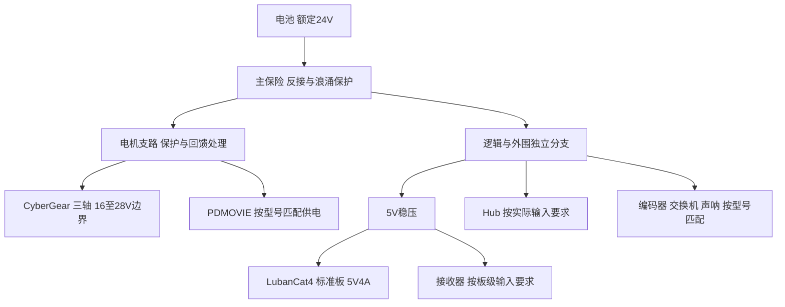

> 历史扩展方案：包含早期四应用范围，已由当前两软件设计取代。不得据此新增跟焦或 mobocon 开发任务。

# SS-07 硬件接线与部署详细设计

本设计定义逻辑连接、供电分支、安装记录及镜像交付。接口名称用于线束设计，不代表板上已有对应连接器。未取得接收器原理图前不分配新增 GPIO，也不将芯片外设数量作为可用接口证明。

## 1 安装区与链路

船端区包括相机、编码器、交换机、RK3588、录像盘、声呐、接收器和电机；岸端区包括 PC、Control 串口适配器及操控设备。时间码发生器建议放在船端接收器附近，PC 使用独立管理旁路取得其时钟；具体管理旁路线长/承载需要随船岸距离确定，不能默认长距离 USB 可行。

船岸已确定以太网视频链路。运动 Control 和发生器管理旁路是额外物理连接：若 PC 位于岸端，必须完成这些连接的距离预算。当前公共 RS485 参考主干为 20m；超出时需要重新验证或设计透明传输/硬件主控适配，保留接收器协议与授时约束。不得未经确认改成由 RK3588 转发运动，也不能承诺任意长缆 1Mbps 可用。

## 2 逻辑端口和线束表

| 线束 ID | A 端 | B 端 | 信号与用途 | 待冻结内容 |
| --- | --- | --- | --- | --- |
| V01 | 云台摄像机 SDI OUT | SE2017 SDI IN | SDI 主视频 | 接口、防松、阻抗/线材及长度 |
| V02 | SE2017 Ethernet | 船端交换机 | RTSP 视频 | 编码器地址、端口、供电 |
| V03 | 五相机 USB | Hub 对应固定端口 | H.264 环境视频 | 前/后/左/右/下标签、速率、功耗 |
| V04 | Hub 上行 | RK USB 主控端口 | 五路视频汇聚 | USB 拓扑、共享控制器及供电防反灌 |
| V05 | RK Ethernet | 船端交换机 | 六路服务/录像查询 | 静态地址与网口身份 |
| V06 | 交换机船岸口 | 岸端 PC/交换机 | 视频与声呐信息 | 线长、卷缆、防水接头、持续吞吐 |
| S01 | RK USB-RS485 | 声呐主干 | 厂家 RS485 | 五地址、参考地、终端、周期 |
| C01 | PC Control 适配器 | F/G Control 主干 | V1.2 双向 RS485 | 线长、方向切换、隔离、SOF/尾时间 |
| C02 | 发生器 TimeCode OUT | F/G TimeCode 主干 | 独立授时 RS485 | SOF 捕获、终端和时序标定 |
| C03 | PC 管理旁路 | 发生器管理接口 | 时间估计/状态 | 物理承载与可信误差界 |
| F01 | F 板载 RS485 | PDMOVIE 电机 | 38400/8N1 | 型号、引脚、电压与回读能力 |
| G01 | G CAN 收发器 | 三电机 CAN 主干 | 1Mbps 扩展帧 | ID、终端、短支线、参考地 |
| R01/R02 | 跟焦器/摇轮 | F/G NRF24 | 无线本地控制 | 地址、频道、干扰与可达距离 |

线束两端采用同一 ID 与方向标签。连接器表另记录 pin、信号名、线色、线径、屏蔽处理和供电电流；根据实物资料生成，当前不猜 pin 编号。A/B 以厂家文档及示波器验证为准，不仅按线色连接。

## 3 接收器外设资源检查

| 角色 | 已知接口 | 新增要求 | 放行条件 |
| --- | --- | --- | --- |
| F | UART1 GPIO44 TX/43 RX 电机侧；NRF24、屏幕和 USB 已占资源 | Control、TimeCode 两路接收/收发，授时捕获 | UART/GPIO/DMA/中断及方向逻辑完整核对 |
| G | 类似接收器，实际板卡待核对 | 两路 RS485、CAN 控制器/收发器、授时捕获 | 确认 MCU 的 CAN 能力和空闲引脚，不照搬 F 针脚 |
| 时间码发生器 | 待选硬件 | 有界定时输出、RS485、PC 管理接口 | 输出时刻和时钟误差界实测 |

F 所需三条串行链路同时运行，必须检查 SDK/Arduino 的 UART 实例占用、原 USB 调试策略与屏幕引脚。资源不足时评估规范已有 SYNC_INPUT=1 承载模式或板卡改版，记录对失联行为和同步预算的影响。方案冻结前先做外设同时工作的最小原型。

## 4 总线电气验收

Control、TimeCode、声呐和电机 RS485 各为独立网络；不共用终端，不把主站并接到电机下行。每条总线核对偏置、终端开关、驱动使能/释放、差分电压、参考地和隔离侧电源。Control 适配器须能在回复开始前释放总线，测量实际行为，不依赖 USB API 返回值推断。

CAN 核对两端终端及电机内置终端配置，关闭重复终端；电机身份逐台设置，接入三轴后核对 ID/UID 对应。布线远离高电流换向回路，电机连接器兼有电源时按厂家定义分别保护，严禁用推测引脚试接。

USB 测量五路同时枚举与传输速率，记录每个 Hub 端口到主控制器路径。五根 2m 相机线不证明 Hub 上行和延长线均合规，按实物验证。录像盘优先使用独立可验证的接口，避免未经预算再挂到同一个 Hub。

## 5 电源树与选型表

额定 24V 电池满电可能超过电机上限，需按实际串数、BMS 和回馈测量决定母线稳压/钳位方案。不能默认普通降压器吸收制动回馈。标准板 RK 输入 5V；若实际工控机箱为 12V 输入，单独登记内部转换器。

每支路选型记录额定/最大电压、稳态功率、启动峰值、换向/制动峰值、转换效率、持续/峰值额定、线长/压降、温度降额、保险和接头。电池容量按实际任务时长计算；设计容量与实测容量分别记录，不以商品额定值直接承诺续航。

日志记录运动、录像和网络满载下电压与温升。是否需要电池遥测、低电量有序关机和保持供电取决于硬件检测接口；未配置检测与保持不能宣布掉电前能关闭录像。电机、机箱、接头和相机的防水条件分别确认。

## 6 RK 镜像构建契约

建议新增本项目 packaging/build-image.sh 作为独立入口，输出 output/ss07/<release>/。该入口尚未实现。借鉴 fusion-platform 的 ARM64 rootfs 构建方式，但不复制其双 IMX287M 应用和 mscam-core 依赖。

| 步骤 | 输入 | 输出与检查 |
| --- | --- | --- |
| 版本锁定 | repo manifest、各 HEAD、板卡配置、工具链 | sources.lock；记录 dirty 状态，正式发布不混入未记录修改 |
| 内核与启动 | 当前源码、目标设备树/defconfig | U-Boot、内核、模块、DTB/extboot；检查实际编译日志 |
| 根文件系统 | 固定 Ubuntu ARM64 基础、包版本与媒体 ABI | 独立 rootfs；记录包版本，远端缺版本时构建失败 |
| 应用构建 | RK 服务/网页、媒体服务校验和、配置 | ARM64 程序/资产，动态依赖无缺失 |
| 集成 | systemd、设备映射、权限、网络、挂载 | 不启用旧相机测试服务；检查端口与外设冲突 |
| 打包 | 匹配分区表及所有新产物 | IMG、SHA256、版本清单、构建日志 |
| 烧录验收 | 完整 IMG、板卡与设备 | 冷启动及实际六路/声呐结果 |

现有 fusion build-image.sh 链接已编译 boot/uboot；SS-07 若要求当前代码完整镜像编译，必须先执行并核验对应源码构建。不得仅重打 rootfs 后声称启动组件已重编。不要盲目采用 output/defconfig 的 Focal 标记，明确实际基础系统与入口。

## 7 服务启动与应用更新

录像数据盘挂载成功是录像启用条件，不是整个媒体服务的启动条件；数据盘缺失时仍能监看并告警。网络可用后媒体服务拉取 SE2017；USB 通道依设备事件重试，不要求所有相机齐全才能启动。声呐服务独立启动。API 读取部分可用快照。

systemd 为采集服务仅授予所需 video/USB 设备权限，为声呐授予指定串口权限；API 不持有这些外设。服务用专属用户，写入仅限状态、日志与录像目录。管理端口只在本机，网页和媒体按现场访问策略开放。

应用版本放 /opt/ss07/releases/<version>，配置、状态和录像在版本目录外。更新先校验签名/摘要及依赖，保留旧版本；停止受影响服务后切换 current，再检查健康，失败回滚。数据库迁移必须提供旧版本恢复路径，否则先备份后离线升级，不能简单回切程序。

RK 初期采用完整 IMG 加应用版本回滚，不假定分区已经支持 A/B 系统回滚。F/G 单独发布与升级，升级前禁运动并确认安全；配置格式兼容、标定保留与否和旧固件恢复需要按板卡验证。发生器更新导致换 epoch，活动节目必须先停止。

## 8 每台设备安装记录

记录板卡/机箱序号、相机身份和通道、Hub 端口、声呐型号地址、F/G UID、CyberGear UID/ID、标定版本、线束版本、网络地址、录像介质和供电配置。现场替换部件必须更新记录并回归相关项，不能只复制旧软件配置。
