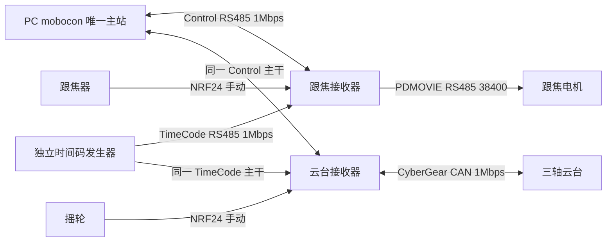

> 历史方案：接收器直接接TimeCode已于2026年10月8日取消。公共V1.2规范事实保留作兼容性参考，本文连接图和接收器授时实施任务不再适用。

> 外部接口参考：本次仅实现云台接收器侧接入，不开发mobocon或重新设计跟焦。本文PC/F/G总体方案中的其他开发任务不属于当前范围。

# SS-07 Mobocom V1.2 协议接入方案

PC mobocon 与跟焦、云台接收器采用用户提供的 device_protocol 公共库。当前唯一时间轴基准为 Mobocom V1.2，不能采用历史标签名推断当前协议，也不使用先前自拟的管理帧替代它。RK3588 保持视频总控职责，不承担运动事务或时间轴调度。

## 1 协议基线

| 项目 | 固定依据 |
| --- | --- |
| 仓库 | `git@codeup.aliyun.com:629f6370487c500c27f60603/device_protocol.git` |
| 分支与提交 | main，`0e192c33dc2a6255e662dd9edf48ca2b3c78aa3b` |
| 规范 | `mobocom_timeline_v1_2/PROTOCOL.md` |
| 接入指南 | `SDK_INTEGRATION.md`、`AI_INTEGRATION_GUIDE.md` |
| SDK | `1.2.0-candidate.1`，wire version `0x12` |
| 设备核心 | C++ `DeviceNode`、Clock、Stream、DeviceProfile 与 Hooks |
| PC 主控 | TypeScript `Client`、`compileProgram`、`MasterService` |
| 状态 | 实施候选；公共库的软件记录不代表 SS-07 电机/硬件已验收 |

公共事务、授时、缓存、准备与运行状态机由协议库维护；接收器负责真实单位、资源、输出和安全反馈。消费工程通过固定 SDK 快照与 lock 记录源码提交和摘要，不直接修改 vendor，也不在跟焦、云台、PC 三处各复制一套协议核心。

本次为方案更新，未安装 SDK 到接收器工程、未修改公共协议或上游固件、未编译或烧写 SS-07 程序。

## 2 时间轴、编辑定位与位置查询

V1.2 实现的是完整节目下载、设备准备、未来 T0 提交和节点本地播放，最长节目 600 秒。它不提供运行中修改节目、暂停后续播或运行时从 PC 预取。

PC 在设置时间轴时可单次移动到指定位置，并查询实际位置/偏差，确认后形成关键点。接收器执行有界定位轨迹，不依赖 PC 连续发送目标；遥控器/摇轮保留连续手动控制，三种运动来源互斥。

需要在公共库增加单次定位与动作状态能力，不新增高频 JOG/LIVE_SET 目标流。V1.2 STATUS 不含各资源实际位置，另按 [定位与位置查询方案](../position-telemetry.md)补定位与只读遥测，沿用公共事务。实际值、目标值与遥控输入分别标识，不能把无反馈设备的目标伪装为实际位置。

## 3 总线与授时硬件

参考配置为两条独立 RS485、1Mbps、8N1、无流控，线型主干、物理两端各 120Ω、偏置一处、支线建议不超过 0.3m。参考规模最多 16 节点、主干不超过 20m；SS-07 节点较少也须实测，不自动把该配置用于更长船岸线缆。

PC 通常通过一个 Control 适配器访问 F/G；不再默认每接收器一个独立 Control 总线。独立发生器每 10ms 发送 TimeCode；PC 选择 T0 时需取得该发生器统一时间的已校准来源，电脑 UTC 不能代替。发生器是额外硬件交付/复用项，不由浏览器定时器或普通串口 write 返回时刻承担精确授时。

F 完整双线配置需要三条物理串行链路：Control 输入、TimeCode 输入、PDMOVIE 电机输出；G 需要两个 RS485 输入和一个 CAN 输出。确认 UART 数量、空闲 GPIO、收发器、隔离及 SOF 捕获方法后出原理图，不能因为芯片支持多个 UART 就假定板卡已引出相应接口。

旧板可通过能力 TLV9 声明 `SYNC_INPUT=1`，在 Control 承载 TimeCode，减少一个输入；这是规范已有备选。承载时间码仍须对应实际发送 SOF、遵守 53ms 事务和 64ms 发现窗口，并通过保持与同步验收。Windows/USB 串口直接写入不等于已证明发送时刻，未具备可靠授时前不开放时间轴 Run。

## 4 报文与事务

### 4.1 Control 帧

| 偏移 | 字节 | 内容 |
| --- | --- | --- |
| 0 | 2 | `D5 7D` |
| 2 | 1 | version `12` |
| 3 | 1 | kind：REQUEST=1、RESPONSE=2、ACK=3、ERROR=4 |
| 4 | 1 | flags=0 |
| 5 | 2 | src_id，PC 为 0 |
| 7 | 2 | dst_id，节点或 FFFF 广播 |
| 9 | 2 | seq，非零，按规范回绕 |
| 11 | 2 | command |
| 13 | 8 | host_session_id，非零 |
| 21 | 2 | payload_len，0 至 240 |
| 23 | N | Payload |
| 23+N | 2 | CRC16 |

多字节字段小端，总长 25+N、最大 265 字节。CRC16 为 CCITT-FALSE，poly=0x1021、init=0xFFFF、不反射、xorout=0，覆盖 version 至 Payload，校验字小端。Program 使用 CRC32 ISO-HDLC，与 Control 校验分开。

全 Control 总线一次只允许一个未完成事务；每节点有独立 seq。回复在请求尾后 10µs 至 50ms 内开始，主控直到完整回复结束或 53ms 窗口关闭才能发下一帧，帧尾另留 10µs 保护。普通事务最多原样重发两次，同 seq 同内容重复返回缓存，不重复运动/准备副作用。

发现使用 UID 与分时回复，主控核对完整参与名册和地址冲突。Control NodeID 与 CyberGear CAN ID 是不同地址空间。会话更换不会自动中止现有节目，重启会改变 boot_id 并使节目缓存失效。

### 4.2 TimeCode 帧

TimeCode 固定 26 字节，`D5 7C`、version=0x12、flags=0、epoch_id:u64、tick_seq:u32、global_time_us:u64、CRC16。CRC 覆盖偏移 2 至 23。时间对应 SOF 首字节起始位，不是解析完成时间；坏 CRC、旧帧与重复帧不能延长有效授时年龄。

连续 8 个同纪元有效帧且误差界合格后 LOCKED。保持硬上限 100ms，超过设备期限或误差界即 LOST；活动节目因换纪元/LOST/时间异常停止本节点，重新锁定不恢复旧 Run。目标为每节点授时预算不超过 250µs、输出生效预算不超过 250µs，对应两节点最坏差不超过 1ms，须实物电气测量。

## 5 下载与运行流程

| 步骤 | 公共命令 | 完成条件 |
| --- | --- | --- |
| 发现与能力 | DISCOVER、ASSIGN_ID、HELLO、INFO、CAPS | 全参与 UID、唯一地址、完整能力页及版本确认 |
| 编译节目 | PC compileProgram | 真正设备类别单位、限值、协调组、缓存预算校验 |
| 下载 | BEGIN 0x0010、CHUNK 0x0011 | 逐片确认 next_offset，单片数据最多 228 字节 |
| 提交校验 | PROGRAM_COMMIT 0x0012、STATUS | ACK 仅受理，异步读回和校验后 READY |
| 设备准备 | DEVICE_PREPARE 0x0018、PREPARATION_STATUS | 回零/使能/到初态由真实反馈确认，VALID |
| 绑定启动 | RUN_PREPARE 0x0020 | 绑定 program、epoch、T0、boot、token、state_version |
| 提交启动 | RUN_COMMIT 0x0021 | 各节点 ACK，T0 时重新核验条件后本地播放 |
| 结束/中止 | STATUS、ABORT 0x0022、ESTOP 0x0023、CLEAR 0x0024 | 实际安全态确认，不能以 ACK 代替制动完成 |

Program 为 MTP2 格式，明确资源初/终态、轨迹、动作和准备 Payload。有速度/加速度限制的位置运动采用五次轨迹；带导数约束的线性位置段只用于保持。节点必须独立校验全区间范围，不能只信任 PC 检查端点。

主控通常选择至少 5 秒后的 T0；每节点 PREPARE 时至少余 2 秒，COMMIT 至少在 T0 前 500ms 受理。开始前授时、初态、准备 token 和缓存全部有效。Run ID 严格递增，重启后重新下载准备；暂停使用 ABORT，后续以新 Run 重新准备，不能续播旧 Run。

## 6 接收器设备类别

跟焦与云台各建立真实 DeviceProfile，登记设备类型、单位、资源、限值、准备动作、反馈、更新周期、停止时限与复位条件。虚拟风扇/双轴类别只是模型夹具，不能直接作为电机参数。

| 类别 | 建议资源设计 | 必须解决 |
| --- | --- | --- |
| SS-07 跟焦 | endpoint=1、resource=1 为 focus 位置；unit 与 i32 量化在类别中冻结 | PDMOVIE 0..7200 的实际行程映射、初态/到位/停机反馈、标定完成 |
| SS-07 云台 | 一个端点下 Yaw/Pitch/Roll 三个位置资源；可考虑毫度单位 | 外部传动、零位、速度/加速度、三轴危险耦合、反馈与 CAN 生效预算 |

设备类型/单位编号在类别发布时登记，不在方案中随意占用已定义编号。云台协议 API 若使用度，轨迹整数单位与厂家 rad 之间在 Hooks 转换，保留确定的量化误差。

F 当前代码只生成电机位置/按钮帧，没有实际位置或准备完成响应解析。只知道“发送成功”不能实现 `prepare_confirmed`、`terminal_confirmed` 与 `safe_confirmed`；需厂家反馈、可验证传感器或明确的真实类别条件。未满足前可以开发编解码和模型，不能开放实体节目 Run。

G 的 `Hooks.apply` 会将三个目标变为 CAN 报文，但排队调用不等于三个电机同时生效。声明 GROUP 前必须确定共同提交点、允许组内偏差并测量；串行 CAN 与电机内部执行延迟纳入预算，不能仅凭 ESP32 日志宣布三轴协调或满足 1ms。

公共 C++ SDK 要求 C++20，不开启 fast-math；五次轨迹验证建议至少 8KiB 验证栈，实际 RAM、PSRAM、实时 tick 和 CAN/RS485 调度需在 ESP32 工程实测。不要使用原先 100Hz PDMOVIE 发送上限代替同步或输出刷新验收。

## 7 本地手动与时间轴仲裁

建议接收器控制源状态为 SAFE、LOCAL_MANUAL、PC_POSITIONING、PC_TIMELINE。单次定位占用 PC_POSITIONING；只读位置查询是观察操作，不成为运动来源。活动时间轴拒绝定位，来源切换先中止并确认安全；定位改变初态也使旧准备失效。设备维护公共 download/preparation/run 正交状态，不用本地来源状态替代它们。

本地手动运动使节目初态前提发生变化时调用公共 `notify_state_change`，旧准备 token 立即失效。时间轴活动期间不能直接让 NRF24 回调写电机目标；需要明确的本地接管动作，先中止本节点节目并确认安全，随后授权手动来源。手动运动后重新播放必须重新准备，不能沿用旧 token。

故障、硬件急停与软件锁存优先于普通来源。一个节点故障仅停止自身；其他节点按 V1.2 继续，不自动广播全场中止。操作者明确中止整场时 mobocon 使用全体 ABORT；协议也不保证部分 COMMIT 后 Control 故障时原子启动。

### 7.1 按运行模式区分失联

| 模式与事件 | 响应 |
| --- | --- |
| 本地手动无线失联 | 取消本地新目标，按真实电机类别执行停止/保持 |
| PC 定位期间 Control 失联 | 已受理有限动作按本地期限完成或停止；PC 标记结果未知，重连查询而不重发 |
| PC 位置查询中断 | 标记位置数据过期，不影响无线手动或按规范运行的时间轴 |
| 缓存时间轴 Control 失联，独立 TimeCode 正常 | 继续已缓存节目；主控离线不能保证远程停止 |
| 时间轴 TimeCode 丢失/换纪元 | 按保持/误差边界停止本节点，恢复授时不自动续播 |
| Control 承载模式断线 | 同时失去 Control/TimeCode，按失时停止 |
| 接收器重启 | boot 改变、节目与准备失效，不自动重播 |
| RK3588 重启/视频网线断开 | 接收器模式保持独立，不自动中止节目 |

## 8 开发与验证顺序

1. 固定公共 SDK 来源；定义跟焦/云台真实类别及反馈缺口，不修改公共事务行为。
2. 确认 Control/TimeCode 与电机输出的硬件接口，选择独立授时或已声明承载路径。
3. PC 复用 TypeScript Wire/Client/MasterService，接入串口、节目编辑、UID 名册与授时来源；u64 使用 bigint，不降为普通 JS number。
4. 接收器复用 DeviceNode，接入 UART 流解析/方向控制、SOF 捕获、tick、驱动、安全和准备反馈。
5. 对照公共黄金向量、事务/流解析和真实类别行为测试，再完成 ESP32 编译与实物单轴/单电机验证。
6. 完成满载通信、电气输出、两线分别失联、本地接管、节点重启与实际停止测试，最后开放对应硬件 Run 门槛。

文档阶段核对字段、链接、源码版本和模型向量，不将上游测试记录写成本次设备验收。正式接入还需运行受影响的公共 SDK 与目标工程回归；任何 1ms 同步结论须给出真实捕获与输出测量。
