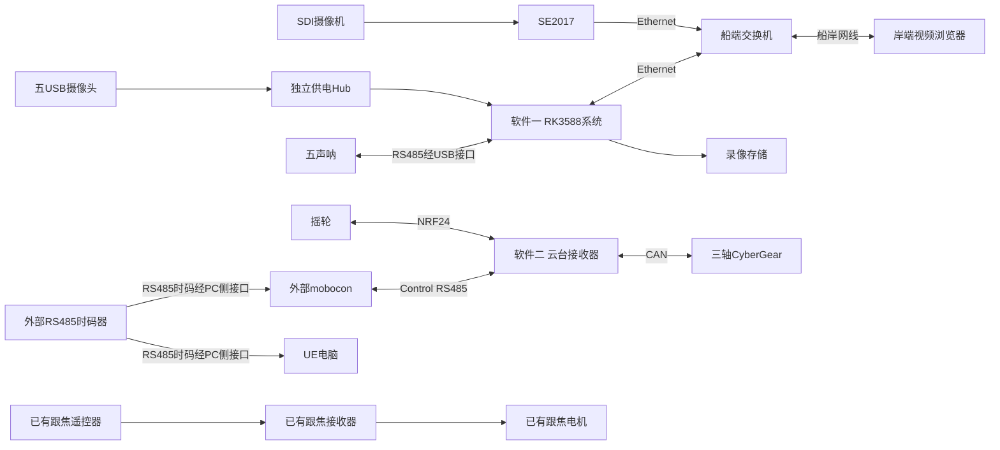

> 历史设计：已由V2.0实时Control方案取代，不作为当前开发依据。

# SS-07 两软件系统设计

版本v1.0，2026年10月8日。本次只设计RK3588系统和云台接收器固件，分别形成独立设计、代码目标、配置、构建产物和验收。跟焦系统已经设计完成，不重新设计；mobocon是外部PC控制端，RS485时码器只接入mobocon和UE电脑，其他设备不接时码器。

## 1 软件边界

| 软件 | 输入 | 职责 | 输出 |
| --- | --- | --- | --- |
| RK3588系统 | SDI经SE2017、五USB视频、五RS485声呐 | 采集、分发、录像、状态、配置和网页 | 船岸Ethernet视频/声呐/录像、完整镜像 |
| 云台接收器 | 摇轮NRF24、PC Control RS485 | 三轴运动、反馈、仲裁、保护及待修订的时间轴执行接口 | CyberGear CAN、PC遥测、独立固件 |

两软件之间没有必须的业务控制接口；可在同一系统中同时运行，但视频服务不是电机控制依赖。跟焦作为独立既有链路继续运行；不得将旧方案中的跟焦反馈/固件扩展列为本次开发任务。

## 2 系统拓扑

图中不规定改造现有跟焦的PC控制接入；该部分沿用已有设计。PC视频监看与mobocon可以运行在同一电脑。RS485时码只进入mobocon与UE电脑，不进入RK、云台或跟焦接收器。PC的时码输入接口与电机Control接口独立，不电气混接；UE电脑不画成电机主站。

## 3 关联与独立故障

| 事件 | RK软件 | 云台软件 |
| --- | --- | --- |
| RK重启/视频断网 | 监看异常，录像按设备可用性处理 | 不改变来源和合法运动 |
| 云台接收器重启 | 六路采集继续 | SAFE，不恢复旧目标/Run |
| Control断开 | 不影响视频 | 定位有界完成/停止；时间轴行为随修订后的播放模式冻结 |
| 时码输入失效 | 不影响视频 | 接收器不直接检测时码；mobocon/UE检测，播放处理契约待冻结 |
| 录像盘故障 | 录像告警，继续可用监看 | 不影响运动 |
| CAN或电机故障 | 仍可监看 | 故障保护、反馈和安全确认 |

电源/电磁干扰可能影响两软件所在硬件，仍需整机满载共存验证；业务独立不表示忽略共享配电。

## 4 两份独立设计

[RK3588设计](../rk3588-design.md)覆盖设备模式/身份、进程、状态机、配置、数据、HTTP/SSE、网页、录像、部署、供电和验收。

[云台接收器设计](../gimbal-receiver-design.md)覆盖工程模块、任务/输出路径、来源世代、摇轮语义、CAN启动、三轴反馈、有限定位、公共SDK、标定、保护、固件交付与验收。

[开发与验收](../implementation-plan.md)只列这两个软件的工作包。公共定位/遥测扩展、无需接收器授时的播放契约及PC时码可用性作为外部依赖管理，不承诺已经具备。

## 5 待实物冻结

RK：相机原生模式、声呐厂家协议、存储、网络线长及实际机箱电源。

云台：接收器MCU/原理图、摇轮载荷、Control输入、三轴机械范围/标定、CAN_TIMEOUT实际行为。

PC：时码器的帧格式、帧率/时间语义、两个电脑的实际接入方式，以及时码失效/跳变时的处理。时码如何驱动云台时间轴仍需冻结播放模式。

mobocon编辑定位要求已明确：下发一次目标、读取实际位置/偏差、检查正确后建立关键点。当前公共V1.2的完整定位/遥测能力仍需公共库提供，不在云台工程私改协议。跟焦资料与历史四应用方案仅作参考，不扩大上述两软件范围。

## 6 现有协议适配约束

已读公共V1.2的缓存Run依赖接收器收到有效TimeCode，无接收器时码输入时不能直接沿用其LOCKED/T0/失时状态机。新的PC时码驱动方案需在公共库确定播放模式、兼容能力和故障行为；不假装现有SDK已支持，也不默认让mobocon转发时码到接收器。单次定位、查询和摇轮链路不依赖时码。详见 [时码输入与播放边界](../timecode-integration.md)。
