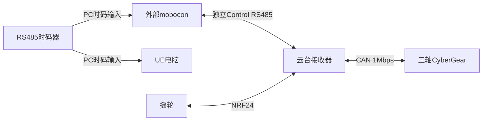

> 历史设计：已由V2.0实时Control方案取代，不作为当前开发依据。

# SS-07 云台与外部mobocon接口接入

当前时码器只接mobocon和UE电脑，不接云台接收器。本文只定义云台侧PC接口；不开发mobocon/UE，也不改造已有跟焦。新的播放方式需适配公共协议，不能直接套用旧的接收器授时方案。

## 1 已读公共基线

仓库为git@codeup.aliyun.com:629f6370487c500c27f60603/device_protocol.git，已检查main提交0e192c33dc2a6255e662dd9edf48ca2b3c78aa3b，Mobocom时间轴V1.2、SDK 1.2.0-candidate.1、wire 0x12。公共事务/编解码和设备类别能力继续作为复用基础；新增功能按公共库发布版本锁定。

Control为D5 7D、25+N字节、最大Payload 240、小端、CRC16 CCITT-FALSE。整个Control总线仅一笔未完成事务，应答/超时窗口和去重仍遵守公共契约；不能因为PC播放模式改变就抢占窗口。

公共V1.2缓存Run需要接收器收到有效TimeCode。当前结构不满足该条件，因此仅复用其受支持的基础能力，不声称原MasterService启动流程已能在新结构运行。旧规范及旧连接方案见 [历史协议接入](../reference/mobocom-integration-with-receiver-timecode.md)。

## 2 当前连接

Control参考电气条件与实际距离另验收。云台只需一个Control RS485接口和CAN，不再需要TimeCode UART、捕获或第二时码收发器。PC的时码适配器和Control适配器独立。

## 3 PC控制契约

编辑阶段支持单次目标定位、停止、动作状态、实际位置/偏差与能力查询。有限定位由接收器按本地时钟执行，PC低频读快照；重复请求不重复动作、重连不自动重发。实际值不能用目标值冒充，见 [定位与遥测](../position-telemetry.md)。

定位/遥测/来源切换并非已读V1.2完整已有API，应在公共库登记后接入。定义动作ID、boot与标定版本、期限、单位/限值、状态/错误与去重，不直接改STATUS或vendor源码。

时间轴采用PC按时码调度指令还是缓存后触发本地播放尚待确定。模式、PC失时、Control断线、迟到、重启和同步误差在公共契约冻结后实现，见 [时码与播放边界](../timecode-integration.md)。在此之前不承诺断Control继续播放或接收器自动检测时码故障。

## 4 设备适配与验证

云台真实类别定义三轴资源、项目单位、范围、导数限制、零位/标定和真实安全确认。来源仲裁与驱动输出唯一，查询不改变来源；摇轮、定位、时间轴继续互斥。停止行为和固件卡死独立保护依据实物验证。

开发可先进行Control流解析/事务、目标固件构建、CAN反馈、摇轮及单次定位；时间轴实施前先冻结无接收器时码的公共播放支持。SDK固定来源和摘要，公共修改在device_protocol完成后发布，消费者不私自绕过时钟检查。
