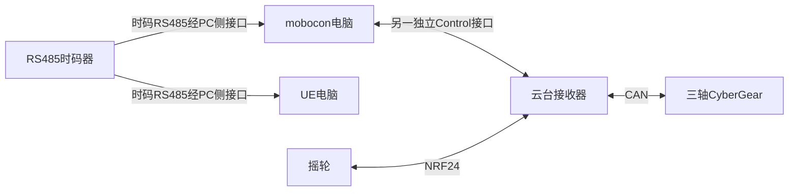

> 历史设计：已由V2.0实时Control方案取代，不作为当前开发依据。

# SS-07 PC侧RS485时码输入与播放边界

2026年10月8日结构变更：RS485时码器只接入mobocon和UE电脑；RK3588、云台接收器、跟焦接收器以及其他设备不接时码器。本文确定连接边界，时间轴的执行方式仍待冻结。

## 1 物理链路

时码输入与电机Control为两条不同链路。mobocon侧分别使用时码输入接口和Control适配器，不在一个差分总线上混接两个用途。UE只画时码输入，不新增其对接收器的Control主站连接。

是否共享一条可分接的时码主干，或使用时码器独立输出，按设备规格和线束确认。核对两个PC接收接口、终端/偏置、隔离和线长；两个接收端不得未经协议允许主动驱动时码总线。mobocon与UE是否运行在同一台电脑仍可按实际部署确定；同机时可由唯一串口读取服务提供两个应用，不能同时独占打开串口。

## 2 时码的数据契约

先确认实际时码器协议、时间单位、帧格式/校验、帧率、有效状态、日期或帧编号、跳变/回绕/重启语义，以及UE侧所需插件/桥接。不能仅因接口为RS485，就假设报文是旧公共V1.2的D5 7C帧或每10ms一帧。RS485是电气承载，不等于UE已能直接读取该协议。

mobocon和UE各自记录来源、有效性、最后样本年龄和时码值，处理丢帧/失联/跳变；相同源不自动证明两个程序同一瞬间消费。任何同步指标按实际采集、软件调度与通信延迟测量，不沿用旧接收器授时的1ms承诺。

## 3 云台接口变化

取消云台TimeCode输入端口、SOF捕获、直连时码线以及接收器端时码LOCKED/LOST验收。保留摇轮NRF24、Control RS485、CAN和本地单调时钟；本地电机刷新、有限定位和保护不需要外部时码。

现有公共V1.2的缓存Run以接收器有效授时为前提。新结构不能直接使用旧的epoch/T0流程，也不能在消费者固件关闭授时检查。原方案的“Control断开但TimeCode正常时继续缓存节目”不再是当前产品契约。

## 4 时间轴播放待选方案

| 方案 | 接收器工作 | 必须定义 |
| --- | --- | --- |
| mobocon按时码调度运动指令 | 收到普通运动请求后本地执行，不接时码 | 下发周期、轨迹/目标粒度、队列、迟到、去重、Control失联及PC时码故障 |
| 接收器缓存轨迹，mobocon触发 | 按本地时钟播放，不接时码 | 触发误差、时钟漂移、时码跳变后的PC策略、停止/重启/重同步 |

两种方案均需要公共协议明确支持；本表不是已实现能力，也不默认选择。接收器收到的普通命令不应被图示为时码连接；不默认通过Control转发时码。

PC时码故障首先由mobocon/UE检测。是否暂停下发、发中止或允许已有动作完成，由选择的播放契约冻结。接收器不能直接得知未接入的时码器状态，也不能保证PC或Control完全失效时收到停止命令；本地期限与独立保护另行验证。

## 5 架构图修改要求

删除：发生器到云台的绿色时码线、云台TimeCode输入端口、“TimeCode接入与同步”模块、PC到发生器的旧管理旁路表述，以及接收器失时/10ms周期的旧说明。

新增两条时码线：RS485时码器 → mobocon时码输入，RS485时码器 → UE电脑时码输入。两端是否需要转换器按实际接口注明。保留mobocon Control适配器 ↔ 云台Control输入，且与时码线完全独立。

RK的Ethernet/USB/声呐、摇轮NRF24、云台CAN及既有跟焦链路不变。云台时间轴模块标“执行模式待按PC时码驱动方案冻结”，不要继续写接收器与时码器直接同步。
