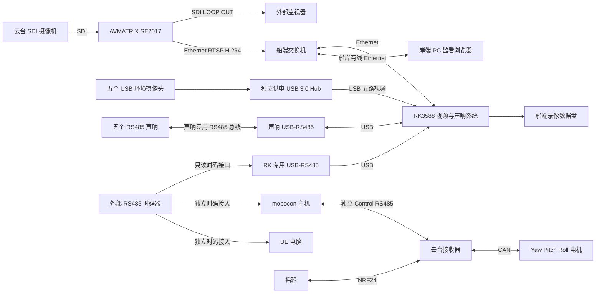

# SS-07 RK3588 系统架构与开发交接

建议新对话名称：**SS-07 RK3588 视频与声呐系统开发**。

本项目为 LubanCat-4 / RK3588 开发独立的船端视频与声呐应用，并基于当前 LubanCat SDK 构建完整镜像。第一阶段目标是六路视频、五路声呐、监看录像与时码记录关联，最终与独立云台和现有跟焦系统联调。

截至 2026-10-13，SS-07 目录仅有设计文档，没有已实现的应用或已验收的镜像。以下描述是开发约束与目标，不代表硬件能力已验证。

## 1 项目位置与设计依据

- SDK 工作区：`/home/forlinx/workspace/LubanCat_SDK`。
- SS-07 应用位置：`/home/forlinx/workspace/LubanCat_SDK/device/rockchip/apps/ss07-water-control`。
- 当前所属 Git 仓库：SDK 的 `device/rockchip` 子仓库，分支 `SS-07-水上控制系统`。SDK 根目录采用 repo 管理多个子仓库，不是一个顶层 Git 仓库。
- 协议与系统设计库：`/home/forlinx/workspace/device_protocol`，远程为 `git@codeup.aliyun.com:629f6370487c500c27f60603/device_protocol.git`。
- 本交接核对时协议库 main 为 `c6f23e003cf1c3aeb27a488d152b73327b1827f0`；开发时重新核对本地版本与最新设计，版本发生变化时明确差异。

主要设计入口为 [系统架构](architecture.md)、[RK3588 独立设计](rk3588-design.md)、[RK 只读时码设计](rk-timecode.md) 和 [开发验收计划](implementation-plan.md)。历史 `reference/` 文档不作为当前控制拓扑依据。先阅读适用的 AGENTS.md，保留现有未提交内容与其他应用。

## 2 系统边界

RK3588 负责视频采集与分发、声呐采集、录像与存储、状态 API、监看网页、配置、日志以及只读时码关联。

云台由独立接收器执行电机控制：摇轮通过 NRF24 接入接收器；岸端 mobocon 通过独立 Control RS485 控制接收器；接收器通过 CAN 控制三个 CyberGear 电机。RK3588 不转发运动命令，不实现电机使能、三轴仲裁或时间轴执行。停止 RK 应用或重启 RK 不应改变接收器的控制权。

跟焦器的遥控器—接收器—电机链路沿用既有设计。mobocon、UE 和云台接收器均属于其他项目，本项目只记录必要外部边界。

最新公共协议采用 V2.0 主机求值并持续下发目标的设计。旧图中接收器的 TimeCode 输入、缓存时间轴播放和时间轴同步应删除；时间轴由 mobocon 处理。RK 只复用独立时码格式，不依赖 DeviceCore 控制状态机。

## 3 硬件连接与数据流



图中时码的三个逻辑接入不代表可任意使用长星形 RS485 接线；电气拓扑按发生器端口、隔离分配器或多接收主干的实际能力核验。

五个 USB 摄像头对应 front、back、left、right、down；第六路视频为 SE2017 网络视频，不经过 USB Hub。声呐串口与时码串口必须使用两个独立适配器。优先按唯一序列号绑定；无序列号时按固定物理端口绑定，不能使用随枚举变化的 video0 或 ttyUSB0 作为设备身份。

船岸视频与网页使用网线。mobocon 控制链路独立于 RK；船岸网线不会自动承载 RS485，不能在图或实现中假定 RK 是控制桥。

## 4 应用模块与运行职责

| 服务 | 主要工作 | 独立故障处理 |
| --- | --- | --- |
| `ss07-camera@front/back/left/right/down` | V4L2 设备识别、模式设置、H.264 采集与本机发布 | 单路重连、退避、帧年龄与错误状态 |
| `ss07-mediamtx` | 接入 SE2017 和五路 USB 发布流；WebRTC/RTSP 分发与分段录像 | 媒体服务恢复、源重新连接 |
| `ss07-sonar` | 厂家协议、公平轮询五地址、距离及有效性、接收时刻标签 | 每节点超时，不让离线节点阻塞整个总线 |
| `ss07-timecode` | 专用串口只读接收、0x12 解码、年龄与质量、时间映射 | 缺时码不阻塞其他服务；恢复建立新映射段 |
| `ss07-storage` | 已完成录像索引、空间清理、锁定、导出与时间侧录管理 | 缺盘告警、索引恢复、元数据缺口可查 |
| `ss07-video-api` | HTTP/SSE、状态聚合、配置、录像查询与网页入口 | API 重启不停止采集和录像 |

首版采用原生 H.264 直通优先，避免为了监看或时码而重复解码编码。USB 摄像头若只支持 MJPEG/YUYV，应先验证板端媒体栈和资源预算，再决定转码方案。不能从商品“300 万像素”描述推定 1080p25 原生 H.264 模式。

技术选择沿用独立设计：C++ 配合 GStreamer/V4L2 实现采集；Python 3 适合 API、声呐和时码服务；TypeScript 实现网页；SQLite 保存索引；MediaMTX 使用固定 ARM64 版本。首次构建前根据 SDK 的实际工具链、运行库与媒体 ABI 锁定版本。

服务间只传状态、控制配置和有界元数据，API 不直接持有视频设备或串口。启动不等待所有相机、编码器、声呐及时码齐全，允许部分设备可用。队列、重试和日志均需有界。

## 5 时码与记录关联

时码器接 mobocon、UE 和 RK，只给 RK 增加一个被动记录输入。云台接收器与跟焦接收器不接时码器。RK 串口服务只接收，不发送轮询、请求或 ACK。

采用协议库 `timecode/` 的公共 0x12 格式与校验规则。实现前阅读该库的 README 和参考实现，冻结串口参数，复用或对照官方实现验证，避免自行猜字段或校验。时码输入与 Control 0x20 的控制协议分开。

记录中保留 UTC、本机单调时间和外部 epoch/time 三套时间。UTC 用于日历展示，单调时间用于顺序、年龄与超时，外部时码用于跨系统查找。外部时码不直接设置 Linux 系统时钟，也不重写视频 PTS/DTS。

映射按 RK boot_id、源 epoch 和 mapping_id 隔离。事件必须按它的本机接收时刻查对应映射，不能给排队的旧事件套用最新时码。元数据至少包含时间来源、质量、年龄与误差依据；u64 JSON 字段用十进制字符串，未知值用 null。

首版完成录像片段级关联和声呐接收时刻标签，侧录索引可回查。逐帧关联需要随后验证采集、发布及录像中的 AU/PTS 对应关系。USB 到包时间、录像文件创建时间不等于摄像机曝光时间；共享时码源不构成曝光同步承诺。

首次无时码标记 UNAVAILABLE；外推值单独标记 ESTIMATED。坏帧和旧帧不刷新有效年龄。失时仍继续录像，恢复或换 epoch 后建立新映射段，保留历史缺口，不回填旧记录。

## 6 API 与网页

业务接口统一位于 `/api/v1`。先冻结数据契约，再让前后端依照同一 schema 实现。

| 接口 | 功能 |
| --- | --- |
| `GET /status` | 系统快照与告警 |
| `GET /streams` | 六路流描述、采集/发布状态、帧年龄 |
| `GET /sonars` | 五方向读数、有效性、原因与年龄 |
| `GET /timecode` | 源 epoch、年龄、映射与记录质量 |
| `GET /events` | SSE 状态及告警，不传视频帧 |
| `GET /recordings` | 通道与时间筛选、分页、缺口与可用性 |
| `GET /recordings/{id}/content` | 已完成录像读取，支持范围请求 |
| `POST /recordings/{id}/lock` | 录像锁定与解锁 |
| `GET /config`、`PUT /config` | 配置查询及带 expected_revision 的修改 |

网页提供一路可切换主画面和五路辅助画面、五方向声呐读数、时码状态、录像查询回放、设备状态与维护配置。浏览器优先使用 WebRTC；原生客户端可使用 RTSP。冻结画面要显示离线或过期状态，测距无效不能显示为零距离。

配置区分持久化值、运行值和应用结果；冲突返回明确错误，应用失败保留可恢复的旧配置。运行权限分为监看、录像读取和维护；录像只能通过 recording_id 访问，路径由服务器内部映射。

## 7 文件布局与镜像交付

建议应用目录如下，开发时按实际实现建立目录，不批量添加空壳服务：

```text
ss07-water-control/
  src/camera/          V4L2 与视频发布
  src/sonar/           厂家驱动、轮询与样本
  src/timecode/        只读时码、映射与质量
  src/storage/         录像索引、清理与侧录
  src/api/             状态与配置接口
  web/                 监看与维护页面
  config/              schema、默认配置与设备绑定示例
  systemd/             服务与权限
  packaging/           应用包和独立镜像入口
  tools/               真实设备探测与诊断
  tests/               协议、状态机与故障场景验证
  docs/                本项目说明与验收记录
```

目标部署位置：配置 `/etc/ss07`，索引 `/var/lib/ss07/catalog.sqlite`，录像 `/data/ss07/recordings`，程序 `/opt/ss07/releases/<version>`。数据盘未挂载时可以监看，但禁止把录像写入系统盘的同名目录；正在写入或被锁定的片段不能被清理。

应用服务用 systemd 管理，外设访问授予实际需要的服务。版本目录外保存配置、状态与录像。程序回滚要同时考虑数据库 schema，不能仅切换二进制后宣称可恢复。

当前 SDK 中已有 `fusion-platform` 等应用和构建入口，只作为环境与构建流程参考，不重命名或覆盖旧产品。新增 SS-07 独立镜像入口，候选输出 `output/ss07/<release>/`。完整镜像交付必须核验当前源码生成的启动组件、内核、设备树、模块及 rootfs，不能仅重新打包旧 boot/uboot。

交付物包括源码、应用包、网页、配置、systemd、完整 IMG、SHA256、源码与依赖版本清单、构建日志、安装与验收说明。标准 LubanCat-4 裸板输入按实际板卡资料核验，不能把机箱的 12V 输入直接套到裸板。

## 8 开发阶段与验收

1. **工程基础与真实探测**：核对 SDK、工具链、媒体库、现有应用和设备；建立实际可运行的设备探测、配置模型与状态服务。
2. **单路 USB 视频**：固定设备身份，枚举真实模式，完成采集—发布—浏览器监看；拔插恢复不交换通道。
3. **六路视频与录像**：扩展五 USB，加 SE2017；完成索引、回放、缺盘与清理策略。
4. **五路声呐**：取得实际型号及厂家报文后实现驱动；验证单节点离线、坏帧和声学互扰。
5. **只读时码**：验证公共帧、串口零发送、质量状态、映射隔离、片段及声呐侧录关联。
6. **网页与部署**：完成维护配置、权限、日志、systemd、应用包与独立完整镜像。
7. **满载联调**：六路监看录像持续 8 小时；验证相机/声呐/时码拔插、满盘、重启和恢复，并确认不影响独立运动系统。

1080p、各路帧率与码率、视频延迟和声呐采样频率都属于待硬件测量后冻结的指标。缺少硬件时可验证配置、协议解码、接口与故障逻辑；模拟数据必须明确标识，不能代替真实链路验收。

## 9 新对话首条消息

将下面的消息粘贴到以当前 SDK 为工作区的新对话：

> 开始开发 SS-07 RK3588 视频与声呐项目。工作区为 /home/forlinx/workspace/LubanCat_SDK。首先完整阅读 /home/forlinx/workspace/LubanCat_SDK/device/rockchip/apps/ss07-water-control/docs/rk3588-development-handoff.md 及其中的当前设计链接，检查适用 AGENTS.md、子仓库状态和现有 SDK 构建方式，然后开展第 1 阶段开发。
>
> 本项目负责六路视频、五路声呐、监看录像、状态配置，以及独立只读 RS485 时码与记录关联；云台接收器、跟焦器、mobocon 和 UE 属于其他项目，RK 不转发运动命令。保留现有应用和未提交内容，在 device/rockchip/apps/ss07-water-control 内建立独立工程。
>
> 首个交付应包含明确的模块与接口设计、真实设备/媒体能力探测工具、配置 schema 和校验、可运行的最小状态 API、构建运行说明与相应验证。根据实际环境选择最小依赖，先形成一条可运行路径，再逐项扩展。用实际探测结果决定视频模式、串口绑定和依赖版本；缺失的声呐厂家协议或设备参数明确列为待确认，不猜报文，不把模拟状态当真实设备。
>
> 在完成初始工程后报告已实现、已验证和未接入的项目，以及下一阶段进入单路视频的条件。提交、推送、烧写和部署到实际设备等待后续明确指令。
