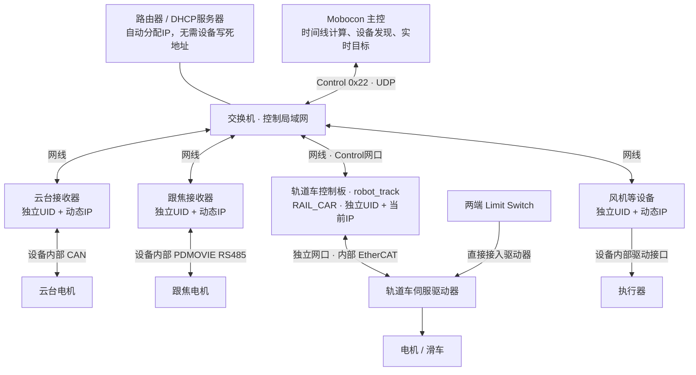
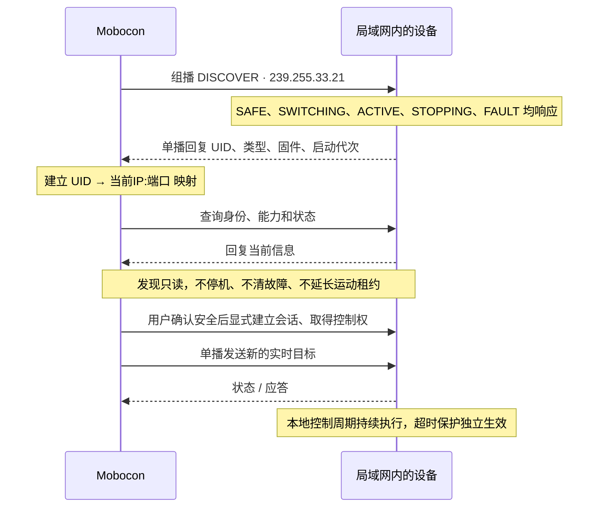
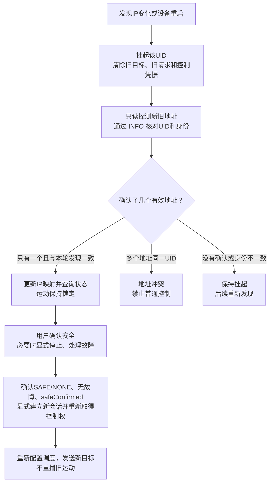

# Mobocom Network Control 公共设备协议 V2.2

schema4保留跟焦位置/按钮输出：读取`wiredCommands`能力、确认Wired交接后使用`focusPositions`/`focusButton`及`Client.writeFocusCommand`；每次关联新revision，丢ACK不重发物理动作。当前上游承载统一为UDP，私有下游驱动不随本次迁移修改。


当前网络专用交付为 `2.2.0-network.1`：设备接收实时命令，授时供 Mobocom/UE；SS-07 的 RK3588 可只读接入记录时码。跟焦接收器、云台接收器、风扇等分别实例化同一公共核心；实体控制节点不接时码、不下载节目、不维护 T0。硬件性能与安全尚未验收，不承诺跨设备 ≤1ms 同步。

网络版本删除 RS485 承载、node_id、ASSIGN_ID 和串口时序；UID 是设备身份，IP:port 是当前网络位置，设备推荐DHCP而非写死IP。跨节点允许并发，同一节点单播保持串行；所有状态均回应发现，后台扫描不阻塞目标/保活。目标新鲜度、租约和失联安全状态机保留。旧 0x21 固件不兼容。名称展示和GitHub参考方案见[动态地址与名称发现](docs/NETWORK_DISCOVERY.md)。

schema4支持跟焦切源与状态回读，保留私有PDMOVIE运动路径，不改变云台会话与目标。[跟焦切源接入说明](docs/MOBOCON_FOCUS_CONTROL.md)中的历史串口部署不作为当前网络接口。Mobocon源码未改，网络迁移及实板验收待完成。

换IP或设备重启后，TS Client支持按UID验证新旧地址并重连查询，不把正常换址直接判为重复设备；旧目标/凭据/调度失效，运动保持挂起，须用户显式安全建会话及重新接管。调用见[换址重连](docs/NETWORK_DISCOVERY.md#换址重发现与重连)。

candidate.5 增加 schema 3 的运行中调速：当前控制会话整组原子应用 RAM，保持目标和控制代次，不续目标期限；schema 2 保留停止配置。三语言 SDK 与跨语言黄金向量已提供，Mobocon 开发者见 [调速接入说明](docs/MOBOCON_MOTION_PROFILE.md)。本次未修改 Mobocon 客户端。

协议唯一维护源：git@codeup.aliyun.com:629f6370487c500c27f60603/device_protocol.git。旧时间轴实现已从当前源码移除，历史在 Git；已有设备快照不会被本次自动修改。

## 协议图解

**用 UID 认设备，用 IP 找设备；换 IP 可以重连，但不能自动恢复运动。**

### 连接拓扑

原来主控到设备的 RS485 总线，改为各设备独立接入控制局域网。



去掉的是主控与设备之间的 RS485，不是跟焦接收器到电机的内部 RS485。普通交换机不提供 DHCP，需要路由器或单独的 DHCP 服务。同一控制局域网内发现，组播 TTL=1，不承诺跨路由/VLAN自动发现。

轨道车与云台、跟焦是平级独立节点，不经过其它接收器或 SS-07 RK3588 转发。整套轨道车只发布一个 Control 身份；EtherCAT 驱动器不作为独立 Control 节点，其内部网口不接入图中的 Control 交换机。当前 robot_track 使用 `eth1` 接 Control，另一个专用网口接 EtherCAT；接线、类别与验收要求见[轨道车接入说明](docs/ROBOT_TRACK_INTEGRATION.md)。图示是连接设计，不代表 Mobocon 客户端或实网／机械安全已验收。

时码器仍独立连接 Mobocom、UE，以及 SS-07 RK3588（只读记录关联），不连接轨道车控制板或其它实体控制接收器；对应遥控器仍通过 NRF24 连接对应接收器，轨道车当前仅支持 MOBOCOM 来源，私有路径不随本次网络迁移修改。

### 发现与控制

发现使用组播，正常控制使用设备当前地址的单播，UDP 端口均为 `47821`；一个 UDP 数据报承载一帧。



设备名称可用本机保存的 UID 别名，或由可选 mDNS 提供；名称只是标签，身份始终按 UID 确认。mDNS 名称/候选地址不能跳过 Control 身份验证。全体 STOP/ESTOP 也使用固定组播，但无回复，不构成物理急停保证。

### 换 IP 后重连



应用失联后调用 `client.reconnect(uid)`，进行有界的发现、身份验证与状态查询；没有后台无限重试。重连只挂起受影响的 UID，其他设备继续工作。旧 IP 被另一 UID 使用不算原设备重复；仅因缓存中留有旧 IP，也不能直接判定冲突。UDP 探测超时不证明设备不存在，UID/CRC 不提供身份认证，仅适用于可信控制网。完整流程见[动态地址与名称发现](docs/NETWORK_DISCOVERY.md#换址重发现与重连)。

以上为当前协议与 SDK 的设计行为，不代表设备固件或 Mobocon 已完成接入；DHCP/可选 mDNS、运行中扫描与换址、实际输出周期及机械安全仍需实网和实板验收。

## 阅读入口

| 内容 | 入口 |
| --- | --- |
| 完整报文、状态机与事务 | [PROTOCOL](mobocom_realtime/PROTOCOL.md) |
| 统一设备类型 ID | [DEVICE_TYPES](mobocom_realtime/DEVICE_TYPES.md) |
| AI 开发设备/主控 | [AI 接入指南](mobocom_realtime/AI_INTEGRATION_GUIDE.md) |
| Mobocon 客户端更新与修改清单 | [客户端更新记录](docs/MOBOCON_UPDATES.md) |
| 类别与安全模板 | [DEVICE_PROFILES](mobocom_realtime/DEVICE_PROFILES.md) |
| 构建、SDK 和固定快照 | [SDK_INTEGRATION](mobocom_realtime/SDK_INTEGRATION.md) |
| 纯 Rust SDK、no_std 与轮询接入 | [Rust 指南](mobocom_realtime/rust/README.md) |
| 从旧串口迁移到0x22网络 | [网络迁移清单](docs/NETWORK_V22_MIGRATION.md) |
| 总体边界 | [实时架构](docs/REALTIME_CONTROL_ARCHITECTURE.md) |
| robot_track 连接与客户端接入 | [轨道车接入说明](docs/ROBOT_TRACK_INTEGRATION.md) |
| SS-07完整系统及两软件设计 | [SS-07设计入口](docs/ss07/README.md)；全系统连接与运行见[系统连接与运行](docs/ss07/system-runtime.md)，Mobocon 接入见[全链路运行说明](docs/ss07/mobocon-runtime.md) |
| 主机时码 | [timecode](timecode/README.md) |
| 可复算结果 | [REPORT](mobocom_realtime/REPORT.md)、[report.json](mobocom_realtime/report.json) |
| 三类完整流程 | [虚拟跟焦](mobocom_realtime/examples/1_walkthrough.json)、[虚拟云台](mobocom_realtime/examples/2_walkthrough.json)、[虚拟风扇](mobocom_realtime/examples/3_walkthrough.json) |

## 公共与私有

公共库实现帧、CRC、发现/寻址、能力、事务、来源仲裁、最新目标、动作、状态、超时和停止。C++ DeviceCore 只依赖本地单调时间，固定内存，状态只能通过接口操作。

设备工程实现实际单位、范围、限速、UDP网络接口、私有GPIO/NRF24/PDMOVIE/CAN/PWM、反馈与安全回调。原有虚拟拍摄 CDC/ACK 保持原样。设备类别未知参数必须标注未配置，不能把虚拟夹具用于真实硬件输出。

TypeScript Client 按bigint UID寻址，同UID串行、不同UID并发，独立关联每笔回复；RealtimeScheduler按网络预算发送最新目标；Python是对照模型。连续目标不积压，动作重试不重复执行，保活不使旧目标永久有效。控制权按设备独占，切换安全确认后生效，不自动失联回退。

## 验证与构建

新增[纯 Rust 完整 SDK](mobocom_realtime/rust/README.md)：DeviceCore、配置 schema 1～4、主控 Client/RealtimeScheduler、UDP 适配及独立主机时码。核心固定容量、支持 no_std，无 C++/FFI 或第三方 crate 依赖；客户端采用显式轮询，不是 TS Promise 接口的逐行替代。Rust 接入与本次已知 C++ 基线测试失败见该指南，不能声明全库验收通过。

Python 3.10+，模型无第三方依赖；C++20；TypeScript Node.js 22+；Rust stable。

```sh
python3 tools/test_rust_sdk.py
```

```powershell
python -m unittest discover -s mobocom_realtime -t .
cmake -S . -B build/v2 -G "MinGW Makefiles"
cmake --build build/v2
ctest --test-dir build/v2 --output-on-failure
```

```powershell
cd mobocom_realtime/typescript
npm ci --ignore-scripts --no-audit --no-fund
npm test
```

修改行为或样例后再生成已提交向量，不能把重新生成覆盖错误当成测试通过：

```powershell
python -m mobocom_realtime.build_examples
python tools/package_sdk.py
python tools/test_isolated_consumers.py
```

发行包位于 release，安装目录 lib/mobocom_protocol，lock 固定摘要和版本。CMake 应用链接 mobocom::protocol；主机时码单独链接 mobocom::timecode。升级消费工程需要更新实际驱动和调用流程，单纯换包不能兼容旧固件。

V2.2保存一个当前会话及固定建立/安全缓存；只读查询不占槽，会话轮换不重启设备。网络封装计入80%链路预算，额外动作、重试与主机调度需留余量。软件检查不能替代真实时延、抖动、失联与安全动作验收。
