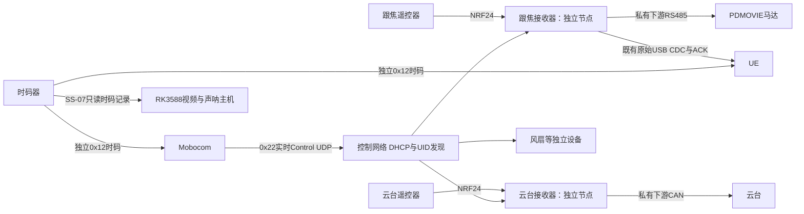

# Mobocom 实时控制整体架构

本文件说明系统分工。报文与行为以 [V2.2 网络规范](../mobocom_realtime/PROTOCOL.md)为准，SDK `2.2.0-network.1` 为实施候选。旧时间轴及Control串口承载不提供兼容路径。

SS-07完整系统及两个独立软件的详细设计见 [SS-07设计入口](ss07/README.md)。

本文件可作为 SS-07 控制子系统的设计基础，不是完整 SS-07 架构。独立 RK3588 视频、声呐和录像部分仍须在系统设计中保留；其接口、启动顺序、故障处理及录像与播放时间的关联由对应系统契约定义，本协议库不替代这些模块。

两台接收器不是同板多模式。各自 UID/地址/boot、控制会话/代次、队列、动作、看门狗、反馈和故障独立；共用公共 SDK。允许一台由 Mobocom 控制，另一台由遥控器控制。单节点故障不自动中止其他节点。

Mobocom 求值时间线并发送目标，实体控制节点不接时码、不转发时码、不缓存节目、不维护统一 T0。主机失时继续按本地单调时间播放，本场恢复授时/发生器重启不跳转，下一场用有效时码重新对齐；失时期间不承诺 UE 与 Mobocom 对齐。

公共核心负责 CRC、事务、发现/寻址、能力、独占来源、最新目标、动作、状态和安全状态机。私有适配负责单位、限速、硬件、实际停止和反馈。设备没有输入时也执行周期 tick。控制来源显式切换，安全确认后生效，清旧无线/软件队列，不自动失联回退。

实体Control UDP与既有虚拟USB CDC分入口。下游PDMOVIE仍为私有驱动。云台CAN不沿用跟焦板GPIO、UART或主控型号；硬件从对应设备工程确认。本库不实现真实NRF24、PDMOVIE、CAN、风扇PWM或操作系统socket。

连续目标最新值优先，离散动作事务去重。来源租约与每资源目标有效期分别保护；保活不维持过期目标。安全完成与机械到位分别确认，ACK 仅受理。正常结束最后目标交付后 STOP；持续保持则继续刷新。

## 编辑定位与机械安全

编辑时单次定位也要持续刷新目标：输入目标 → 持续发送并移动 → 查询有效实测位置、计算偏差 → 满足类别规定的容差和稳定时间后确认关键点。到位后的保持仍需刷新目标及来源租约；停止刷新会触发目标过期。开环设备只能确认命令关键点或经人工确认，不能显示“实测到位”。详细流程见 [AI 接入指南](../mobocom_realtime/AI_INTEGRATION_GUIDE.md)。

STOP 是请求执行设备类别规定的安全动作，等待真实安全确认并释放控制权。它不统一表示保持、制动或卸力，也不是仅停止主机发包。Pitch/Roll 等受重力作用的轴必须定义负载、姿态、制动和失电条件下的停止行为；在类别契约和硬件验证完成前不得默认卸力。目标交付驱动和 STOP 成功均不能证明已到达最后目标。

RK3588只读接收时码，用于录像和声呐记录关联；不参与电机Control，不给接收器转发时码。时码丢失或重启不停止采集，以记录质量/映射边界标记，详见 [RK时码设计](ss07/rk-timecode.md)。

## 两个播放主机的策略

Mobocom 本场失时后按本地时间续播、恢复不跳转、下一场重新对齐。UE 工程尚未在本次交付中接入或验收，其失时后继续、暂停或人工重对齐的行为仍需系统层明确；公共 HostTimeline 的存在不能视为 UE 已采用该策略。若 UE 采用不同策略，需定义它与 Mobocom 的联动及界面提示。即使两端均本地续播，失时期间也不能保证它们持续对齐。

预算参考100Mbps Ethernet/IPv4/UDP，包含网络封装，超过80%拒绝配置。没有16节点通信地址上限；典型跟焦/云台100Hz是需求，不是实际网络保证。硬件验收关注实际输出延迟、抖动、丢包/乱序/拥塞、失联安全及复位，不承诺≤1ms跨设备同步。

## 后续消费工程迁移

下表是独立消费工程的后续任务，不是本次协议库交付清单，也不自动纳入 SS-07 所称“两个软件”的交付范围。各工程的实现和验收范围需要在对应项目中确定。

| 工程 | 接入工作 |
| --- | --- |
| Mobocom | 接主机时码，使用Client/RealtimeScheduler；实现UDP、组播网卡选择、bigint UID映射及响应来源关联 |
| UE | 独立接时码，保持已有虚拟无线CDC业务；失时状态独立显示 |
| 跟焦接收器 | 保留无线/CDC；Control UDP、公共核心、来源仲裁、PDMOVIE私有适配 |
| 云台接收器 | 提供独立工程/硬件后接公共 SDK，注册云台类别和 CAN 私有适配 |
| 风扇固件 | 从节目/T0模式迁移至实时目标、类别安全回调和本地看门狗 |
| 测试网页 | 替换下载/准备/T0流程，使用实时来源、目标、动作、状态与故障测试 |

本次只交付协议库和虚拟样例，消费工程当前固定快照未升级，硬件不烧录。
