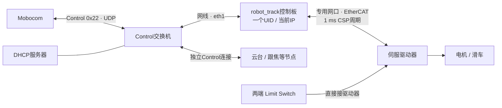

# robot_track 轨道车接入 Control 拓扑

## 范围与状态

轨道车作为一个独立 Node，与云台、跟焦等并列接入 [Control 局域网](../README.md#连接拓扑)。本说明只补充连接与客户端接入要求，不新增拓扑注册报文、不改变 Control `0x22` 或 SDK `2.2.0-network.1`，不升级消费工程固定快照，也不扩大 SS-07 两软件工程范围。

robot_track 当前工作区已有 UDP、DeviceCore 宿主和 EtherCAT 驱动适配实现，仍为实施候选。本次仅交付文档，未修改或验证 Mobocon 客户端，未部署、烧录或执行实网／机械安全验收。

类别与安全行为的权威说明在 **robot_track 仓库的 `docs/MOBOCOM_CONTRACT.md`**；部署要求在该仓库 `docs/NETWORK_CONTROL.md`。下文是接入摘要，不替代设备契约。公共帧与状态机以 [PROTOCOL](../mobocom_realtime/PROTOCOL.md) 为准。

## 连接与职责

- Control 网口接交换机，IP 由系统 DHCP 或静态配置管理。普通交换机不提供 DHCP。
- EtherCAT 使用独立专用网口连接驱动器，不接入普通 Control 交换机，不桥接两个网络。专用网口名称及主站绑定以板端实际配置为准，不假定为 eth0。
- 整套轨道车只有一个 Control UID；EtherCAT 从站、PDO、轴和电机不是额外的 Control Node。
- 不经过云台、跟焦或 RK3588 记录主机转发；轨道车不直接接时码、不下载节目、不维护 T0。
- 公共 DeviceCore 管理事务、来源、目标新鲜度和故障状态机；robot_track 的 AxisDriver 将 DriverHooks 接入本地运动控制。EtherCAT、插值、单位换算、驱动器和 Limit Switch 安全留在设备工程。

## 身份与能力摘要

| 项目 | 当前设备契约 |
| --- | --- |
| 类别 | 已登记的正式类型 `RAIL_CAR`，`0x9006`（C++ 常量为 `DeviceType::RailCar`），无需新增类型 ID |
| UID | `(0x9006 << 48) \| MAC`，MAC 来自设备配置的 `uidInterface`；更换控制板后 UID 改变 |
| 当前网络位置 | 系统管理的 IP，UDP `47821`；发现组播 `239.255.33.21`，TTL=1 |
| 类别版本 | 当前 `profile_version=4`；客户端须核对实际返回值，不凭类别号假定能力 |
| 来源 | 仅 MOBOCOM，无 REMOTE 遥控入口 |
| 位置资源 | endpoint/resource `1/1`，整数 µm；界面用 mm 时编码乘 1000、解码除 1000 |
| 只读资源 | `1/2`：Limit Switch 诊断位域；`1/3`：当前最大速度；`1/4`：当前最大加速度；`1/5`：GET_ZERO，逻辑零点距离（µm） |

UID 是身份，IP 和用户别名都不是身份。MAC 必须跨重启稳定；更换控制板不能自动继承旧 UID 的控制凭据和运动。范围、限速、限加速度与动作超时读取最新 CAPS，不把摘要表当成完整类别定义。只读资源不得加入 WRITE_TARGETS。

轨道车发布 ENABLE、DISABLE、SET_ZERO、CLEAR_ZERO、HOME、SET_RANGE、SET_VMAX、SET_AMAX 等 Action。参数、前置条件和持久化语义见设备契约；HOME 是回到逻辑零点，不是 CiA402 寻参。当前 SET_VMAX / SET_AMAX 要求驱动器失能，不因公共 SDK 具备 schema 3 就推定轨道车支持运行中调速。

`GET_ZERO` 不是额外的 Action，而是 CAPS/STATUS 中的只读资源 `1/5`；其 `feedback` 返回电子齿轮和位置映射换算后的逻辑零点距离（µm），不返回编码器原始数据。

## Mobocon 接入顺序

1. 后台发现，按 UID 建立当前 endpoint 映射；检查必需设备、重复 UID、类别和版本，再查询 INFO/CAPS/STATUS。发现不能打断其它节点的目标与保活。
2. 用户确认现场安全，必要时显式停止或处理故障；确认 SAFE/NONE、无故障且 safeConfirmed 后，显式建立会话。
3. 查询新上下文，切换至 MOBOCOM 并确认 ACTIVE 与所有权。按设备契约先配置需要的运动参数，再执行 ENABLE；长动作期间保持来源心跳。
4. 位置目标刷新频率不超过节点声明的上限（当前 100 Hz），并满足协商 TTL。定位到起始点后以有效实测反馈确认到位，再播放时间线；静态保持也须持续刷新目标，HEARTBEAT 不延长目标 TTL。
5. 正常结束使用 SDK finish 等待最终目标 applied，再 STOP 并查询真实安全状态。ACK 或 applied 都不表示机械到位；反馈无效时不能显示到位。收工释放来源遵守设备契约。
6. 换址、失联或重启后丢弃旧目标、请求和凭据，按 [换址重连流程](NETWORK_DISCOVERY.md#换址重发现与重连)只读验证与查询；运动仍挂起，用户显式安全建会话、重新接管、必要时 ENABLE 后才能提供新目标，禁止自动续播。

轨道车当前对目标过期／来源失联采用 Quick Stop 并锁存故障，不套用其它设备的自动超时恢复策略。STOP 的受控停车、故障 Quick Stop、Limit Trip 恢复及物理急停要求始终以设备契约为准。

## 多设备编排与验收

共用交换机或同一拍摄装置不合并设备身份、来源或故障状态。Mobocon 对各 UID 分别发送实时目标；“轨道车故障后整组停止”若有需要，应另行明确主控编排策略，不能假定协议或其它接收器已经联动。

相同时间线不保证机械同步。轨道车当前配置的流式设定点跟随延迟约 30 ms，另有驱动器实际响应滞后；这是设备行为，不是跨设备同步精度承诺。应先测量各节点端到端延迟和抖动，再决定主控补偿，不能仅通过放宽 TTL 掩盖卡顿。

仍需分别提供验收证据：

- **客户端**：类别识别、能力与单位解释、只读资源保护、Action 前置条件、真实反馈、故障与待接管状态；本次未修改 Mobocon 源码，未验收。
- **实网**：DHCP 启动／续租／换址、静态部署、多网卡与组播隔离、重复 UID、多设备并发与后台发现、丢包重试；视频共网时增加满载抖动验证。
- **实板**：100 Hz 长时间目标及本地输出周期、拔线后的保护、重启／重连不重播、真实停车距离、Limit Switch、物理急停与断电安全；本次未执行。

软件测试或文档交付不能替代上述验收。客户端修改与兼容状态记录在 [MOBOCON_UPDATES](MOBOCON_UPDATES.md)。
