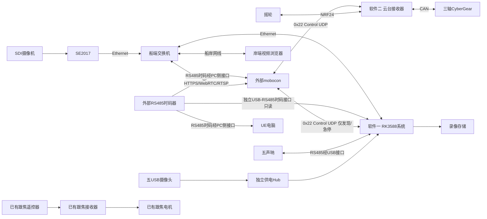

# SS-07 两软件系统设计

网络设计修订：2026年11月2日，Control更新为V2.2/0x22 UDP。本设计仍只覆盖RK3588系统和云台接收器固件，分别形成独立代码目标、配置、构建产物和验收；不表示消费工程已实现网络迁移。跟焦为既有系统；mobocon是外部PC控制端，RS485时码器接入mobocon、UE电脑和RK3588只读记录主机，云台/跟焦接收器仍不接时码器。

## 1 软件边界

| 软件 | 输入 | 职责 | 输出 |
| --- | --- | --- | --- |
| RK3588系统 | SDI经SE2017、五USB视频、五RS485声呐、只读RS485时码 | 采集、分发、录像、状态、配置和网页 | 船岸Ethernet视频/声呐/录像、完整镜像 |
| 云台接收器 | 摇轮NRF24、PC Control UDP | 三轴运动、反馈、仲裁、保护及V2.2实时目标执行 | CyberGear CAN、PC遥测、独立固件 |

两软件之间没有必须的业务控制接口；可在同一系统中同时运行，但视频服务不是电机控制依赖。跟焦作为独立既有链路继续运行；不得将旧方案中的跟焦反馈/固件扩展列为本次开发任务。

**2026年11月5日修订**：RK3588以`VIDEO_SONAR(0x9009)`加入Control 0x22 UDP网络，只用于UID发现、版本核对和安全待机语义，不承载运动、视频或配置；Mobocon按发现到的IP用既有HTTPS/WebRTC/RTSP取流，并通过RK的lan-monitor免密钥只读模式免去Bearer密钥。详见[视频声呐节点契约](video-sonar-node.md)。文中“RK不属于Control”的旧说法以此为准：RK进入Control名册，但不是运动节点，也不是云台依赖。

## 2 系统拓扑

图中不规定改造现有跟焦的PC控制接入；该部分沿用已有设计。PC视频监看与mobocon可以运行在同一电脑。RS485时码进入mobocon、UE及RK记录主机，不进入云台或跟焦接收器。RK时码接口与声呐接口分开，PC时码与Control分开。两类接口不电气混接；UE电脑不画成电机主站。

## 3 关联与独立故障

| 事件 | RK软件 | 云台软件 |
| --- | --- | --- |
| RK重启/视频断网 | 监看异常，录像按设备可用性处理 | 不改变来源和合法运动 |
| 云台接收器重启 | 六路采集继续 | SAFE，不恢复旧目标/Run |
| Control断开 | 不影响视频 | 目标停止刷新后按每资源TTL/来源租约安全停止；不继续缓存节目 |
| 时码输入失效 | 继续采集录像，记录时码失效/估计状态，不伪造有效时码 | mobocon本场按本地时钟继续且不跳转；UE策略需独立冻结，接收器不直接检测时码 |
| 录像盘故障 | 录像告警，继续可用监看 | 不影响运动 |
| CAN或电机故障 | 仍可监看 | 故障保护、反馈和安全确认 |

电源、电磁干扰或共享交换机拥塞可能影响两软件所在硬件，仍需整机满载共存验证；业务独立不表示忽略共享配电和网络。视频满载时也必须验证Control丢包、抖动及本地失联停车。

## 4 两份独立设计

[RK3588设计](rk3588-design.md)覆盖设备模式/身份、进程、状态机、配置、数据、HTTP/SSE、网页、录像、部署、供电和验收。

[云台接收器设计](gimbal-receiver-design.md)覆盖工程模块、任务/输出路径、来源世代、摇轮语义、CAN启动、三轴反馈、有限定位、公共SDK、标定、保护、固件交付与验收。

[开发与验收](implementation-plan.md)只列这两个软件的工作包。公共V2.2网络实时目标/来源/状态接入及PC时码可用性作为外部依赖管理，不承诺已经具备。

## 5 待实物冻结

RK：相机原生模式、声呐厂家协议、存储、网络线长及实际机箱电源。

云台：接收器MCU/原理图、摇轮载荷、Control输入、三轴机械范围/标定、CAN_TIMEOUT实际行为。

PC：时码器的帧格式、帧率/时间语义、三个主机的实际接入方式，以及时码失效/跳变时的处理。mobocon按时码求值并持续下发实时目标；UE开始/结束和失时策略仍需冻结。

mobocon编辑定位要求已明确：发起一次编辑定位并持续刷新目标、读取实际位置/偏差、检查正确后建立关键点。V2.2保留目标/反馈与动作接口，真实云台类别参数仍需冻结，不在云台工程私改协议。跟焦资料与历史四应用方案仅作参考，不扩大上述两软件范围。

## 6 V2.2公共基线

协议实现基线为device_protocol的feat/network-only-v22提交5568bd3。Control=0x22 UDP、SDK=2.2.0-network.1，与旧0x21/0x20不兼容；主机时码独立0x12。RK只读记录端不改变时码格式或HostTimeline播放行为。设备采用DeviceCore/LocalControlInput，mobocon采用Client/RealtimeScheduler/HostTimeline；设备不授时、不下载/缓存节目、不使用T0或旧兼容执行路径。

编辑“单次定位”由PC后台持续刷新目标，不是一帧命令。现有WRITE_TARGETS/STATUS支持目标/反馈，HEARTBEAT不延长目标年龄；反馈采样时间、到位容差/稳定时间与标定元数据由真实类别/应用约定，不能假称全部已有字段。SAFE/SWITCHING/ACTIVE/STOPPING/FAULT和NONE/REMOTE/MOBOCOM由公共核心统一维护，不再增加PC_POSITIONING/PC_TIMELINE公共来源。

候选协议已有软件实现，尚未在SS-07消费工程安装、编译或硬件验收；当前契约见[V2.2网络接入](mobocom-integration.md)，协议库软件结果见[REPORT](../../mobocom_realtime/REPORT.md)。

RK新增时码接收/映射服务及录像、声呐关联元数据。UTC、时码、本机单调时间分开保存；接收关联不等于六相机曝光同步，详细设计见 [RK时码接入](rk-timecode.md)。
