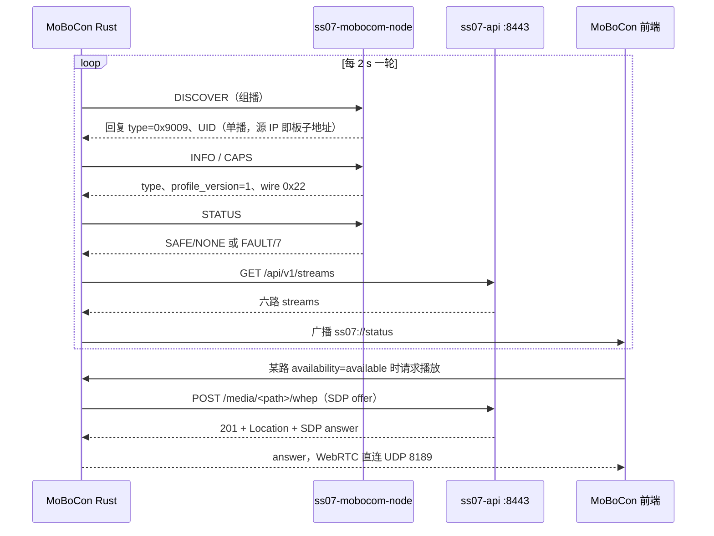

# SS-07 与 MoBoCon 全链路连接与运行

修订：2026-11-06。本文说明 SS-07（RK3588 视频声呐节点）与 MoBoCon 实际怎样连接、启动、取流、急停和排障。字段与报文的约束以[视频声呐节点契约](video-sonar-node.md)和[公共 V2.2 网络接入](mobocom-integration.md)为准；本文写的是运行时的完整链路和实测结论。

**实测基线**：RK 固件 0.10.10（节点 fw `0x000a000a`），MoBoCon `ee628ba`，MoBoCon 内置协议库快照 `0c8e2fd`，SDK `2.2.0-network.1`。板子 `192.168.3.233`，控制主机 `192.168.3.20`。

**已验证**：组播发现与 INFO/CAPS/STATUS 核对；`/api/v1/streams` 免密钥读取；五路视频经 WHEP 在 MoBoCon 出画（约 25 fps）；sdi 无输入时返回 `no_signal` 并停止给出拉流地址；`/api/v1/media/sessions` 会话计数；单播 ESTOP 锁存 FAULT 和 RESET_FAULT 恢复；窗口关闭后会话回收。

**未验证**：接上 SDI 摄像机后 sdi 恢复为 `available`；DHCP 换址后的自动重建；同一网段多台 SS-07；满载（48 个会话）时的时延与丢帧。

## 1 组成与职责

| 组件 | 位置 | 职责 |
| --- | --- | --- |
| `ss07-mobocom-node` | RK3588 | V2.2 网络节点，类型 `VIDEO_SONAR=0x9009`，只响应 DISCOVER/INFO/CAPS/STATUS、STOP/ESTOP、RESET_FAULT；没有运动能力 |
| `ss07-api` | RK3588，HTTPS 8443 | `/api/v1/status`、`/api/v1/streams`、`/api/v1/media/sessions`，以及 `/media/<path>/whep` 信令代理 |
| `ss07-media` + MediaMTX | RK3588 | 采集、发布、轨道信息、实测帧率；每 3 s 查询一次 SE2017 的输入状态 |
| SE2017 编码器 | 现场网络 | SDI 输入转 1080p60 H.264，供 sdi 路使用；无输入时仍会输出全黑码流 |
| MoBoCon Rust 端 | 控制主机 | 发现与核对、轮询 streams、WHEP 信令代理（接受自签证书）、按窗口回收会话、广播 `ss07://status` |
| MoBoCon 前端 | 控制主机 | 监视器与画中画显示，只按 `availability` 决定是否拉流 |

SS-07 不转发其它设备的控制，也不参与时间轴播放。轨道车、云台、跟焦等节点与它平级，各自直接接入 Control 网络。

## 2 网络与端口

| 用途 | 地址或端口 | 说明 |
| --- | --- | --- |
| 发现与控制 | UDP 组播 `239.255.33.21:47821`，TTL=1 | 只在同一二层网段内有效；节点回复的源 IP 就是后续所有 HTTP 和媒体访问用的 IP |
| API 与 WHEP 信令 | HTTPS `8443` | 自签证书；浏览器页面不直接访问，统一经 Rust 代理 |
| WebRTC 媒体 | UDP `8189` | ICE 候选只取板子在 Control 网卡上的地址 |
| RTSP | `8555` | `rtsp://<ip>:8555/<path>`，供外部播放器使用 |
| RTSPS（原生） | `8322` | `native_url` 字段给出的地址 |

免密钥访问依赖 RK 端 `lan-monitor` 模式：来源 IP 必须落在 `allow_cidrs` 白名单内。板子看到的是**来源地址**，开发机经 NAT 访问时，白名单要写 NAT 出口地址；会话计数也按这个地址归属，同一 NAT 后面的多台机器会共享一个 12 会话额度。

多网卡主机由用户选定控制网卡，组播出站路由必须走这张网卡，否则会出现收不到回复的情况。

## 3 启动时序



判定规则如下。

连续 2 轮没有回复即判离线，前端停止该设备的全部画面。

INFO/CAPS 中 wire 版本字节必须是 `0x22`（十进制 34，不是 22），type 必须是 `0x9009`，profile_version 必须是 1。任何一项不符都标记为不兼容，不取流。

`/api/v1/streams` 返回 401 或 403，说明来源 IP 不在白名单或 lan-monitor 未开启。这是配置问题，界面要明确提示，不要重试刷屏。

设备以 `ip|boot` 为键。IP 或 boot 计数变化即视为新实例：丢弃旧的全部 WHEP 会话，重新核对后再建。

## 4 streams 字段

响应外层为 `{request_id, data}`，`data` 含 `schema_version`、`device_id`、`boot_id`、`service_instance_id`、`seq`、`observed_at_utc` 和 `streams` 数组，每项以 `channel_id` 标识。

`availability` 是**唯一的拉流判据**，取值 `available`、`no_signal` 等。只有 `available` 才拉流；其它取值显示状态文字，并停止已有播放。缺少该字段的旧固件按 `available` 处理。

| 字段 | 含义 |
| --- | --- |
| `capture_state` / `publish_state` | 采集与发布状态，例如 `NO_SIGNAL`；用于显示，不作为拉流判据 |
| `format` / `width` / `height` | 来自 MediaMTX 轨道信息，例如 front 为 H264 1280×720，sdi 为 H264 1920×1080 |
| `fps_observed` | RK 板内拉流按帧计数的实测值，不读编码器配置；视频路约 25，sdi 约 60 |
| `bitrate_observed` | 实测码率，单位 bit/s；sdi 无输入的黑场约 0.3 Mbit/s |
| `last_frame_age_ms` / `restart_count` | 最近一帧距今时间、采集重启次数；未提供时为 null |
| `live_url` | WHEP 路径，例如 `/media/front/whep`；不可用时为 null |
| `rtsp_url` / `native_url` | RTSP 8555 与 RTSPS 8322 地址；不可用时为 null |
| `error` | 机器可读原因，例如 `sdi_no_signal` |
| `media_activity_age_ms` / `timestamp_basis` | 最近一次收到媒体的时间和时间基准 |

sdi 路另有三个字段：`input_signal`（`present`、`no_signal`、`unknown`）、`input_info`（编码器原文，例如 `SDI NoSignal N/A`）、`input_error`。

SE2017 无输入时仍发送全黑 1080p60 码流，所以码流到达不能说明有画面。RK 每 3 s 查询一次编码器输入状态：无信号时 sdi 返回 `availability=no_signal`、`capture_state=NO_SIGNAL`、`error=sdi_no_signal`，不给出任何拉流地址，`/api/v1/status` 的 `alerts` 中出现 `SDI_NO_SIGNAL`。读不到编码器状态时（账号文件缺失、密码错误、编码器离线）`input_signal=unknown`，此时退回按码流是否到达判断。

## 5 WHEP 会话生命周期

配额：每个来源地址 12 个会话，全板合计 48 个。超出时 WHEP POST 会被拒绝。

建会话时，MoBoCon 的 ICE 收集最长等待 1.5 s，之后直接发送已有候选；失败后 3 s 重试，不要紧密循环。

结束时 DELETE `Location`。返回 404 表示板端已回收，视为成功。

窗口或进程被直接关闭时，前端来不及发 DELETE。MoBoCon Rust 端在窗口 Destroyed 事件里按窗口回收该窗口名下的全部会话；如果没有这一步，板端要约 20 s 超时后才回收，期间仍占配额。

多窗口规则：每个窗口（主窗口、各画中画）独立建会话、独立回收，事件只发给本窗口，不能广播，否则会出现画面互串。同一路在两个窗口同时显示，就是两个会话。

核对会话用 `GET /api/v1/media/sessions`，免密钥来源可直接调用。返回本来源自己的 `sessions[{channel_id, location}]`、`count`、全板 `total`，以及 `limit_per_client=12`、`limit_total=48`。其它来源的会话只计入 `total`，不列出地址。

## 6 急停与复位

SS-07 只接受这些命令：DISCOVER、INFO、CAPS、STATUS、STOP、ESTOP、RESET_FAULT。不得发送会话、来源、目标、保活、配置或任何运动命令。

ESTOP 带 guard，可单播也可全局。收到后节点锁存 `FAULT`，fault 码为 7（ESTOP）。解除急停时 MoBoCon 要对它单独发 RESET_FAULT，节点回到 `SAFE/NONE`。

Control 状态不影响媒体：FAULT 期间画面照常，streams 与 WHEP 不受影响。现场测试只用单播 ESTOP，避免误停其它设备。

## 7 RK 端配置文件

| 文件 | 内容 |
| --- | --- |
| `lan-monitor.json` | 免密钥只读模式开关与 `allow_cidrs` 白名单，默认关闭 |
| `/var/lib/ss07/mobocom-node.json` | 节点 UID 等持久状态；升级不得重写，否则 MoBoCon 视为新设备 |
| `/etc/ss07-credentials/sdi-encoder.json` | SE2017 网页账号，属主 root，权限 0640；权限不对时服务拒绝读取，sdi 退为 `unknown` |

每次安装前，安装脚本把旧版本备份到 `/var/backups/ss07-pre-<版本>-<时间戳>`，例如 0.10.10 的备份是 `/var/backups/ss07-pre-0.10.10-20261106131044`。

## 8 故障定位

| 现象 | 先查 | 常见原因 |
| --- | --- | --- |
| 设备列表里没有 SS-07 | 组播回复 | 控制网卡选错、组播路由未走控制网卡、不在同一网段、`ss07-mobocom-node` 未运行 |
| 显示不兼容 | INFO/CAPS | wire 版本字节按十进制 22 比较、固件过旧 |
| streams 401/403 | `allow_cidrs` | 来源 IP 不在白名单；经 NAT 时写成了内网地址 |
| 某路黑屏但 `available` | `fps_observed`、`media_activity_age_ms` | 源端无画面；sdi 读不到编码器状态时（`unknown`）会出现这种情况 |
| sdi 显示无信号 | `input_info` | SDI 摄像机未接或未输出 |
| 新开窗口拉不到流 | `/api/v1/media/sessions` | 本来源 12 个会话已满；旧窗口未回收，约 20 s 后自动释放 |
| 画中画互串 | 事件 target | 窗口事件广播给所有窗口 |

只读检查命令（不改变板端任何状态）：

```bash
curl -k https://192.168.3.233:8443/api/v1/status
curl -k https://192.168.3.233:8443/api/v1/streams
curl -k https://192.168.3.233:8443/api/v1/media/sessions
```

## 9 新客户端接入清单

1. 在控制网卡上加入组播 `239.255.33.21:47821`，每 2 s 发一次 DISCOVER，收集 `type=0x9009` 的回复，以 UID 为键记录源 IP。
2. 发 INFO、CAPS、STATUS，核对 type、profile_version=1、wire `0x22`；不符就不取流。
3. 确认本机来源地址（经 NAT 时是出口地址）已在 RK 的 `allow_cidrs` 中，然后轮询 `/api/v1/streams`。
4. 只对 `availability=available` 的路建 WHEP 会话；信令放在能接受自签证书的后端，不放在网页里。
5. 停止播放、关闭窗口、退出进程时都要 DELETE 会话；以 `ip|boot` 为键，变化时全部重建；用 `/api/v1/media/sessions` 核对没有泄漏。
6. 急停联动时对 SS-07 发 ESTOP，解除时补发 RESET_FAULT；不对它发任何其它控制命令。
