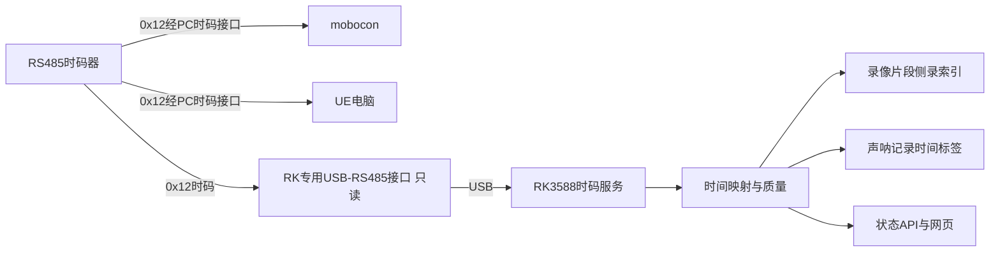

# SS-07 RK3588只读时码与记录关联

RK3588增加外部RS485时码输入，与mobocon、UE共享同一时码来源，用于查找录像/声呐记录对应的外部时刻。它是记录主机，不是DeviceCore控制接收器，不参与电机Control，不向云台或跟焦转发时码。Control当前独立采用0x22 UDP；本设计不修改0x12时码或HostTimeline行为，尚未实现应用。

## 1 连接与用途

RK时码接口与声呐USB-RS485、mobocon Control适配器独立，使用稳定序列号/物理路径绑定，禁止按ttyUSB枚举顺序混用。时码接口不发送请求/ACK/轮询；独立时码服务唯一持有该串口，其他模块读其快照与映射事件。

图中的三条逻辑输出不意味着允许长星形分支。按发生器的端口能力选择隔离分配输出，或符合线长/短支线和终端要求的单发送者多接收主干；检查参考地、隔离、偏置和新增RK输入负载。UART/GPIO直连RS485不成立，需要实际收发器。若选板载UART替代USB，另核验引脚与电气，不猜默认配置。

## 2 记录服务与时间映射

ss07-timecode复用公共0x12解码/校验规则，取得epoch、seq、source_time_us及本机origin/observed时间，检查坏帧、重复/旧帧、回绕和时间步进。校准不足时只记录可证明的接收时刻，不能将USB到包时间称为SOF。波特率/接线/采样延迟按实际发生器与适配器冻结。

保留三种时间：原有UTC用于日历显示；RK本机单调时间用于超时和事件顺序；外部epoch/time_us用于关联。时码不是UTC，不用它直接设置Linux系统时钟，不改原视频PTS/DTS。

每个映射段标识RK boot_id、时码epoch、mapping_id、有效区间、锚点、校准依据和误差估计。视频/声呐事件按其发生的本机接收时间查对应映射段，不直接读取“最新时码”标记已在队列里的旧事件。服务重启、本地时钟异常、源epoch变化或失时恢复均建立边界；旧事件/索引不按新epoch重新解释。

## 3 本地元数据草案

以下属于RK记录/API schema，不加入公共Control STATUS或时码线帧；u64在JSON中为十进制字符串。

| 字段 | 语义 |
| --- | --- |
| rk_boot_id、mapping_id | RK本机及映射段身份 |
| source_epoch、source_sequence、source_time_us | 有效源样本；无有效依据时允许null |
| local_monotonic_us、observed_at_utc | 本机事件时间及UTC记录 |
| timestamp_basis | 如media_receive、sonar_receive、segment_start；不暗示曝光/测量时间 |
| quality | VALID、ESTIMATED、UNAVAILABLE，另给reason |
| source_age_ms、uncertainty_us | 最近有效样本年龄及已知误差；误差未知用null |
| estimated_time_us | 可选本地外推值，单独字段；不冒充有效源时码 |

首版以录像片段与记录接收时刻关联：保存recording_id、通道、媒体时间区间和本机映射锚点，另保存声呐sample_id/seq及其TimeTag。侧录索引/有界映射日志放在状态/数据目录，不假设MediaMTX原生写入自定义时码。目录、保留策略和索引导出随录像管理统一；记录元数据失败要告警，不能声称录像已有可查时码。

逐帧定位若需要，先在实际采集/发布和录像写入路径证明AU/PTS与映射对应，记录其时间来源和延迟，不能靠事后片段文件创建时间推导。SDI编码器、USB缓冲、网络抖动和声呐内部测量延迟分别纳入预算；这不是曝光同步或声呐发射同步。原生H.264直通无需因时码接入而重新编码。

## 4 失时、恢复与界面

首次未收到有效源样本时UNAVAILABLE，视频/声呐/录像仍正常工作。按公共时码年龄规则失去有效映射时清有效标志；源值不继续伪造，若按最后锚点外推则单独标ESTIMATED并记录外推起点。不得让估计值显示成有效授时，也不承诺失时期间与mobocon/UE对齐。

恢复有效时码或换epoch后新建映射段，不改历史媒体PTS，不回填过去时码，也不要求停止录像。记录恢复前后缺口/跳变和序号，回放按epoch+time查询，禁止跨epoch只按数值time_us匹配。

RK没有mobocon“本场/下一场”的播放业务，因此不直接套用HostTimeline本场fallback保持逻辑；RK自己的映射恢复与mobocon本场继续本地时间可能不同步，两端状态须可查。网页显示源状态、epoch、年龄和记录质量，不宣称硬件曝光已锁定。API GET /api/v1/timecode提供状态，SSE发布质量/epoch变化，不以100Hz刷新整个网页。

## 5 部署与验收

时码服务独立启动/退避重连；缺接口、服务崩溃、坏帧或输出侧录日志拥塞不阻塞媒体/声呐和运动链路。事件与日志有界，慢写入产生可见缺口，不无限积压。应用更新保留历史epoch/索引，串口重连不把声呐接口当时码口。

验收覆盖三主机合法接线与RK零发送、原格式解码、USB枚举变化、正常锚点/误差、首次无时码、重复/坏帧不延长年龄、失时持续录像、源重启/恢复epoch隔离、服务重启/队列旧样本、不改PTS、索引可回查以及满载吞吐。逐帧或跨主机精度只有测量后才能声明。云台/跟焦依然没有TimeCode输入或设备授时路径。
