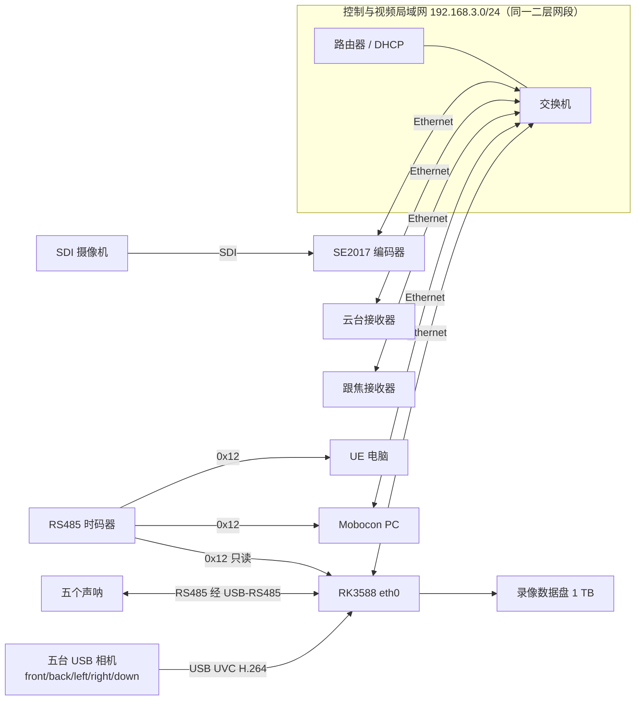
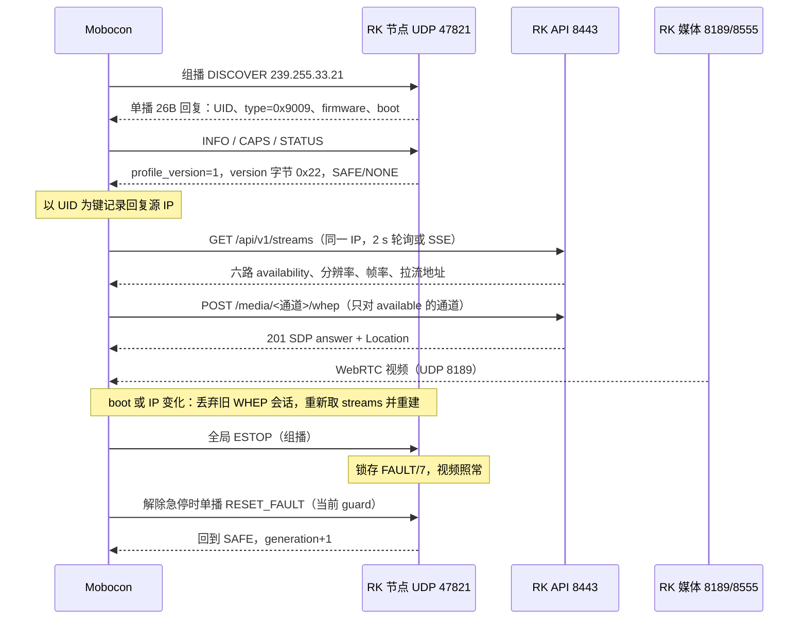

# SS-07 系统连接与运行

修订：2026年11月6日，对应 RK3588 应用 0.10.10（`camerakang/device_rockchip` 分支 `SS-07-水上控制系统`，提交 `c665233`）。本文把 SS-07 用到的全部链路、协议、端口和启动顺序放在一处，读完即可知道整套系统怎样连、怎样跑、哪些已经在实物上跑通。Mobocon 客户端怎样发现、取流、回收会话和排障，见 [SS-07 与 MoBoCon 全链路运行](mobocon-runtime.md)；各链路的详细契约仍以表中链接的专题文档为准；本文与专题文档冲突时，以专题文档和公共 [PROTOCOL](../../mobocom_realtime/PROTOCOL.md) 为准，并回来修正本文。

## 1 系统组成

| 组成 | 角色 | 本库中的契约 |
| --- | --- | --- |
| Mobocon（PC） | 主控：发现设备、时间线求值、下发云台/跟焦实时目标；显示六路视频与声呐状态 | [PROTOCOL](../../mobocom_realtime/PROTOCOL.md)、[客户端更新记录](../MOBOCON_UPDATES.md) |
| RK3588 视频声呐系统（LubanCat-4） | 六路视频采集分发、五路声呐、录像、状态配置、只读时码记录；Control 中为 `VIDEO_SONAR(0x9009)`，没有运动能力 | [视频声呐节点](video-sonar-node.md)、[RK3588设计](rk3588-design.md) |
| SE2017 编码器 | 把 SDI 摄像机编码为 H.264 RTSP，供 RK 拉取 | 本文第 3 节 |
| 云台接收器 | 三轴实时目标执行，Control 运动节点 | [云台接收器设计](gimbal-receiver-design.md) |
| 跟焦接收器 | 既有系统，Control 运动节点 | [跟焦切源接入](../MOBOCON_FOCUS_CONTROL.md) |
| RS485 时码器 | 发 0x12 时码给 Mobocon、UE 和 RK | [timecode](../../timecode/README.md)、[RK只读时码](rk-timecode.md) |
| UE 电脑 | 接收时码，不是电机主站 | [主机时码与播放](timecode-integration.md) |

RK 不转发任何运动命令，也不在云台、跟焦的控制路径上。RK 重启或断网只影响监看、录像和声呐显示；云台与跟焦按各自的目标有效期和租约运行。

## 2 物理连接

| 链路 | 当前现场 | 状态 |
| --- | --- | --- |
| RK 网口 | eth0，DHCP 得到 192.168.3.233/24 | 已运行 |
| SE2017 | 192.168.3.47，SDI IN 接 SDI 摄像机 | 编码器在线；SDI 摄像机未接，编码器报告无信号 |
| USB 相机 | 五台分到三个 USB 控制器，“2＋2＋1”：`fc880000` 接 front、down；Type-C Hub（`xhci-hcd.9`）接 left、right；蓝色 USB 3.0 口（`fc800000`）接 back。按 `/dev/v4l/by-path` 物理路径绑定 | 已运行。五台挤在同一控制器时 STREAMON 报 ENOSPC，不能全部接同一 Hub |
| 声呐 | 五路 RS485，经 USB-RS485 | 型号、厂家协议、地址、串口参数未提供，未接入 |
| 时码 | 独立 USB-RS485，500000 baud，只读 | 服务已运行；串口绑定、数据位、校验、停止位未确认，未接实物 |
| 录像盘 | 1 TB | 未连接；缺盘时监看照常，录像不落系统盘 |

组播 TTL=1，Mobocon、RK 和各接收器必须在同一二层网段。交换机开启 IGMP snooping 却没有查询器时会丢组播，需要开查询器或关闭 snooping。时码线和声呐线是两套独立 USB-RS485，不能共用；时码接线方式见 [RK只读时码](rk-timecode.md) 第 1 节。

## 3 链路、协议与端口

| 链路 | 协议 | 地址与端口 | 方向 | 契约 |
| --- | --- | --- | --- | --- |
| 设备发现、身份、急停 | Control 0x22 UDP | 组播 239.255.33.21:47821，单播 `<ip>:47821`，TTL=1 | Mobocon ↔ RK 节点、云台、跟焦 | [PROTOCOL](../../mobocom_realtime/PROTOCOL.md)、[视频声呐节点](video-sonar-node.md) |
| 时码 | 0x12，26 字节帧，每 10 ms | RS485，RK 侧 500000 baud | 时码器 → Mobocon、UE、RK | [timecode](../../timecode/README.md) |
| 状态与配置 | HTTPS JSON，自签证书 | `https://<ip>:8443/api/v1/...` | Mobocon → RK | 第 5 节 |
| 实时视频 | WebRTC WHEP | 信令 `https://<ip>:8443/media/<通道>/whep`；媒体 UDP 8189 | RK → Mobocon、浏览器 | 第 5 节 |
| 视频转发 | RTSP over TCP | `rtsp://<ip>:8555/<通道>` | RK → 外部程序 | 第 5 节 |
| 视频转发（TLS） | RTSPS | `rtsps://<ip>:8322/<通道>` | RK → 外部程序 | 第 5 节 |
| SDI 视频输入 | RTSP | `rtsp://192.168.3.47:5554/live/av` | RK 拉取 SE2017 | RK 工程配置 `sdi.rtsp_url` |
| SDI 输入状态 | SE2017 网页接口 | `PUT /cgi-bin/entry.cgi/system/login`，`GET /cgi-bin/entry.cgi/system/device-status`，每 3 秒 | RK 只读 SE2017 | 第 6 节 |
| USB 视频输入 | UVC，相机内 H.264 直通 | `/dev/v4l/by-path/...` | 相机 → RK | RK 工程配置 `cameras` |
| 声呐 | 厂家 RS485 协议 | 待确认 | RK ↔ 声呐 | 待厂家资料 |

通道名固定为 `front`、`back`、`left`、`right`、`down`、`sdi`。RK 内部端口只监听本机：MediaMTX RTSP 127.0.0.1:8554、MediaMTX 管理 127.0.0.1:9997、RK API 127.0.0.1:8077，外部只能经 8443、8189、8555、8322 和 47821 访问。

媒体服务器为 MediaMTX v1.21.2：五路 USB 和 SDI 都先进入内部 MediaMTX，再由它分发给 WebRTC、录像和外部 RTSP relay。整条链路只转发，不解码也不重新编码。

## 4 启动与运行顺序

RK 上电后由 systemd 拉起 `ss07.target`，各服务互不阻塞：

| 服务 | 作用 | 依赖与故障影响 |
| --- | --- | --- |
| `ss07-config-recover` | 启动前恢复已确认的配置 | 一次性，先于其他服务 |
| `ss07-media` | MediaMTX、SDI 拉流、SE2017 状态读取、外部 RTSP relay | 重启时六路分发短暂中断，采集端自动重连 |
| `ss07-camera@<通道>` ×5 | 打开相机、设置模式、把 H.264 发布到内部 MediaMTX | 单通道失败只影响该通道，按 1/2/5/10/30 秒退避 |
| `ss07-sonar` | 声呐轮询和历史 | 未配置时报告 `sonar_not_configured`，不阻塞视频 |
| `ss07-timecode` | 只读时码接收与录像关联 | 未配置或失时只标记质量，不阻塞录像 |
| `ss07-storage` | 录像与目录索引 | 缺盘时告警 `RECORDING_MOUNT_MISSING` |
| `ss07-api`、`ss07-gateway` | 状态与配置 API、HTTPS 网关与网页 | 重启不停止采集和录像 |
| `ss07-maintenance`、`ss07-application` | 配置应用、回滚、录像锁定 | 只处理维护请求 |
| `ss07-mobocom-node` | Control 0x22 节点（Rust，DeviceCore） | 与媒体服务没有 `Requires=` 关系，两者重启互不影响 |

Mobocon 接入 RK 的完整流程：

Mobocon 对 VIDEO_SONAR 只发 DISCOVER、INFO、CAPS、STATUS、全局 STOP/ESTOP 和急停后的 RESET_FAULT，不发 SESSION_OPEN、SET_SOURCE、WRITE_TARGETS、HEARTBEAT、WRITE_CONFIG。Control 状态只表示协议层；视频是否可看只看 HTTP 的 `availability`。

## 5 RK 对外接口

免密钥模式（lan-monitor）开启后，`allow_cidrs` 内的来源不带 `Authorization` 和 Cookie 即可访问下表“免密钥”列为“是”的接口；其他来源和其他接口需要 `Authorization: Bearer <API 客户端密钥>`。现场配置 `allow_cidrs=["192.168.3.0/24"]`。

| 接口 | 免密钥 | 内容 |
| --- | --- | --- |
| `GET /api/v1/status` | 是 | 全部状态：相机、声呐、时码、存储、告警（如 `SDI_NO_SIGNAL`、`RECORDING_MOUNT_MISSING`） |
| `GET /api/v1/streams` | 是 | 六路状态与拉流地址 |
| `GET /api/v1/sonars`、`/api/v1/timecode` | 是 | 声呐读数、时码质量 |
| `GET /api/v1/events` | 是 | SSE，`event: status`，约 1 Hz |
| `GET /api/v1/media/sessions` | 是 | 调用者自己的 WHEP 会话、`count`、`limit_per_client=12`、`total`、`limit_total=48` |
| `POST /media/<通道>/whep`，`DELETE <Location>` | 是 | WebRTC 会话；只能删除自己（同一来源 IP 或同一密钥）建立的会话 |
| `rtsp://<ip>:8555/<通道>`、`rtsps://<ip>:8322/<通道>` | 是（只读） | 仅 TCP，每路最多 4 个外部读者；publish 一律拒绝 |
| 录像、时码/声呐历史 | 否，reader | 免密钥请求返回 403 `LAN_MONITOR_FORBIDDEN` |
| `GET/PUT /api/v1/config`、`/config/plan`、`/apply`、`/recover`、`/logs` | 否，maintainer | 同上 |

响应统一为 `{"data": ...}`，错误为 `{"error":{"code","message","details"}}`。常见错误：401 未授权，403 权限不足或 `LAN_MONITOR_FORBIDDEN`，404 关闭别人的会话，409 配置 revision 冲突，422 请求体不合法，503 `MEDIA_SESSION_LIMIT` 或服务不可用。API 不返回 CORS 头，Mobocon 应在本地后端发 WHEP 和 API 请求。

`/api/v1/streams` 的字段、`availability` 取值和 WHEP 会话生命周期见 [全链路运行](mobocon-runtime.md) 第 4、5 节。拉流判据只有 `availability`：`available` 才建立 WHEP，`no_signal` 显示“无信号”，`unavailable` 显示离线。JSON 中所有 u64（UID、boot 等）为十进制字符串，不要转为 JavaScript number。

## 6 状态语义与故障隔离

| 事件 | RK 表现 | 对其他设备 |
| --- | --- | --- |
| SDI 摄像机未接或无信号 | SE2017 仍输出全黑 1920×1080 码流；RK 读编码器状态后报 `sdi` 为 `no_signal`，告警 `SDI_NO_SIGNAL`，不给拉流地址 | 无 |
| 读不到 SE2017 状态 | `input_signal=unknown`，按码流是否到达判断 `available` | 无 |
| 单台 USB 相机掉线 | 该通道 `unavailable`，自动退避重连；其他通道不受影响 | 无 |
| 声呐未接或离线 | `valid=false`，`reason` 如 `sonar_not_configured`；不进入 Control 故障码 | 无 |
| 时码缺失或失时 | `quality` 为 `UNAVAILABLE` 或 `ESTIMATED`，录像继续，不伪造有效时码 | 无 |
| 全局 STOP | 节点保持 SAFE/NONE | 各运动节点按协议停止 |
| 全局 ESTOP | 节点锁存 FAULT/7，视频、录像、声呐照常 | 各运动节点急停 |
| RK 重启或断网 | 监看中断；恢复后 boot 变化，Mobocon 重建拉流 | 云台、跟焦不受影响 |
| Mobocon 断开 | 视频服务不受影响 | 运动节点按目标有效期和租约安全停止 |

## 7 实现与验收状态

| 项目 | 状态 | 证据 |
| --- | --- | --- |
| RK 节点 `ss07-mobocom-node` | 0.10.9 起实现并部署；UID `8455818509601193611`（`0x75591a2235f3be8b`），0.10.10 firmware `0x000a000a` | 黄金向量 5/5 逐字节一致；板上组播 DISCOVER 0.2–0.9 ms；INFO/CAPS/STATUS、STOP、ESTOP、RESET_FAULT、异常帧 11/11 |
| lan-monitor 免密钥 | 0.10.9 实现并在现场启用 | 白名单 200、非白名单 401、受保护接口 403、删除配置回到 401 |
| 五路 USB | H.264 1280×720@25，“2＋2＋1” | 五路约 25 fps，WebRTC/RTSP 可解码 |
| SDI 状态 | 0.10.10 实现 | 无信号时正确报 `no_signal`，1920×1080、约 60 fps |
| 会话查询接口 | 0.10.10 实现 | 现场返回本来源会话与总数 |
| 未验证 | DHCP 实际换址、同一网段多台 SS-07、六路满载下 DISCOVER 成功率、端到端延迟、整版回滚、RTSPS 完整拉流、接 SDI 摄像机后回到 `available` | 需现场电脑和设备 |
| Mobocon 接入 | `ee628ba` 已接入发现、免密钥取流、五路出画、无信号判断、会话回收、单播急停复位 | 见 [全链路运行](mobocon-runtime.md) |
| 未接入 | 声呐厂家协议、录像数据盘、时码实物与串口参数 | 等待资料或实物 |

RK 端实现细节、部署和回滚步骤维护在 RK 工程 `apps/ss07-water-control/docs/`（`mobocon-development.md`、`mobocon-video-api.md`、`mobocon-network-node.md`、`mobocon-test-plan.md`）。RK 工程通过 `lib/mobocom_protocol` 固定快照使用本库，快照更新须用 `tools/package_sdk.py` 重新安装并校验摘要，不能直接改 vendor 文件。
