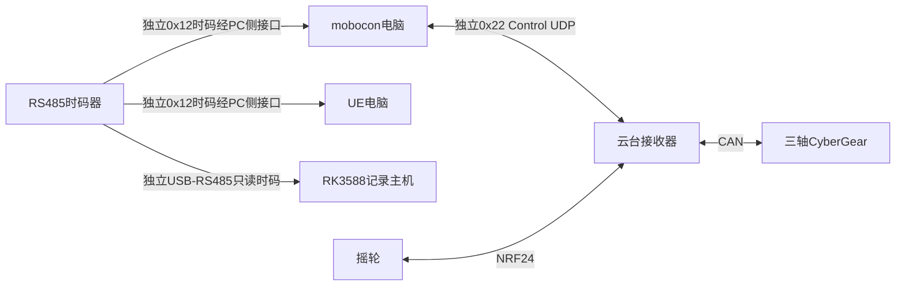

# SS-07主机时码与实时播放

时码接mobocon、UE电脑与RK3588只读记录主机。云台/跟焦实体控制接收器不接时码器，也不通过Control接收转发时码。公共V2.2由mobocon求值时间线、设备经UDP执行实时目标，不保留本地缓存节目或旧串口Control兼容路径；独立0x12时码承载不随Control迁移修改。

## 1 连接与帧

时码和Control为不同链路；PC时码适配器与Control适配器分开。三个时码接收端是否共享合法短支线主干或使用隔离分配输出，按时码器规格、线长与终端配置确认；不画未经核验的长星形分支。RK时码适配器与声呐适配器独立且只读，不发轮询/ACK。UE不新增电机Control主站。

已核验公共timecode/README.md：时码D5 7C，version=0x12，26字节，每10000µs一帧，多字节小端，CRC16 CCITT-FALSE覆盖[2,24)。字段为flags=0、非零epoch:u64、sequence:u32、time_us:u64；不是UTC，time_us对应发送SOF起始位。实际时码器需验证符合该格式，不能只看RS485接口。

PC适配器提供对应SOF的本地origin_us及解析observed_us；普通USB到包时间不自动等于SOF，无法校准时只报告估计，不承诺跨电脑同步精度。重复/旧/错误帧不刷新有效性；同epoch前向序号差及时间间隔按规范检验，处理延迟≥30ms的样本不用于有效映射。

## 2 已确定的mobocon播放策略

HostTimeline每次start以最新有效时码建立本场锚点，之后按本地单调时钟连续推进。30ms无有效帧标fallback，本场继续、不跳转；恢复时码或换epoch只更新下一场锚点，本场fallback保持到结束。下一场自动start须有效时码；尚无有效时码时手动实时控制仍可用。

业务按当前场时间求值完整目标快照，RealtimeScheduler经独立Control发给节点；设备没有节目/统一T0，只执行目标和看门狗。主机时码fallback时仍正常刷新目标，不等于Control断线：Control目标停止后设备按TTL/租约安全停机。

## 3 RK记录、UE与同步边界

RK用独立只读服务解码同一0x12帧，记录时码epoch/值/质量与本机接收时间的映射。它没有mobocon的场次播放，不直接套用HostTimeline本场fallback逻辑；失时继续录像，实际时码无效，外推值独立标为估计。恢复/换epoch建立新的映射段，不改历史记录或媒体PTS。详见 [RK时码设计](rk-timecode.md)。

公共库明确UE工程尚未接入/验收，需冻结UE的开始/结束、失时继续或暂停、恢复及下一场对齐策略。相同源和各自本地续播不保证失时期间同步；UE采用不同策略时需定义应用联动。两端显示失时状态，不声称原V1.2跨设备1ms保证。

## 4 图示和验收

图中有时码器→mobocon、时码器→UE、时码器→RK独立只读接口三条逻辑时码线，云台无TimeCode端口或同步模块。云台执行实时目标接收与驱动刷新，Control标0x22 UDP，时码标0x12。

验收包括真实格式/三主机接线、SOF估计误差、时码丢失/重启/跳变本场不跳转、下一场对齐、PC时码fallback下目标继续刷新、Control断线下节点停止，以及UE策略、RK时码丢失/恢复映射边界与记录关联的独立验证。
