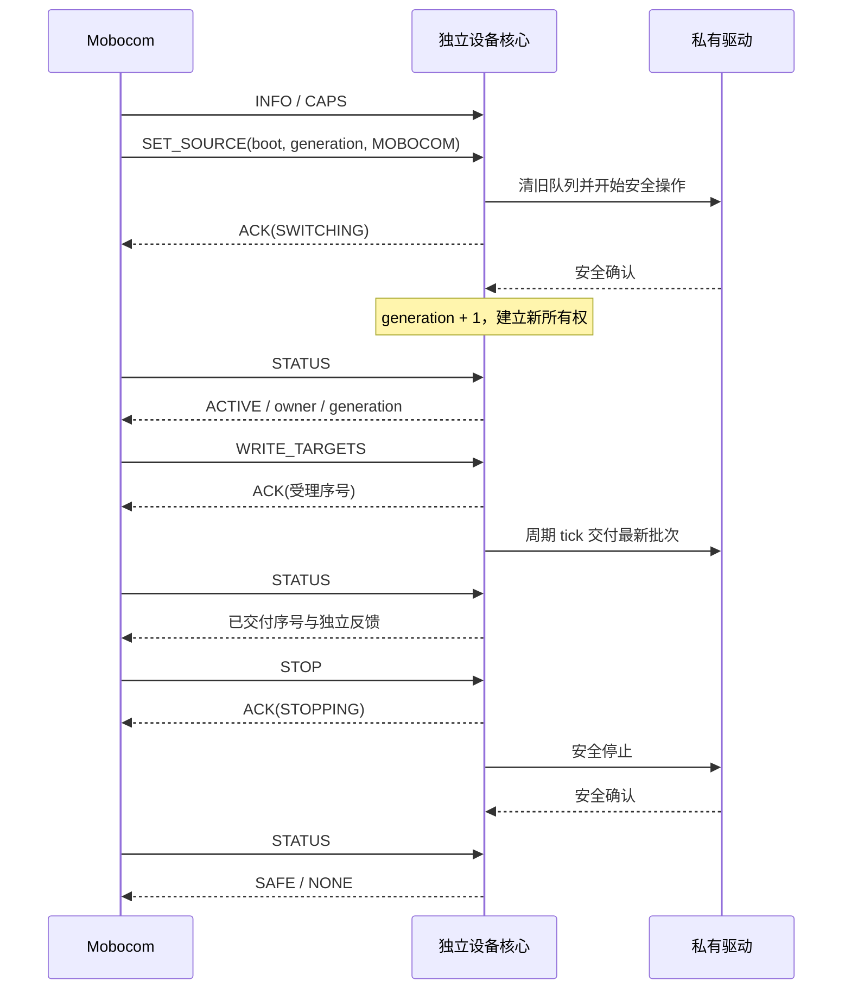

# Mobocom Network Control V2.2 公共实时控制规范

状态：网络专用实施候选，wire version `0x22`。传输为 Ethernet/UDP，推荐设备通过 DHCP 获取地址；旧 RS485/0x21 不属于本版本兼容对象。真实网络时延、安全及物理层尚未验收。本文、SDK、参考模型和黄金向量共同交付；类别契约决定实际设备单位和安全行为。

## 1. 架构与边界

时码器接 Mobocom 和 UE；SS-07 可增加 RK3588 只读记录接收端。Mobocom 求值时间线并通过 Ethernet/UDP 发送实时命令；设备按本地单调时间执行驱动刷新和失联保护。一个 UDP 数据报承载一帧，DISCOVER 和全体 STOP/ESTOP 使用固定组播，其余请求使用 UID 对应的当前 IP:port 单播。Control 不再定义 RS485 承载方式；各设备的实际驱动仍由设备工程实现。

网络绑定固定使用组播 `239.255.33.21`、UDP 端口 `47821`、组播 TTL=1；地址可由 DHCP 分配，也允许部署时静态配置，不要求固件写死 IP。主站通过 `controlInterface` 选择网络接口。发现窗口为 100 ms。

不包含设备授时、节目缓存/下载、Track/Segment 执行、T0、Run 提交、Event、条件分支或跨节点同步保证。Control 丢失后设备执行本地安全规则。主机时码失联续播规则见[主机授时](../timecode/README.md)。

## 2. 数值、身份与帧

所有多字节字段小端。CRC16 CCITT-FALSE：poly `0x1021`、init `0xFFFF`、不反射、xorout 0；`123456789` 的 CRC 为 `0x29B1`。CRC 不提供身份认证。

UID 为出厂唯一非零 u64；boot_id 为每次节点启动变化的非零 u64，由适配器保证跨重启唯一。UID 是设备身份，IP:port 只是当前网络位置；协议不定义 node_id、ASSIGN_ID 或地址持久化。主站请求 src_uid 为 0，设备回复 src_uid 为设备 UID；dst_uid 为 0 表示组播/all-nodes。主控会话 session_id 为非零 u64；节点所有权绑定会话与控制代次，不绑定电脑显示名称。

设备类别 `type:u16` 必须使用[统一类型注册表](DEVICE_TYPES.md)，唯一数值源为[device_types.json](device_types.json)。所有DISCOVER、HELLO/INFO和CAPS节点记录发布同一type。正式类型位于0x9000～0xEFFF，虚拟类型位于0x8000～0x8FFF；范围内未登记值与其它保留值均不能自行使用，0x0000/0xFFFF无效。新增类型先在公共库登记，不在设备工程临时分配。C++ DeviceCore与Python Profile拒绝未登记类型；虚拟类型只能用于测试。

type 区分类别，UID 区分实例；硬件型号/轴数不同通常沿用同类别 type，具体资源与含义由 profile_version、CAPS 和类别契约约束。type 与 unit/opcode 不是同一命名空间。网络版本使用 0x22，不兼容旧 0x21。主控保留未知type原值用于查询与停止，显示未知类型并禁止自动套用其它类别运动适配；不能仅凭已登记type声明支持其资源或安全行为。

| 偏移 | 字节 | 字段 |
| --- | --- | --- |
| 0 | 2 | SOF `D5 7D` |
| 2 | 1 | version=`22` |
| 3 | 1 | kind：1 REQUEST、2 RESPONSE、3 ACK、4 ERROR |
| 4 | 1 | flags=0 |
| 5 | 8 | src_uid |
| 13 | 8 | dst_uid |
| 21 | 4 | sequence，1～`FFFFFFFF`，不回绕 |
| 25 | 2 | command |
| 27 | 8 | session_id |
| 35 | 2 | payload_length=N，0～240 |
| 37 | N | payload |
| 37+N | 2 | CRC16，覆盖 `[2,37+N)` |

总长 `39+N`，最大 279 字节；UDP 数据报必须完整承载一帧。未知版本、非法 kind/flags/零会话/零序号、长度越界及坏 CRC 静默丢弃，不回复。

解码器只接受一个完整 UDP 数据报，缺字节、尾随字节、拼接多帧均丢弃，不缓存半帧、不搜索 SOF 重同步。空数据报无操作。

## 3. 事务、回复和发现

Control 使用可信的局域网；不同节点之间允许并发事务，同一节点内仍保持一个未完成单播事务。每个节点观察到的本会话单播 sequence 必须严格递增；客户端采用全局递增计数也满足此约束。重试保持整个帧不变，最多两次。节点为每个会话保留最高序号及上一请求/回复：同序号同字节返回缓存，同序号不同字节 CONFLICT，更低序号 SEQUENCE。错误回复也缓存。重复请求不延长来源租约、目标有效期或动作期限。原始 ACK 是历史受理结果，当前状态用 STATUS 查询。

设备仅维护当前会话及固定事务缓存，不累积历史会话。非当前会话的只读查询无副作用、不分配槽位；其重试返回当前查询值。SESSION_OPEN仅在SAFE/NONE、safeConfirmed且UID/boot/epoch/generation匹配时生效，替换当前会话、epoch+1、generation=1并清无线旧队列。成功建立请求独立缓存，丢ACK重试返回原结果。当前会话所有事务记录最高序号；旧会话的运动/改址拒绝SESSION，旧epoch拒绝EPOCH且在缓存查找前完成。陌生会话可用当前guard执行STOP/ESTOP/RESET_FAULT，使用一个独立安全缓存；guard变化后旧安全请求不能影响新运行。序号接近耗尽时STOP并等待SAFE，再轮换新会话；不要求重启MCU。

UDP 回复直接单播至请求源 endpoint；网络适配器必须设置自身发送/接收超时，不能依赖串口回复窗。异步安全/动作操作立即 ACK，不能等待机械完成才回复。设备核心仍使用本地单调时间检查目标新鲜度和安全状态。

SDK 客户端响应超时默认 30 ms，包括适配器传输。TypeScript Client 的第四参数可配置 `transactionTimeoutMs`（整数30～2000 ms）；超时最多重试两次，保持原帧字节。无串口排空/方向保护接口；适配器应限制自身发送等待，不积压超时的数据报。响应按 session、sequence、command、src_uid、dst_uid 关联，提供源 endpoint 时同时核对来源。设备回复立即可取，最多保留20 ms；新数据报会丢弃未取出的旧回复。适配器应在 receive 后立即 take_reply 并单播回该请求源，不能将待发回复绑定到后续请求源。

单播 STOP/ESTOP 在该 UID 队列中优先；组播 STOP/ESTOP 立即发送，不等待其它事务或发现窗口。停止取消对应尚未发送任务并阻止对应旧事务继续重试。最新实时目标替代旧目标后，旧目标也不再重试。UDP 可能丢包或乱序，组播停止无回复，不构成物理急停保证。

DISCOVER 向固定组播地址发送空 payload；SAFE、SWITCHING、ACTIVE、STOPPING、FAULT 所有状态均将26B回复单播回请求源 endpoint，不要求会话或控制权。发现不修改控制权、代次、目标、动作、事务缓存、租约和故障锁存，不触发安全停止或输出交付；receive 内原有的本地时间安全检查继续执行，不能借发现延长目标/租约期限。主站每轮收集100 ms，后台扫描不能阻塞实时目标和保活；同一 Client 同时只允许一个扫描。网络不存在发现时隙、碰撞槽或总线静默窗口。

发现建立 UID→当前 IP:port 映射，不依赖预先知道设备 IP。TS Client 将正常换址与多个在线地址声明同一UID分开处理：发现不同地址或boot变化时，只挂起该UID，清除旧凭据/待发目标并取消旧地址在途请求及重试；使用独立只读会话向候选和旧地址发送INFO，严格匹配帧头/载荷UID及来源endpoint。仅一个地址确认身份且与DISCOVER的boot/type/firmware一致时更新映射，不需要重建Client。多个地址确认同一UID才报告地址歧义冲突；无人确认或身份不一致报告unconfirmed，不沿用旧映射发送。探测超时不能证明设备不存在，UDP/UID不提供认证或网络分区下的唯一性保证。

换址/重启重连后仅恢复查询及显式STOP/ESTOP/RESET_FAULT能力，禁止来源接管、目标、动作、保活和配置写；Client不自动STOP/RESET/OPEN/恢复运动。用户确认安全后显式openSession成功才解除写入挂起，再显式选择来源和提供新目标。连接代次使旧调度批次永久失效；重连不等于无缝续播。网络协议不提供 ASSIGN_ID。设备名称建议通过可选 mDNS/DNS-SD 提供，不改变26B布局，重连API及操作顺序见[动态地址与名称发现](../docs/NETWORK_DISCOVERY.md)。

## 4. 命令字段

`guard` 固定为 `boot_id:u64, expected_generation:u32, session_epoch:u64`，共20字节。以下按字段顺序编码，无填充、无尾随字节。

| command | 请求 Payload | 成功回复 |
| --- | --- | --- |
| 0001 HELLO | 空 | INFO 布局 RESPONSE，不取得所有权 |
| 0002 DISCOVER | 空；组播 | src_uid 表达设备 UID，type:u16,firmware:u32,boot:u64,epoch:u64,generation:u32 RESPONSE |
| 0003（保留） | 不支持 | 单播返回 UNSUPPORTED；组播丢弃 |
| 0004 INFO | 空 | uid:u64,type:u16,firmware:u32,boot:u64,wire_version:u8=22,profile_version:u16,epoch:u64；33B RESPONSE |
| 0005 CAPS | cursor:u16，从 0 开始 | 能力页 RESPONSE |
| 0006 SESSION_OPEN | boot:u64,expected_epoch:u64,expected_generation:u32；20B；UID在帧头 | ACK，安全待机建立会话 |
| 0010 SET_SOURCE | guard,source:u8,target_ttl_us:u32,lease_ttl_us:u32；29B | ACK，完成需 STATUS |
| 0011 HEARTBEAT | guard；20B | ACK |
| 0020 WRITE_TARGETS | guard,count:u8,重复 count 条 endpoint:u16,resource:u16,value:i32 | ACK |
| 0021 EXECUTE_ACTION | guard,opcode:u16,类别参数；22B+参数 | ACK 中 operation_id |
| 0022 ACTION_STATUS | operation_id:u64 | operation_id:u64,outcome:u8,error:u16,progress:u8；12B RESPONSE |
| 0030 STATUS | cursor:u16，从 0 开始 | 状态页 RESPONSE |
| 0040 STOP | 单播guard；广播空 | 单播 ACK；广播无回复 |
| 0041 ESTOP | 单播guard；广播空 | 单播 ACK；广播无回复 |
| 0042 RESET_FAULT | guard；20B | ACK |
| 0050 READ_CONFIG | schema:u16；2B；仅单播 | 配置快照 RESPONSE，见第 9 节 |
| 0051 WRITE_CONFIG | uid:u64,guard,schema:u16,expected_revision:u32,values；34B+值；仅单播 | ACK 仅受理，随后 READ_CONFIG 查询异步结果 |

除 DISCOVER、STOP、ESTOP 外不允许组播；SESSION_OPEN 和其它命令必须发送到目标 UID 的已确认当前 endpoint。停止与急停不依赖当前持有者，但不提供认证或物理急停的通信保证。

### 4.1 ACK 和 ERROR

ACK固定40B：`boot:u64,generation:u32,state:u8,source:u8,fault:u16,last_accepted_target_seq:u32,last_applied_target_seq:u32,operation_id:u64,epoch:u64`。

ERROR固定44B：`error:u16,detail:u16` 后接 ACK 布局。公共错误 detail 当前为 0；不能私自加入字段。ACK 表示受理，applied 表示已交给驱动，并非机械到位。

错误码：0 OK、1 MALFORMED、2 UNSUPPORTED、3 STATE、4 BOOT、5 GENERATION、6 OWNER、7 SEQUENCE、8 CONFLICT、9 RANGE、10 GROUP、11 BUSY、12 SPACE、13 SAFETY、14 NOT_FOUND、15 ADDRESS、16 CAPABILITY、17 BANDWIDTH（主控预算）、18 TIMEOUT、19 DRIVER、20 EPOCH、21 SESSION。类别扩展使用 `8000～FFFF` 并登记契约。

### 4.2 能力页

每页一个记录：`next_cursor:u16,total_items:u16,item_type:u8,item_length:u16,item_bytes`。结束 cursor=`FFFF`；其他页 cursor 严格加 1，最多 33 项。节点记录在第 0 页，之后资源、动作。

| item_type | item_bytes |
| --- | --- |
| 1，43B | type:u16,profile_version:u16,source_mask:u8,max_target_hz:u16,update_gap_us:u32,target_min_us:u32,target_max_us:u32,lease_min_us:u32,lease_max_us:u32,safe_timeout_us:u32,switch_timeout_us:u32,resource_count:u16,action_count:u16,auto_reset_mask:u32 |
| 2，26B | endpoint:u16,resource:u16,unit:u16,flags:u16,minimum:i32,maximum:i32,group:u16,vmax:i32,amax:i32 |
| 3，12B | opcode:u16,resource_mask:u32,parameter_bytes:u16,timeout_us:u32 |

source_mask bit1=REMOTE、bit2=MOBOCOM；不支持的来源拒绝。资源 flags bit0=持续输出需目标新鲜度保护，bit1=支持实测反馈，其余为 0。group=0 独立；同一非零 group 的资源必须一起提交。vmax/amax 的实际单位、实现方式由类别登记，0 表示不声明该限制，不能用于隐藏真实运动设备所需的驱动约束。动作资源掩码按能力中资源索引，最多 16 位；参数最多218B。

### 4.3 状态页

固定头64B，后接最多 8 条 17B 资源记录。资源分页是逐次查询，不承诺反馈的跨页原子快照。

| 偏移 | 字段 |
| --- | --- |
| 0 | boot:u64 |
| 8 | generation:u32 |
| 12 | state_version:u32，公共状态变化版本，提示用途，不作控制 guard |
| 16、17、18 | state:u8,source:u8,fault:u16 |
| 20 | owner_session:u64；非 MOBOCOM 为 0 |
| 28、32 | accepted_target_seq:u32,applied_target_seq:u32 |
| 36 | running_operation:u64；无运行操作为 0 |
| 44 | lease_remaining_us:u32 |
| 48、50 | active_resource_mask:u16,pending_resource_mask:u16 |
| 52 | safe_confirmed:u8 |
| 53、55 | next_cursor:u16,count:u8 |
| 56 | session_epoch:u64 |

资源记录：`endpoint:u16,resource:u16,target:i32,feedback:i32,target_age_us:u32,flags:u8`。flags bit0=当前控制代次内目标有效，bit1=本次反馈有效。无目标 age=`FFFFFFFF`；无效数值字段为 0。停止/切换清除旧目标有效性；实际硬件状态只能看私有反馈和安全确认。开环不得设置反馈有效位或报告到位。

动作结果：1 RUNNING、2 SUCCESS、3 FAILED、4 CANCELLED；运行进度当前 0，成功为 100。SDK 保存最近 8 条结果，旧操作查询 NOT_FOUND；操作 ID 在本 boot 内递增且不回绕。动作硬超时返回 error=TIMEOUT，同时锁存 ACTION_TIMEOUT。查询不延长动作时间。

## 5. 状态和执行

source：0 NONE、1 REMOTE、2 MOBOCOM。state：0 SAFE、1 SWITCHING、2 ACTIVE、3 STOPPING、4 FAULT。generation在每个epoch从1开始，不回绕；接近边界时停止并轮换epoch，不重启设备。session_epoch为非零u64，在同boot内不回绕；u64空间耗尽属于身份空间终点，禁止静默复用。固件禁止直接修改 SDK 私有状态，使用只读 getter。

| 当前状态 | 输入/条件 | 结果 |
| --- | --- | --- |
| SAFE/ACTIVE | 合法 SET_SOURCE/本地显式选择 | 清队列、取消动作、来源 NONE，开始安全操作，进入 SWITCHING |
| SWITCHING | 安全确认成功，未到硬期限 | generation+1，清无线待处理数据，建立新来源/会话；NONE→SAFE，其余→ACTIVE |
| SWITCHING | 安全操作失败或切换超时 | 停止并锁存故障，进入 STOPPING/FAULT |
| ACTIVE | 持有者合法目标/动作 | 原子校验受理，延长来源租约 |
| ACTIVE | 非持有者运动 | OWNER，不改变输出 |
| ACTIVE | 目标过期、来源超时、驱动/动作故障 | 清队列、撤销来源和控制代次，进入 STOPPING；完成后 FAULT |
| ACTIVE/SWITCHING | STOP | 清队列、撤销来源、generation+1，STOPPING；安全确认后 SAFE |
| SAFE | 新 STOP | 保持SAFE，不增加代次或重新启动安全动作 |
| 任意状态 | ESTOP | 锁存故障；需要停止时进入 STOPPING，完成后 FAULT |
| STOPPING | 重复 STOP/ESTOP | 不重新启动安全动作，不延长期限；可锁存急停 |
| STOPPING | 未确认且安全期限到达 | FAULT，禁止自动恢复；STOP_TIMEOUT覆盖可自动恢复的软件原因，保持未确认状态 |
| FAULT | RESET_FAULT 且安全确认、私有复位条件满足 | SAFE/NONE；不恢复旧目标或持有者 |

SAFE 初始化以设备适配器已完成硬件安全初始化为前提。开机遥控行为由适配器显式选择 REMOTE，不恢复旧队列。来源切换后旧 NRF24 队列必须排空；之后新解码目标带当前epoch、generation 和新的本地 sequence。

WRITE_TARGETS count=1～16，无重复资源；范围、整批私有校验、协调组全部通过后才改变缓存。私有 validate_targets 接收旧有效目标与新批次合成的候选快照，包含尚未交付的目标，以校验耦合限制。每资源最新值覆盖旧待应用值；receive 不交付目标，周期 tick 才调用一次批量 apply_targets，提交当前最新待输出集合。主控合并同节点尚未发送的不同资源目标，不能因更新另一个资源而丢弃已有待发送值。私有驱动必须实现声明的限速/限加速度及组内共同更新；通用核心不插值、不冒充物理同步。

持续资源每次受理新目标设定本地年龄。年龄 `>=target_ttl` 即停止本节点；不能用保活、状态查询、重复请求或别的资源更新刷新。来源租约由新合法目标、动作或 HEARTBEAT 更新，`now>=lease_until` 时失效。从空闲（没有待交付或持续目标）受理目标即建立首次交付期限，之后按驱动服务时间检查刷新 gap；非持续资源（flags bit0=0）交付后不再被服务，下一个目标到达时重新建立期限，不以旧交付时间判 gap；超过声明值锁存 OUTPUT_GAP，不能补发过期输出。

离散动作不被新目标覆盖，同一节点最多一个运行动作。动作与已持续控制/待交付的占用资源冲突时 BUSY；动作期间相关目标也 BUSY。准备、回零和校准作为明确动作，在目标发送前完成。动作取消和安全操作都是非阻塞回调，硬期限由核心检查。

正常结束：主控停止普通目标调度，提交最后目标，查询确认该序号已经交给驱动，再 STOP，查询安全完成。机械到位需要类别反馈另行确认。需要持续保持时，继续刷新目标和租约。

故障码：0 NONE、1 SOURCE_TIMEOUT、2 TARGET_EXPIRED、3 ACTION_TIMEOUT、4 DRIVER、5 STOP_TIMEOUT、6 SWITCH_TIMEOUT、7 ESTOP、8 LOCAL_CLOCK、9 OUTPUT_GAP、10 GENERATION_EXHAUSTED、11 LIMIT_TRIP。LIMIT_TRIP 表示设备的物理限位开关触发、驱动器已自行停车，开关仍可能有效；离开限位的方向与条件由类别契约规定，其余按 DRIVER 处理。单节点故障不改变其他节点状态；整场停止由主控逐节点或广播发起，再逐节点查询结果。

## 6. 带宽与物理验收

参考预算为100 Mbps Ethernet/IPv4/UDP，不设16节点通信地址上限；每节点资源仍最多16个。交换机、网卡、DHCP/地址配置、组播接口和TTL须在部署时验证。CAN/PDMOVIE等下游私有驱动不由Control网络迁移修改。

每个长度N的数据报占用 `max(46,N+28)+38` 字节：28为IPv4/UDP，38为以太网前导码、MAC头、FCS和帧间隔。请求/回复分别计费，计入目标、状态分页和保活，利用率超过80%返回BANDWIDTH。额外动作/配置/发现需预留预算；不包含VLAN、交换机排队和主机调度。发现可在运行中后台执行；UI应低频触发（建议每秒最多一次扫描），适配器限制每轮处理量和发送队列，优先保证tick和目标处理，不能等待发现窗口才刷新输出。

桌面/浏览器计时和网络均有实际抖动。测算、软件模型、UDP发送成功均不证明机械响应或端到端时延。原型验收分别记录设备类别、数量、网络接口、交换机、目标频率、实际输出延迟和抖动、丢包/重试、停止期限和复位行为。不得标记已冻结或开启未经硬件验收的输出门槛。

## 7. 黄金向量与时序

Rust 实现见 [rust/README.md](rust/README.md)，使用相同 0x22 线格式、状态机和 schema 1～4；新增语言不改变现有向量、类型ID或协议版本。`python3 tools/test_rust_sdk.py` 重放向量并与 Python 参考模型差分比较。Rust 主控使用显式轮询/ticket，配置写均单次发送；具体接入差异与验收限制以 Rust 指南为准。

[vectors.json](vectors.json) 给出合法请求、应答、非法协调批次、重复事务及三类完整流程；[测试](test_reference.py)给出非法长度、CRC、旧序号/代次、时间故障和停止失败的预期结果。生成命令 `python -m mobocom_realtime.build_examples`。

## 8. V2.1自动恢复策略

CAPS的auto_reset_mask默认0，仅允许bit1 SOURCE_TIMEOUT、bit2 TARGET_EXPIRED。candidate.7新增设备本地可选入口 `recover_timeout_fault(now)`（C++/Python同名），由设备所有者任务在tick和硬件故障处理之后调用。它只接受已进入FAULT的这两类超时，要求对应掩码、safeConfirmed、reset_allowed、无来源/持有者/活动目标/动作、无待处理配置，且代次未耗尽；成功递增generation、清旧目标并进入SAFE/NONE/fault0，boot/epoch不变。调用不产生串口请求/回复、不等待上位机、不恢复运动；不满足条件返回false且不重启停止期限。普通tick保持原行为，设备须在类别契约中声明是否启用本地恢复。

未启用本地恢复的旧设备仍可使用主控流程：停发并丢弃旧队列、恢复传输、查询状态，确认安全和掩码后RESET_FAULT并确认SAFE。启用本地恢复的设备由主控停止旧发布、等待并查询SAFE，无需发RESET；若旧主控与本地恢复发生竞态而收到Generation/State/Safety，应重新查询，不能据此重接管或重放目标。重新运动由用户显式启动，使用最新凭据。当前CAPS没有单独的本地恢复标志，须按设备类别/固件契约识别，不能仅凭mask推断。

旧设备的主控自动恢复每次故障最多3次，间隔500/1000/2000ms；失败保持诊断。本地恢复只执行非阻塞条件检查，安全确认前不会清故障。Driver、STOP_TIMEOUT、SWITCH_TIMEOUT、ACTION_TIMEOUT、ESTOP、LOCAL_CLOCK、OUTPUT_GAP、LIMIT_TRIP禁止自动清除。超时STOPPING/FAULT期间出现其他非超时故障时，升级为该锁存故障；急停始终优先。start_safe失败升级DRIVER；安全确认超时升级STOP_TIMEOUT，即使最初原因是来源/目标超时。硬件无法确认安全时不能显示正常。

网络版本不定义波特率、串口距离或总线利用率预算。设备工程必须按实际网络的实测往返时延、抖动、丢包率和 100 m 单段网线约束验收；不能把 UDP send 返回当作对端已处理的证明。

## 9. 可选维护配置扩展（candidate.3）

配置使用正式命令 `READ_CONFIG=0x0050` / `WRITE_CONFIG=0x0051`，使用 `0x22` 网络帧头及现有 ACK/ERROR 布局。未实现该扩展或不认识 schema 的节点回复 `UNSUPPORTED=2`。主机通过 READ_CONFIG 探测支持情况，不能仅凭 Gimbal 类型推断支持。

READ_CONFIG 为无副作用单播查询，不要求 SESSION_OPEN。WRITE_CONFIG 必须同时匹配 UID、boot、generation、epoch；schema 3 实时入口按 9.3 检查当前运动会话。schema 1/2 不要求建立运动会话，其前置条件为 `SAFE` 或 `FAULT`、`source=NONE`、无 owner。各 schema 可以收紧条件：schema 1 由适配器检查私有输出空闲、驱动未使能；**schema 2 必须 SAFE、fault=0、safeConfirmed，允许静止保持使能**。FAULT 下可写 schema 1 并不清故障、不证明机械安全、不授权运动，也不更改硬件/时序验收标志。

schema 4是独立板级跟焦来源控制，按9.4例外处理公共运动状态：不要求运动会话或SAFE/NONE，但仍校验完整guard、配置busy和跟焦私有revision/准入，不改变公共运动状态。

配置回调属于 DeviceCore 所有者任务，必须有界且非阻塞。Flash、SPI 和 RTOS 留在设备适配器，耗时工作只验证并排队；纯 RAM 配置可以在回调中原子完成。适配器在 Pending 期间报告 busy；核心拒绝建立新会话、改地址、选择来源和清故障，本地来源选择同样受限，STOP/ESTOP 和查询仍可处理。板端还须限制其私有控制入口。

配置写有独立固定事务缓存，查询不淘汰写缓存。同 session/sequence/完整字节的重试仅返回缓存，不能重复写 Flash；同序号不同内容返回 CONFLICT，缓存内更旧序号返回 SEQUENCE。新写必须通过 expected_revision 比较，避免已淘汰缓存或其他客户端导致旧配置再执行。revision 是本 boot 内的 u32，受理时递增，失败也消耗 revision；耗尽返回 SPACE。每次重启从 0 开始，但旧 boot 请求必须被拒绝。建立新运动会话会更新 epoch 并清配置事务缓存。

READ_CONFIG RESPONSE payload（无填充，小端）：

| 偏移 | 字段 | 类型 |
|---|---|---|
| 0 | schema | u16 |
| 2 | revision | u32 |
| 6 | state：Idle=0、Pending=1、Applied=2、Failed=3 | u8 |
| 7 | error，公共 Error 枚举，成功为 0 | u16 |
| 9 | 最近受理写的 request_session | u64 |
| 17 | 最近受理写的 request_sequence | u32 |
| 21 | value_length，最大 217 | u16 |
| 23 | values | value_length 字节 |

Idle 的关联 session/sequence 为 0。Pending 时 values 保留已提交值。Applied 表示该 schema 定义的持久化和配置应用步骤已完成；不代表电机运动成功或无线对端在线。Failed 必须报告错误；若持久化已成功而应用超时，values 可以是新保存值，主机不得自动恢复旧值。保存状态须通过关联 session/sequence 确认为本次请求，不能把别的客户端的结果当成功。

### 9.1 schema 1：双路无线逻辑频道

WRITE_CONFIG 的 values 恰好 2B：`focus_channel:u8,wheel_channel:u8`，各为 `0..15`。主机显示通道 `1..16` 时，编码必须减 1。此 schema 的角色固定为跟焦和摇轮，与运动资源、RS485 地址、CAN ID 无关；具体射频映射由接收板实现。

READ_CONFIG 的 values 恰好 4B：`focus_channel:u8,wheel_channel:u8,ready_mask:u8,focus_source:u8`。ready_mask bit0=跟焦模块硬件就绪，bit1=摇轮模块硬件就绪，其余位为 0；不是发射器在线标志。focus_source 为板端跟焦来源：0=Wireless、1=Wired、2=Stopped、3=Fault，**不是**公共 Source 枚举。

接收板受理时停止后续跟焦输出，清除旧目标与按钮边沿；保存使用 CRC/回读校验并保留原配置其他字段；由无线任务切换频道、清空 FIFO/ACK 和旧输入队列。未连接的无线模块也保存目标频道，后续恢复用新值；Applied 可以同时有 ready_mask 位为 0，界面必须显示该模块未就绪。完成或失败后保持跟焦 Stopped，不自动恢复旧动作。该接口没有电机使能、标定、位置指令或强制清故障功能。

配置完成后先读取确认值；持久化验收还需重启后重新 INFO/STATUS/READ_CONFIG，确认 boot 更新且频道保持。主机等待异步结果的总时限和轮询间隔由板端接入说明规定，不能把网络应答超时当作 Flash 完成时限。

### 9.2 schema 2：Mobocom 运行速度与加速度（candidate.4）

`MotionProfileSchema=2`。通过 READ_CONFIG(schema=2) 探测；未知 schema 返回 UNSUPPORTED，已实现但当前类别参数/控制准入不支持时返回 CAPABILITY。读取成功不授予运动权限。

作用是设置 **Mobocom 来源的位置规划** 运行上限，不是目标位置、当前实测速度、电机保护阈值或 CAN 寄存器。速度单位为对应 CAPS 资源单位/秒，加速度为资源单位/秒²；设备类别决定适用的位置动作。CAPS 的 vmax/amax 始终表示硬上限，修改后不变。用户设定和可调范围从本 schema 读取。未配置的物理设备不得发布虚构的调速范围。

WRITE_CONFIG payload：`uid:u64,boot:u64,generation:u32,epoch:u64,schema:u16,expected_revision:u32,values`。偏移依次为 0、8、16、20、28、30、34。schema 2 的 values：

| values 偏移 | 字段 | 约束 |
| --- | --- | --- |
| 0 | source:u8 | 固定 2（Mobocom） |
| 1 | persistence:u8 | 固定 0（RAM only），其余值拒绝 |
| 2 | count:u8 | 1..7 |
| 3 + 12×i | endpoint:u16,resource:u16,vmax:i32,amax:i32 | 每记录 12B；值必须为正；资源不得重复 |

全部字段小端、无填充，长度必须恰好 `3+12×count`。适配器必须验证全部资源存在、每个被选中的协调组完整、范围及类别组合约束；任何一轴失败不更新其他轴，不消耗配置 revision 或 generation。速度 0 不表示停止，应使用 STOP。

READ_CONFIG 沿用第 9 节的 23B 快照头，其 values 为 `source:u8=2,persistence:u8=0,count:u8`，随后 count 个 28B 记录：

| 记录偏移 | 字段 |
| --- | --- |
| 0 / 2 | endpoint:u16 / resource:u16 |
| 4 / 8 | 当前 vmax:i32 / amax:i32 |
| 12 / 16 | min_vmax:i32 / max_vmax:i32 |
| 20 / 24 | min_amax:i32 / max_amax:i32 |

长度恰好 `3+28×count`，范围及当前值均为正 i32；当前值在各自上下限内。独立上下限不表示所有速度/加速度组合都合法，设备仍可按类别契约返回 RANGE。max_vmax/max_amax 不得超过对应 CAPS 硬上限。三轴设备的写 payload 为 73B、读 RESPONSE payload 为 110B；完整帧分别为 112B、149B。ACK/ERROR 仍为 40B/44B payload。

只有 `SAFE/NONE、owner=0、fault=0、safeConfirmed=true` 才接受新写，运行中返回 STATE；核心还会在 generation ≥ `0xfffffffe` 时返回 SPACE。适配器另检验真实反馈、身份、配置准入和组合约束，不能因调速改变安全标志、重新使能或清故障。整组验证成功后，适配器原子安装到 RAM、revision+1，记录 request_session/sequence 并报告 Applied；**本 schema 的 Applied 表示 RAM 生效，不表示 Flash 保存或电机到位**。失败拒绝不更新最近受理事务。实现必须同步有界完成本 schema，不进入 Pending。

受理成功时核心清空旧目标、generation+1、清遥控队列并保持 SAFE/NONE；ACK 带新 generation。原帧重试允许旧 generation 命中成功缓存，不重复应用。建立新运动会话仍按原规则更新 epoch；只读查询不会淘汰配置写缓存。schema 1 和 2 的 revision/values 独立，但共用配置写防重放缓存，客户端应串行化全部配置写。

主机先停发并取消旧目标队列，明确 STOP 后等待安全确认；不得在写失败后自动 STOP/RESET 再重试。第一帧发送前留存 UID/boot/epoch、session/sequence、revision、期望值和完整帧。ACK 或写超时后只查询确认；仅当关联、revision=原值+1、Applied/error=0、值及身份上下文均匹配时显示已应用。别的写覆盖结果或重启/epoch 变化时显示未确认，不能新建写事务“补发”。下一次运动使用最新 STATUS 上下文和新目标。

参数在来源切换、STOP、故障复位和会话轮换期间保留，但不会自动恢复运动；断开/重连先读回，硬件重启恢复类别默认值且 revision=0。schema 2 不支持热调速；运行中使用下面的 schema 3。两者都不提供保存默认或保护阈值修改接口。

### 9.3 schema 3：当前控制会话实时调速（candidate.5）

`LiveMotionProfileSchema=3` 使用与 schema 2 完全相同的读写值布局，仅请求/快照的 schema 改为 3。READ_CONFIG(schema=3) 成功表示设备支持实时调速；未知时返回 UNSUPPORTED，主控回退 schema 2 停止后配置，不可把通信超时视作旧固件。schema 2/3 访问同一 RAM 参数、revision 与最近受理事务。

此 schema 是第 9 节停止配置门槛的特例：只允许已 SESSION_OPEN 的当前 owner，在 ACTIVE/MOBOCOM、fault=0、无运行中 action、无配置 BUSY 时写入。必须匹配 UID、boot、epoch、generation 和 expected_revision；适配器继续验证全组参数、反馈和身份。SAFE、FAULT、STOPPING、遥控来源、外部会话不能使用实时入口。停止时仍使用 schema 2。

成功原子安装参数并 revision+1，报告 Applied；**generation、epoch、owner、当前目标及运动速度/位置状态保持连续，不清目标、不 flush_remote、不刷新 target TTL 或 lease**。设备从下一规划周期按新运行参数加减速，不能把新 vmax 直接裁剪为实际速度。运行加速度降低若破坏现有制动空间，必须使用独立的设备制动参数保住目标/软限位；各类别须说明制动及回中规则。

实时写在读取去重缓存前严格检查当前 generation/session/owner/action。原帧在同一控制上下文可获得缓存确认，不重复应用、不续租；STOP 或会话变化后，旧写即使缓存命中也必须被拒绝。不得使用配置缓存绕过控制会话。

主控将一笔实时写/读作为有界低优先级事务，只在最新目标 ACK 后、剩余 target TTL 足够时插入；随后立即续发最新目标。持续拖动采用一个在途事务和一个最新待提交值，禁止积压历史调速或阻塞目标流。预算须包含写112B+ACK79B、读41B+回复149B（三轴），另计网络封装及主机调度余量。

TypeScript `readLiveMotionProfile` / `writeLiveMotionProfile` 每笔只发送一次，不自动重试；写超时后按 schema 2 同样的 session/sequence、revision、Applied和值关联查询确认，期间目标流持续运行。确认前不创建下一笔写。STOP/ESTOP 优先并取消未发送调速；上下文变化后丢弃旧待发送参数。`writeConfiguration` 属于通用停止配置流程，实时主控应使用上述单次入口。

### 9.4 schema 4：独立跟焦来源控制（candidate.6）

`FocusControlSchema=4`，仅由支持共板跟焦的适配器实现；公共核心不实现PDMOVIE/RS485驱动。通过READ_CONFIG(4)探测支持；未知schema返回UNSUPPORTED，不按设备类型或版本号猜测。

WRITE_CONFIG沿用34B前缀，values恰好1B：`focus_source:u8`，0=Wireless、1=Wired、2=Stopped；3=Fault只读。读沿用23B快照头，values恰好8B：`focus_source:u8,flags:u8,reserved:u16=0,button_remaining_ms:u32`。flags bit0=output_idle、bit1=radio_ready、bit2=bus_quiet、bit3=wired_commands（candidate.8），其余位0。output_idle=true时button_remaining_ms必须0。写payload35B/帧74B，读RESPONSE payload31B/帧70B。ACK/ERROR保持40/44B。

schema 4的revision就是私有跟焦generation，与WRITE_CONFIG前缀的公共generation分开：每次成功显式切源（包括重选同一来源）推进一次，清旧目标/按钮边沿/无线队列；同帧重试不能重复推进。溢出前返回SPACE。只改本次运行来源，不写NVS或启动默认。成功同步报告Applied，并记录session/sequence；本地切源、外部让出或故障使代次变化时读回Idle和零关联，当前来源/代次仍准确。Applied只表示选择已生效，不表示UART/按键忙窗口结束；Wired须额外确认output_idle及bus_quiet才允许外部RS485发送。

公共核心允许本schema在任意公共State/Source/owner下执行，不要求SESSION_OPEN或当前云台owner；仍要求单播、UID、boot、epoch、公共generation、配置非busy及expected_revision匹配。公共guard在查重缓存前严格验证；旧代次不能命中成功缓存。成功不清目标、不推进公共generation/epoch、不更换owner、不调用云台safe/flush、不刷新目标TTL或租约。配置写缓存仍共用；查询当前结果而非用缓存ACK推断来源未变。

适配器切Wired/Stopped立即取消本板尚未发送的跟焦数据，保留已发出按键动作的不可撤销忙窗口。Wireless前必须确认外部发送已停止、总线无未处理接收且至少20ms静默、本板发送/按钮空闲、无线模块与启动配置准入；BUSY/SAFETY/DRIVER时不得延后自动恢复。bus_quiet只是瞬时观测，不提供多主仲裁或总线独占保证。具体条件及两端切换顺序见[Mobocon说明](../docs/MOBOCON_FOCUS_CONTROL.md)。candidate.6/7只切源；candidate.8扩展见下节。所有版本都不能清公共故障。

Client `readFocusControl/writeFocusSource` 每笔单次发送，不自动重试、不丢弃云台目标。同UID串行插入目标ACK后的空闲预算，不同UID可并发；写超时依session/sequence、revision、当前来源及身份关联查询，不换序号盲发。协议测试使用独立`focus_control_vectors.json`，全部控制向量使用0x22。

### 9.4.1 schema 4 有线输出扩展（candidate.8）

仅当状态 flags.bit3=`wired_commands` 时允许发送扩展命令。没有该能力的固件只接受1B切源；SDK提示能力缺失。网络版统一使用0x22，状态长度不变，旧0x21固件不可接入。公共DeviceCore与云台隔离规则沿用9.4。

WRITE_CONFIG保留34B前缀，扩展values为：

| 操作 | values | 含义 |
| --- | --- | --- |
| 位置 | `0x10:u8, mask:u8, position[3]:u16`，共8B | mask低3位选择3个跟焦轴；至少1位；位置为归一化0～65535，未选轴必须为0 |
| 按钮 | `0x11:u8, action:u8`，共2B | 0校准、1切速度档；实际按钮时序由设备驱动定义 |

归一化位置0/65535对应已校准行程两端，中点32768；具体轴映射、物理单位、限速及下游协议均由设备实现。主机不能把该接口当作有反馈的实时运动节点。收到命令后适配器必须检查Wired来源、独立revision、启动准入、UART空闲、总线静默与按钮忙窗口；不满足立即拒绝，不排队等待恢复。命令成功提交到下游发送器后同步revision+1、Applied并关联session/sequence；这是发送受理，非物理到位、非按钮动作完成。不得清除已经发出的按钮忙窗口。I/O失败进入跟焦Fault。

每笔命令绑定公共guard及跟焦revision，不改变云台目标、generation、epoch或租约。同帧重试由现有配置缓存去重；旧revision即使换sequence仍拒绝。主机使用`focusPositions`/`focusButton`与`Client.writeFocusCommand`，单次发送、禁止自动重发物理动作；ACK丢失只读schema4关联结果。发生超时、身份或revision变化、关联被覆盖时锁定发送，用户重新读取并明确接管后才继续。所有配置事务串行，不暂停云台连续目标流。参考codec向量为`focus_command_vectors.json`。
